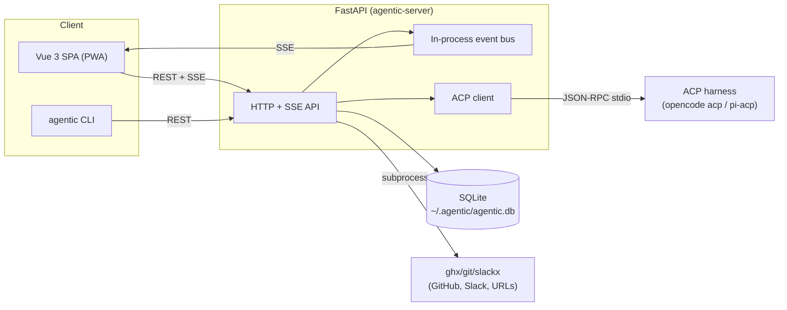
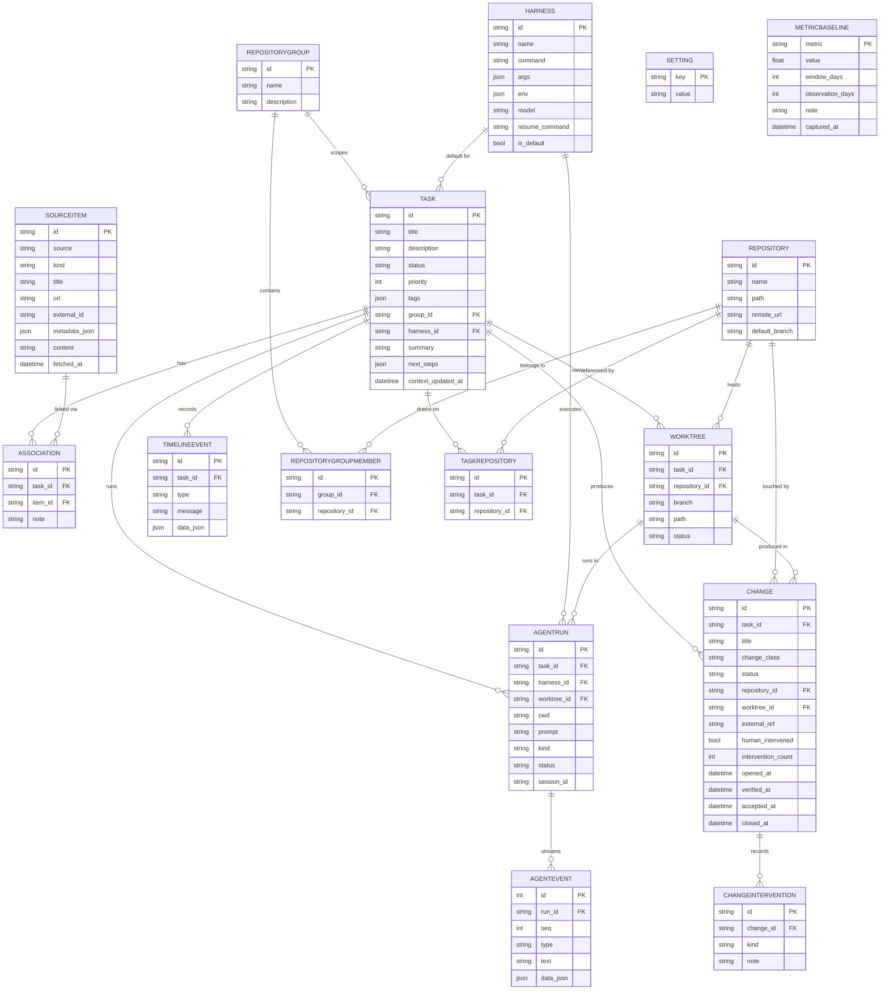

<!-- session_link: http://localhost:10000/?session=ses_ed778bb8affeJQ6f9Tkxe4MjUl -->
# Architecture

## System Overview

Agentic is a three-part app: a FastAPI backend that owns the database and agent execution, a Vue 3 single-page app that the backend serves, and an HTTP client CLI.
The backend drives coding agents over ACP (Agent Client Protocol) as child processes and streams normalized events to the SPA over SSE.

## Entity Relationship Diagram

The full schema with types, constraints, and indexes lives in [`schema.dbml`](schema.dbml).

## Key Components

| Component | Responsibility | Technology |
|---|---|---|
| HTTP API | REST endpoints and SSE streams for all resources | FastAPI, Pydantic/SQLModel |
| Persistence | Tables, engine, and in-place migrations | SQLite, SQLModel/SQLAlchemy |
| ACP client | Spawn a harness, normalize its updates, auto-approve permissions | `agent-client-protocol`, asyncio |
| In-process event bus | Publish run and task events to SSE subscribers | asyncio queues |
| Source services | Parse/infer/fetch items, build the context prompt, parse agent JSON | httpx, subprocess (`ghx`, `slackx`) |
| Git services | Create/remove worktrees, detect remote and default branch | `git` subprocess |
| Gantt view | Tasks as time bars with one marker per timeline event | `routers/gantt.py`, Vue GanttView |
| Change lifecycle | Record changes and the human interventions on them, from a task page | `routers/changes.py`, Vue ChangesPanel |
| Metrics engine | Compute autonomy rate and yield from changes, read against a baseline | `metrics.py`, `routers/metrics.py`, Vue MetricsView |
| Session links | Build OpenChamber/terminal/resume-command links from settings | templating over stored settings |
| SPA | Mobile-friendly task list, task detail, settings, live transcript, PWA install | Vue 3, Vite, vue-router, vite-plugin-pwa |
| User CLI | Scriptable client over the HTTP API | cyclopts, httpx, rich |
| Backend CLI | Run the server and report config | cyclopts, uvicorn |

## Data Flow

1. The SPA or CLI calls a REST endpoint on the backend.
2. The router reads or writes rows through SQLModel and writes a `TimelineEvent` for meaningful task changes.
3. Task changes are published on the in-process bus and streamed to any subscribed SPA as SSE (`/api/tasks/{id}/stream`).
4. An agent run spawns the selected harness as a child process, drives it over ACP JSON-RPC on stdio, normalizes each update into an `AgentEvent` (persisted and streamed on `/api/runs/{id}/stream`), then terminates the process.
5. A context refresh runs the same path, then parses a JSON `{summary, next_steps}` out of the assistant text and writes it back onto the task.

## Infrastructure

The app runs as a single local process plus the `git` and optional `ghx`/`slackx` binaries it shells out to.
There is no hosted environment and no CI.
Detailed stack, tooling, environments, deployment, and rollback live in [`infrastructure.md`](infrastructure.md); logging lives in [`observability.md`](observability.md).

## Architecture Decisions

- SQLModel over SQLite with PRAGMA WAL and foreign keys on, using small in-place migrations instead of a migration framework.
- ACP over stdio as the single agent abstraction, so a harness is a database row (command plus args) and never special-cased in code.
- An in-process asyncio event bus rather than an external broker, because the app is single-process and local.
- The SPA is built into `backend/static` and served by the API, so one process serves both the API and the UI.
