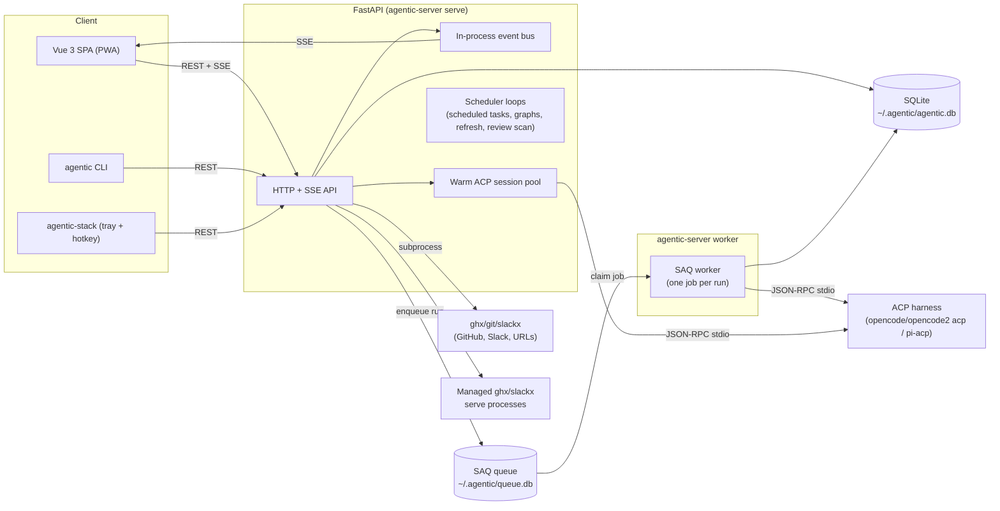

<!-- session_link: http://localhost:10000/?session=ses_ed778bb8affeJQ6f9Tkxe4MjUl -->
# Architecture

## System Overview

Agentic is a FastAPI backend that owns the database and agent execution, a Vue 3 single-page app that the backend serves, an HTTP client CLI, and a worker process that executes queued agent runs.
The backend drives coding agents over ACP (Agent Client Protocol) as child processes and streams normalized events to the SPA over SSE.
An optional native launcher (`launcher/`) adds the tray icon and global hotkey a browser cannot provide, and talks to the same HTTP API.

## Entity Relationship Diagram

```mermaid
erDiagram
    TASK ||--o{ ASSOCIATION : "has"
    SOURCEITEM ||--o{ ASSOCIATION : "linked via"
    TASK ||--o{ WORKTREE : "owns"
    REPOSITORY ||--o{ WORKTREE : "hosts"
    TASK ||--o{ AGENTRUN : "runs"
    HARNESS ||--o{ AGENTRUN : "executes"
    AGENTRUN ||--o{ AGENTEVENT : "streams"
    TASK ||--o{ AGENTSESSION : "records"
    HARNESS ||--o{ AGENTSESSION : "produced in"
    TASK ||--o{ TIMELINEEVENT : "records"
    TASK ||--o{ TASKDEPENDENCY : "blocks"
    TASK ||--o{ TASKDEPENDENCY : "depends on"
    REPOSITORYGROUP ||--o{ REPOSITORYGROUPMEMBER : "contains"
    REPOSITORY ||--o{ REPOSITORYGROUPMEMBER : "belongs to"
    TASK ||--o{ TASKREPOSITORY : "draws on"
    REPOSITORY ||--o{ TASKREPOSITORY : "referenced by"
    TASK ||--o{ TASKPERSON : "involves"
    PERSON ||--o{ TASKPERSON : "linked via"
    TASK ||--o{ TASKREQUESTER : "requested by"
    PERSON ||--o{ TASKREQUESTER : "linked via"
    SOURCEITEM ||--o{ ITEMPERSON : "involves"
    PERSON ||--o{ ITEMPERSON : "linked via"
    PERSON ||--o{ PERSONALIAS : "known as"
    REPOSITORYGROUP ||--o{ TASK : "scopes"
    HARNESS ||--o{ TASK : "default for"
    PERSON ||--o{ TASK : "waited on by"
    WORKTREE ||--o{ AGENTRUN : "runs in"
    TASK ||--o{ CHANGE : "produces"
    CHANGE ||--o{ CHANGEINTERVENTION : "records"
    REPOSITORY ||--o{ CHANGE : "touched by"
    WORKTREE ||--o{ CHANGE : "produced in"
    TASK ||--o{ STACKENTRY : "queued as"
    STACKENTRY ||--o{ TASKSESSION : "spends time as current"
    SCHEDULEDTASK ||--o{ SCHEDULEDTASKRUN : "executes as"
    EXECUTIONGRAPH ||--o{ GRAPHEXECUTION : "runs as"
    TASK ||--o{ GRAPHEXECUTION : "carries"

    TASK {
        string id PK
        string title
        string description
        string status
        int priority
        json tags
        string group_id FK
        string harness_id FK
        datetime deadline
        string waiting_on_person_id FK
        datetime follow_up_at
        datetime snoozed_until
        string summary
        json next_steps
        datetime context_updated_at
    }
    SOURCEITEM {
        string id PK
        string source
        string kind
        string title
        string url
        string external_id
        json metadata_json
        string content
        datetime fetched_at
    }
    ASSOCIATION {
        string id PK
        string task_id FK
        string item_id FK
        string note
    }
    REPOSITORY {
        string id PK
        string name
        string path
        string remote_url
        string default_branch
        string review_scan
    }
    REPOSITORYGROUP {
        string id PK
        string name
        string description
    }
    REPOSITORYGROUPMEMBER {
        string id PK
        string group_id FK
        string repository_id FK
    }
    TASKREPOSITORY {
        string id PK
        string task_id FK
        string repository_id FK
    }
    PERSON {
        string id PK
        string name
        string notes
    }
    PERSONALIAS {
        string id PK
        string person_id FK
        string value
    }
    TASKPERSON {
        string id PK
        string task_id FK
        string person_id FK
    }
    TASKREQUESTER {
        string id PK
        string task_id FK
        string person_id FK
    }
    ITEMPERSON {
        string id PK
        string item_id FK
        string person_id FK
    }
    WORKTREE {
        string id PK
        string task_id FK
        string repository_id FK
        string branch
        string path
        string status
    }
    HARNESS {
        string id PK
        string name
        string command
        json args
        json env
        string model
        string resume_command
        bool is_default
    }
    AGENTRUN {
        string id PK
        string task_id FK
        string harness_id FK
        string worktree_id FK
        string cwd
        string prompt
        string kind
        string status
        string session_id
        string model
        string graph_execution_id
    }
    AGENTEVENT {
        int id PK
        string run_id FK
        int seq
        string type
        string text
        json data_json
    }
    AGENTSESSION {
        string id PK
        string task_id FK
        string harness_id FK
        string session_id
        string label
        string cwd
    }
    TIMELINEEVENT {
        string id PK
        string task_id FK
        string type
        string message
        json data_json
        string client
        string actor
    }
    TASKDEPENDENCY {
        string id PK
        string before_id FK
        string after_id FK
    }
    SETTING {
        string key PK
        string value
    }
    OPERATION {
        string id PK
        string method
        string path
        int status_code
        string client
        string actor
    }
    CHANGE {
        string id PK
        string task_id FK
        string title
        string change_class
        string status
        string repository_id FK
        string worktree_id FK
        string external_ref
        bool human_intervened
        int intervention_count
        datetime opened_at
        datetime verified_at
        datetime accepted_at
        datetime closed_at
    }
    CHANGEINTERVENTION {
        string id PK
        string change_id FK
        string kind
        string note
    }
    METRICBASELINE {
        string metric PK
        float value
        int window_days
        int observation_days
        string note
        datetime captured_at
    }
    STACKENTRY {
        string id PK
        string task_id FK
        int position
        bool is_current
        datetime deleted_at
        string deleted_reason
    }
    TASKSESSION {
        string id PK
        string stack_entry_id FK
        datetime started_at
        datetime ended_at
    }
    SCHEDULEDTASK {
        string id PK
        string name
        string command
        string cwd
        string schedule
        string timezone
        bool enabled
        datetime next_run_at
    }
    SCHEDULEDTASKRUN {
        string id PK
        string scheduled_task_id FK
        string status
        int exit_code
        string output
        datetime started_at
        datetime ended_at
    }
    EXECUTIONGRAPH {
        string id PK
        string name
        string schedule
        string timezone
        bool enabled
        json definition
        datetime next_run_at
    }
    GRAPHEXECUTION {
        string id PK
        string graph_id FK
        string task_id FK
        string trigger
        string status
        json state
        datetime started_at
        datetime ended_at
    }
    REVIEWREQUEST {
        string id PK
        string repository
        int number
        string source
        string title
        string url
        string author
        bool draft
        datetime first_seen_at
    }
```

A person is a flat directory entry whose handles and emails are aliases in `PersonAlias`, so the same person dedupes across GitHub and Slack.
`ReviewRequest` stands alone: GitHub is its source of truth, and each scan replaces the stored set, so its rows carry GitHub's own `owner/name` and PR number rather than foreign keys.
The full schema with types, constraints, and indexes lives in [`schema.dbml`](schema.dbml).

## Key Components

| Component | Responsibility | Technology |
|---|---|---|
| HTTP API | REST endpoints and SSE streams for all resources | FastAPI, Pydantic/SQLModel |
| Persistence | Tables, engine, and in-place migrations | SQLite, SQLModel/SQLAlchemy |
| Run queue and worker | Durable queue for agent runs: the API enqueues a job keyed by the run id, the worker executes one run per job, and startup reconciliation fails runs left behind | SAQ (`jobs.py`), `agentic-server worker` |
| ACP client | Spawn a harness, normalize its updates, auto-approve permissions | `agent-client-protocol`, asyncio |
| Warm ACP session pool | Hold one ACP session for the default harness from startup, so the model picker lists models without spawning a harness per request | `agents/pool.py` (gated by `AGENTIC_WARM_HARNESS_SESSION`) |
| In-process event bus | Publish run and task events to SSE subscribers | asyncio queues |
| Scheduled tasks | User-defined shell commands fired on a cron schedule, each execution recorded with its exit code and output tail | `schedules.py`, `routers/schedules.py` |
| Execution graphs | Named DAGs of agent runs, CLI commands, and form nodes, fired on demand or by cron; the executor walks the DAG in the API process and pauses on forms until answered | `graphs.py`, `routers/graphs.py` |
| Review queue | Pull requests awaiting the user's review: reports read from the user-global review store, the GitHub scan that stores the awaited set, and the must/should/may findings | `reviews.py`, `review_store.py`, `review_scan.py`, `review_queue.py`, `review_findings.py`, `routers/reviews.py` |
| PR feedback | The reviewer-comment analysis files in the store, read as a triage queue whose implement/decline/defer decision is written back into the file's frontmatter for the executor to run | `feedback_store.py`, `routers/feedback.py`, Vue FeedbackView |
| Decisions | Colleague-decision reports written by the extract-colleague-decisions skill, parsed read-only from the notes tree | `decisions_store.py`, `routers/decisions.py` |
| Inbox | Suggestions of things to do (stale reviews, unreviewed own PRs, closable tasks, leftover worktrees), recomputed from current state on every read so nothing is stored | `inbox.py`, `routers/inbox.py` |
| My PRs | The viewer's own open pull requests with attention counts, the individual checks behind each CI badge, plus reviewer pokes over Slack | `my_pulls.py`, `routers/my_pulls.py` |
| On-call | Scan a Slack channel and prepare replies | `routers/on_call.py` |
| Process and cycle time | The task lifecycle read as a production line (station inventory, flows, Little's law) and cycle-time metrics over GitHub issue and PR events | `process_flow.py`, `cycle_time.py`, `routers/process.py` |
| Operations audit | Every mutating request recorded with its client (web/cli/api) and actor (human/agent), exposed to handlers as request provenance | `provenance.py` (middleware), `routers/operations.py` |
| Tiered item refresh | Age-band refresh policies for Slack and GitHub items, applied by a background loop and on demand | `refresh.py`, `routers/items_refresh.py` |
| Managed tools | ghx and slackx run in serve mode as processes the server starts and stops, replacing a user-supplied URL and token | `services/managed_tools.py` |
| Task dependencies | Before/after edges between tasks, refused when they would close a cycle, plus the whole-graph view | `dependencies.py`, `routers/task_dependencies.py`, `routers/graph.py` |
| Source services | Parse/infer/fetch items, build the context prompt, parse agent JSON | httpx, subprocess (`ghx`, `slackx`) |
| Git services | Create/remove worktrees, detect remote and default branch | `git` subprocess |
| Gantt view | Tasks as time bars with one marker per timeline event | `routers/gantt.py`, Vue GanttView |
| People directory | People linked to tasks and items, auto-populated from GitHub and Slack metadata, shown on the task page, the items list, and a People page. A task also tracks who requested it, a link set separate from the people it involves | `routers/people.py`, `routers/people_service.py` + `routers/people_links.py`, `services/github.py` + `services/slack.py`, Vue PeopleView/PeoplePanel |
| Change lifecycle | Record changes and the human interventions on them, from a task page | `routers/changes.py`, Vue ChangesPanel |
| Metrics engine | Compute autonomy rate and yield from changes, read against a baseline | `metrics.py`, `routers/metrics.py`, Vue MetricsView |
| Stack | An ordered focus queue of tasks, materialized from the in-flight ones (open, in progress, blocked): position 0 is current, sessions track time and execution count, entries are soft-deleted | `stack.py`, `routers/stack.py`, Vue StackView |
| Launcher | Menu-bar/tray companion with a global hotkey and a Mark Done action | `launcher/`, pystray, pynput |
| Session links | Build OpenChamber/terminal/resume-command links from settings | templating over stored settings (`links.py`) |
| SPA | Mobile-friendly task list, task detail, settings, live transcript, PWA install | Vue 3, Vite, vue-router, vite-plugin-pwa |
| User CLI | Scriptable client over the HTTP API | cyclopts, httpx, rich |
| Backend CLI | Serve the API, run the worker, and report config | cyclopts, uvicorn |

## Data Flow

1. The SPA or CLI calls a REST endpoint on the backend, and the provenance middleware records each mutating request as an `Operation` row (which client sent it and whether a human or an agent is behind it).
2. The router reads or writes rows through SQLModel and writes a `TimelineEvent` for meaningful task changes.
3. Task changes are published on the in-process bus and streamed to any subscribed SPA as SSE (`/api/tasks/{id}/stream`).
4. An agent run is stored as a queued `AgentRun` and enqueued as a SAQ job keyed by the run id; a worker process (`agentic-server worker`) picks the job up, spawns the harness as a child process, drives it over ACP JSON-RPC on stdio, normalizes each update into an `AgentEvent` (persisted and streamed on `/api/runs/{id}/stream`), then terminates the process.
5. A context refresh runs the same path, then parses a JSON `{summary, next_steps}` out of the assistant text and writes it back onto the task.
6. At startup the API fails runs and graph executions left mid-flight by a previous process, unless their queue job is still live, so nothing looks running forever.
7. Background loops in the API process refresh due items on their tiered policies, run the review scan on its cadence, fire scheduled shell tasks and cron-triggered execution graphs, and hold the warm ACP session for the default harness.

## Infrastructure

The app runs as a local API process (which also serves the built SPA) plus a separate worker process (`agentic-server worker`) and the `git` and optional `ghx`/`slackx` binaries they shell out to.
CI runs on GitHub Actions: `.github/workflows/ci.yml` runs the Python and frontend jobs, and `docs.yml` publishes the docs site to GitHub Pages.
There is no hosted deployment.
Detailed stack, tooling, environments, deployment, and rollback live in [`infrastructure.md`](infrastructure.md); logging lives in [`observability.md`](observability.md).

## Architecture Decisions

- SQLModel over SQLite with PRAGMA WAL and foreign keys on, using small in-place migrations instead of a migration framework.
- ACP over stdio as the single agent abstraction, so a harness is a database row (command plus args) and never special-cased in code.
- Agent runs go through a durable SAQ queue executed by a separate worker process, so a run survives an API or worker restart; the job key is the run id, so enqueue and cancel need no side table.
- Execution graphs are first-class rows whose definition and execution state are JSON columns, so the editor stores what the user arranged and progress is readable without scraping transcripts; the DAG walk itself lives in the API process and is reconciled at startup.
- The review, PR-feedback, and decisions features read the user-global `~/.sdlc` store (and the notes tree) that the skills already write, instead of duplicating it in the app database; only the review scan persists its own rows.
- Tools whose transport is `managed` are started and stopped by the API lifespan, so the ghx/slackx serve processes live and die with the server.
- The API holds one warm ACP session for the default harness, so the model picker answers without spawning a harness per request; it is best effort and never delays startup or runs.
- An in-process asyncio event bus rather than an external broker, because the app is single-process and local.
- Task dependency edges are refused when they would close a cycle, so the before/after links always form a DAG.
- The SPA is built into `backend/static` and served by the API, so one process serves both the API and the UI.
- The focus stack is a separate `StackEntry` (plus `TaskSession`) rather than fields on `Task`, so a task can exist without being queued and its stack history stays independent of its own lifecycle.
- A small native launcher rather than a desktop shell: the tray icon and global hotkey are the only things a PWA cannot do, so the launcher adds just those and opens the web stack page.
