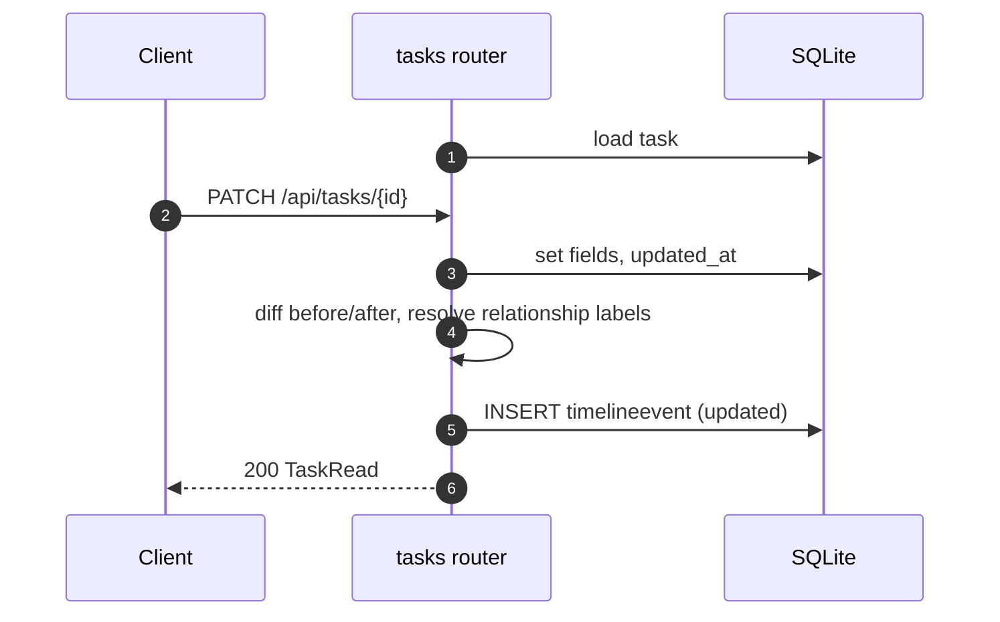

# Specification: Task management and timeline

## Overview

Tasks are served by `routers/tasks.py` over `/api/tasks`.
The `Task` table holds the work item plus agent-maintained context (`summary`, `next_steps`, `context_updated_at`).
Repositories are attached through the `TaskRepository` join table.
Meaningful changes are written as `TimelineEvent` rows, and the same changes are published on the in-process event bus so the SPA can refresh over SSE.

## Architecture

```mermaid
flowchart LR
    C[Client / SPA / CLI] --> R[routers/tasks.py]
    R --> M[(Task, TaskRepository, TimelineEvent)]
    R --> U[crud.add_timeline]
    R --> B[event bus]
    B --> S[SSE /api/tasks/{id}/stream]
```

## Data Models

### Task

| Field | Type | Constraints | Description |
|---|---|---|---|
| id | string | PK, 12-hex | Generated id |
| title | string | not null | Task title |
| description | string | default "" | Free text |
| status | enum | open, in_progress, blocked, done, archived | Lifecycle status |
| priority | int | default 2 | 0 low, 1 medium, 2 high, 3 urgent |
| tags | JSON | default [] | Labels |
| group_id | string | FK repositorygroup, nullable | Repository group |
| harness_id | string | FK harness, nullable | Preferred harness |
| summary | string | default "" | Agent-maintained state |
| next_steps | JSON | default [] | Agent-maintained actions |
| context_updated_at | datetime | nullable | Last context refresh |
| created_at / updated_at | datetime | not null | Timestamps |

### TaskRepository

| Field | Type | Constraints | Description |
|---|---|---|---|
| id | string | PK | Join row id |
| task_id | string | FK task, index | Task |
| repository_id | string | FK repository, index | Repository |
| created_at | datetime | not null | When attached |

A unique constraint on `(task_id, repository_id)` prevents duplicates.

### TimelineEvent

| Field | Type | Constraints | Description |
|---|---|---|---|
| id | string | PK | Event id |
| task_id | string | FK task, index | Owning task |
| type | string | not null | created, updated, item_added, item_removed, worktree_created, worktree_removed, run_started, context_refresh, context_updated, context_refresh_failed |
| message | string | default "" | Human-readable text |
| data_json | JSON | default {} | Structured payload (includes before/after for edits) |
| created_at | datetime | not null | When it happened |

## API Contracts

The normative contract is in [`api.yaml`](api.yaml) once written; the table below is the summary.

| Method | Path | Purpose |
|---|---|---|
| GET | /api/tasks | List tasks (filters: status, q) |
| POST | /api/tasks | Create a task (or import from a GitHub URL) |
| GET | /api/tasks/{task_id} | Task detail with associations, worktrees, runs, timeline |
| PATCH | /api/tasks/{task_id} | Update fields (including repository_ids) |
| DELETE | /api/tasks/{task_id} | Delete the task and its children |
| GET | /api/tasks/{task_id}/timeline | Timeline events |
| GET | /api/tasks/{task_id}/stream | SSE task changes |

Error codes shared across endpoints:

| Status | Code | Description |
|---|---|---|
| 400 | INVALID_INPUT | Missing title and no GitHub URL |
| 404 | NOT_FOUND | Task not found |

## Sequences

### Update with change recording



## Technical Decisions

| Decision | Choice | Rationale |
|---|---|---|
| Change recording | Diff `before`/`after` per field, skip no-ops | Keeps the timeline meaningful and compact |
| Relationship labels | Resolve `group_id`/`harness_id` to names in the event | Timeline reads in names, not ids, for UI, CLI, and agents |
| Deletes | Explicit ordered `sa_delete` statements | SQLite FK enforcement with no ORM cascade ordering |
| Repository links | `TaskRepository` join table | A task can draw on more than one repository |

## Risks and Unknowns

1. The timeline is capped at 100 rows in the detail response; older history is only reachable through the timeline endpoint.
2. Search is an in-process filter, so it will not scale to very large task counts.

## Out of Scope

- Bulk task operations.
- A formal migration framework for the `Task` table.
