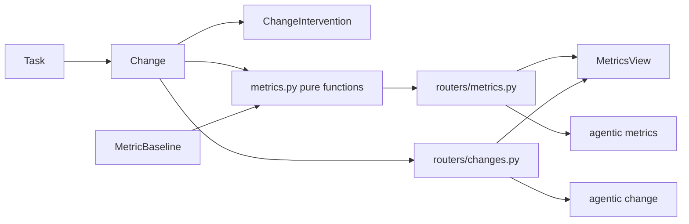
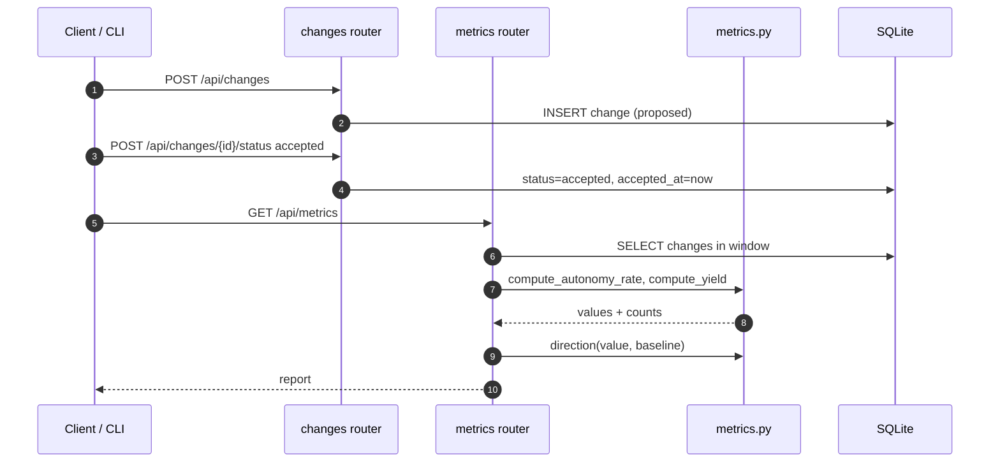

# Specification: Factory metrics: autonomy rate and yield

## Overview

A new `change` table records each unit of factory output, a `changeintervention` table records every human touch on a change, and a `metricbaseline` table stores the comparison point for each metric.
`metrics.py` holds pure functions that compute autonomy rate and yield from a list of changes plus the current time and the windows, and a direction function that compares a value against its baseline.
`routers/changes.py` exposes the change lifecycle, `routers/metrics.py` exposes the computed metrics and baselines, and `main.py` registers both.
The CLI gains a `change` group and a `metrics` group, each task page gains a Changes panel for recording and moving changes, and the SPA gains a read-only Metrics page at `/metrics`.
New domain terms (`change`, `intervention`, `autonomy rate`, `yield`, `metric baseline`) are added to `.sdlc/context/vocabulary.md`, and the two new tables are added to `schema.dbml` and `architecture.md`.

## Architecture

## Data Models

### Change

| Field | Type | Constraints | Description |
|---|---|---|---|
| id | string | PK | Change id |
| task_id | string | FK task, index, not null | Owning task |
| title | string | default "" | Short description |
| change_class | string | default feature | feature, bugfix, refactor, chore, docs, test, trivial |
| status | string | default proposed | proposed, verified, accepted, rejected, reverted |
| repository_id | string | FK repository, nullable | Repository the change touches |
| worktree_id | string | FK worktree, nullable | Worktree it was produced in |
| external_ref | string | nullable | PR URL or number |
| human_intervened | bool | default false | Set when any intervention is recorded |
| intervention_count | int | default 0 | Interventions recorded |
| opened_at | datetime | not null | When the change entered the lifecycle |
| verified_at | datetime | nullable | Stamped on the verified transition |
| accepted_at | datetime | nullable | Stamped on the accepted transition |
| closed_at | datetime | nullable | Stamped on the rejected or reverted transition |
| notes | string | default "" | Free-form |
| created_at / updated_at | datetime | not null | Bookkeeping |

### ChangeIntervention

| Field | Type | Constraints | Description |
|---|---|---|---|
| id | string | PK | Intervention id |
| change_id | string | FK change, index, not null | Owning change |
| kind | string | not null | question, correction, manual_fix, rerun, approval, other |
| note | string | default "" | What happened |
| created_at | datetime | not null | When it happened |

### MetricBaseline

| Field | Type | Constraints | Description |
|---|---|---|---|
| metric | string | PK | autonomy_rate or yield |
| value | float | not null | Baseline value in [0, 1] |
| window_days | int | not null | Window the baseline was measured over |
| observation_days | int | not null | Observation window at capture |
| note | string | default "" | Free-form |
| captured_at | datetime | not null | When it was captured |

Indexes: `change.task_id`, `change.status`, `change.accepted_at`, and `changeintervention.change_id`, so the metric queries and the per-task listings stay fast.

## Lifecycle Transitions

A change starts as `proposed` (`opened_at` set on create) and moves through a defined set of transitions, applied by `POST /api/changes/{id}/status`:

| From | Allowed to |
|---|---|
| proposed | verified, accepted, rejected |
| verified | accepted, rejected |
| accepted | reverted |
| rejected | (terminal) |
| reverted | (terminal) |

Rules:

- Setting the current status again is accepted as a no-op and returns 200.
- An unknown status is a 400.
- A transition outside the table is a 409; the change is left unchanged.
- `verified` stamps `verified_at`, `accepted` stamps `accepted_at`, and `rejected` or `reverted` stamp `closed_at`.
- A change need not pass through `verified`; `proposed -> accepted` records a change accepted without a separately recorded verification, which the yield metric then covers by observation.

Task deletion cascades: `delete_task` deletes a task's interventions, then its changes, before the task row, matching the existing ordered-delete pattern for other children.

## Metric Definitions

The article's definitions, made exact for this data model.

| Metric | Numerator | Denominator |
|---|---|---|
| Autonomy rate | accepted changes with `human_intervened = false` | accepted changes |
| Yield | accepted changes not reverted | accepted changes whose observation window has elapsed (or that were reverted) |

Terms:

- An **accepted change** is a change with `accepted_at` inside the reporting window and status `accepted` or `reverted`. A reverted change was accepted before it was reverted, so it stays in the denominator.
- A change is **observed** when it was reverted, or when `accepted_at <= now - observation_days`.
- Changes still inside the observation window are pending and excluded from yield, so a recent change is never counted as surviving by default.
- A change is **touchless** when `human_intervened` is false; recording any intervention (including an approval) clears it, because the article counts an approval as a human gate.
- A metric with a zero denominator has no value; it reports `no-data` rather than zero.
- Both metrics are "higher is better".

Direction, relative to the stored baseline:

- `no-data` when the metric has no value.
- `no-baseline` when no baseline exists for the metric.
- `improving` when `value - baseline.value > tolerance`.
- `worsening` when `value - baseline.value < -tolerance`.
- `flat` otherwise.
- The tolerance defaults to 0.02 (two percentage points).

## API Contracts

| Method | Path | Purpose |
|---|---|---|
| GET | /api/changes | List changes (filters: task_id, status, change_class) |
| POST | /api/changes | Record a change |
| GET | /api/changes/{change_id} | Read a change with its interventions |
| PATCH | /api/changes/{change_id} | Update editable fields |
| POST | /api/changes/{change_id}/status | Transition the lifecycle |
| POST | /api/changes/{change_id}/interventions | Record an intervention |
| DELETE | /api/changes/{change_id} | Delete a change and its interventions |
| GET | /api/metrics | Compute autonomy rate and yield |
| GET | /api/metrics/baselines | List baselines |
| PUT | /api/metrics/baselines/{metric} | Upsert a baseline |
| DELETE | /api/metrics/baselines/{metric} | Clear a baseline |

`GET /api/metrics` accepts `window_days` (default 30), `observation_days` (default 14), `tolerance` (default 0.02, the flat band around a baseline), `task_id`, and `change_class`.
`PATCH /api/changes/{change_id}` accepts only `title`, `change_class`, `repository_id`, `worktree_id`, `external_ref`, and `notes`; status changes go through the transition endpoint so the timestamps stay correct.

Response shape for `GET /api/metrics`:

| Field | Type | Description |
|---|---|---|
| window_days / observation_days / tolerance | number | The resolved parameters |
| generated_at | datetime | When it was computed |
| metrics | list | One entry per metric |
| counts | object | Raw change counts |

Each `metrics` entry has `metric`, `label`, `value` (number or null), `numerator`, `denominator`, `baseline` (number or null), `delta` (number or null), `direction` (`improving`, `worsening`, `flat`, `no-baseline`, or `no-data`), and `unit` (`ratio`).

`counts` carries `accepted`, `touchless`, `reverted`, `rejected`, `pending_observation`, and `open`.

Status codes: 201 on create; 200 on read, update, and transition; 204 on delete; 400 for an unknown status, class, or intervention kind; 404 for a missing change or task; 409 for an invalid transition.

## Non-Functional Considerations

- NFR-1: `metrics.py` exposes pure functions (`compute_metrics`, `direction`) that take values and return values, so they are tested without a database.
- NFR-2: the metric queries read `change` rows within the window once and compute in process; the `accepted_at` and `status` indexes keep that scan bounded.
- NFR-3: deleting a task deletes its changes and interventions first; deleting a change deletes its interventions first.
- NFR-4: the Metrics page uses the existing responsive patterns (cards that wrap, a table that collapses to rows at phone widths).
- NFR-5: no endpoint accepts a person identifier; filters are task and change class only.

## Sequences

### Record a change and read the metrics

## Technical Decisions

| Decision | Choice | Rationale |
|---|---|---|
| Change unit | Explicit task-scoped rows | The article says nothing works until the lifecycle is instrumented; explicit rows keep the definition honest and let auto-detection fill them later |
| Metric core | Pure functions over a change list | Deterministic and directly unit-testable (NFR-1) |
| Yield window | Exclude unobserved changes | Prevents recent changes from counting as survivors by default |
| Direction | Baseline plus a tolerance | A stored baseline is what makes "improving or worsening" meaningful, per the article |
| Interventions | Separate table plus a denormalized flag | The flag makes the metric query simple; the rows preserve why the change was touched |
| Metric scope | Whole store, never per person | Matches the article's rule against measuring individuals |
| Deletion | Hard delete with cascade | The app is local and single-user; deleting a change removes it from historical metrics, which is acceptable for the foundation and called out as a limitation |

## Risks and Unknowns

1. Explicit recording means the metrics are only as complete as what the user or an agent records; auto-creation from agent runs is a later iteration.
2. The choice to exclude a rejection from both metrics may hide a factory that produces much and rejects most; open question in the requirements.
3. The baseline is a single value per metric; multiple baselines over time may be needed once trends matter.

## Out of Scope

- Cost per accepted change, human minutes per accepted change, and queue depth.
- Auto-creating changes from agent runs, git, or GitHub.
- Trend charts and per-class breakdowns beyond the raw counts.
- Per-person measurement.
