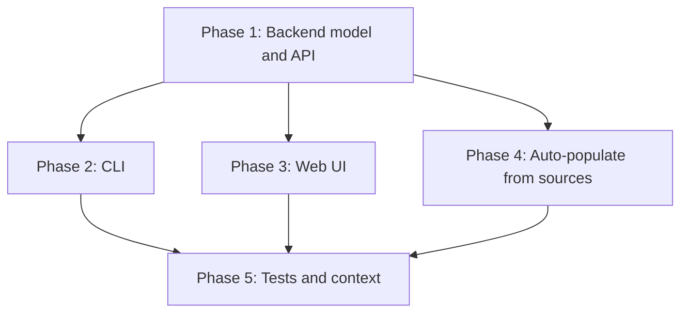
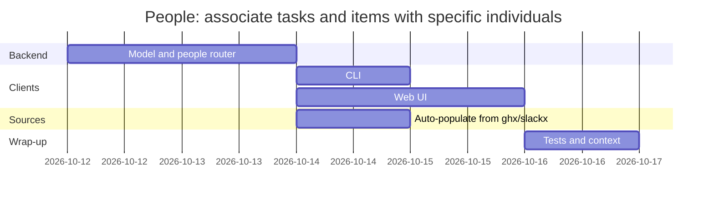

# Implementation Plan: People: associate tasks and items with specific individuals

## Goal

Add a people directory and link people to tasks and to source items across the backend, the CLI, and the SPA, so a task shows who is involved and an item shows the people behind it.
The backend lands first (it is the only writer of the tables), then the CLI and the SPA consume the same endpoints, then tests and the context artifacts catch up.

## Phases

### Phase 1: Backend model and API

**Goal:** The `person`, `taskperson`, and `itemperson` tables exist, and the people directory and link endpoints work over HTTP.
**Effort:** M
**Depends on:** None

**Deliverables:**
- [ ] `Person`, `TaskPerson`, and `ItemPerson` tables in `models.py`, with unique constraints on the links.
- [ ] `PersonRead`, `PersonDetail`, `PersonCreate`, `PersonUpdate`, and `PersonLink` schemas, plus `people` on `TaskDetail` and `person_ids` on `ItemRead`.
- [ ] `routers/people.py`: list with counts, create, get, update, delete, merge, and link/unlink for tasks and items, with idempotent linking.
- [ ] `merge_people` moves a source's aliases and links to a target, drops what the target already holds, and deletes the source; `POST /api/people/{id}/merge` exposes it.
- [ ] Router registered in `main.py`; task links write `person_added` / `person_removed` timeline events.
- [ ] Task delete cascades its people links; item delete cascades its people links.

### Phase 2: CLI

**Goal:** The `agentic person` command group drives the directory and the links.
**Effort:** S
**Depends on:** Phase 1

**Deliverables:**
- [ ] `person list`, `person get`, `person create`, `person update`, `person delete` in `cli.py`.
- [ ] `person link` / `person unlink` with `--task` or `--item`, and `person merge SOURCE --into TARGET`.
- [ ] `client.py` methods: `list_people`, `get_person`, `create_person`, `update_person`, `delete_person`, `merge_person`, `link_person`, `unlink_person`.
- [ ] Text renderers for a person (name, contact, counts).

### Phase 3: Web UI

**Goal:** People are visible and editable on the task page, the Items page, and a People page.
**Effort:** M
**Depends on:** Phase 1

**Deliverables:**
- [ ] `api.js`: `api.people.*` and `person_ids` handling on items.
- [ ] `store.js`: `people`, `loadPeople`, and link helpers.
- [ ] `PeoplePanel.vue` on the task page (chips, add existing, create new, remove).
- [ ] `PeopleView.vue` at `/people` with per-person counts and links to tasks, plus rename and delete.
- [ ] `PersonView.vue` at `/person/:id` with aliases, notes, relationships, delete, and a merge picker of the other people.
- [ ] `ItemsView.vue`: people chips per item and a person linker.
- [ ] Sidebar nav and command palette "People" entries; route in `main.js`.

### Phase 4: Auto-populate from ghx and slackx

**Goal:** Fetching a GitHub or Slack item adds the people named by its metadata to the directory and links them to the item; linking the item to a task links those people to the task.
**Effort:** M
**Depends on:** Phase 1

**Deliverables:**
- [ ] `services.py` extracts people from a `ghx` issue/PR payload (author, assignees, commenters) and a `slackx` thread payload (participants), resolving Slack names best effort.
- [ ] `fetch_source` returns a `people` list; `fetch_github_issue` includes one.
- [ ] `upsert_person`, `link_people_to_item`, and `link_item_people_to_task` in `routers/people.py`, de-duplicating by handle.
- [ ] The items router links fetched people on create and refresh; the tasks router propagates an item's people when the item is linked.

### Phase 5: Tests and context

**Goal:** The feature is covered by tests and the context artifacts describe the new tables and terms.
**Effort:** S
**Depends on:** Phases 1-4

**Deliverables:**
- [ ] `backend/tests/test_people_api.py` covering create, list counts, task and item links, idempotency, timeline events, cascades, and the merge (moving, deduping, source deletion, self-merge 400, unknown ids 404).
- [ ] CLI tests for the person commands and client.
- [ ] Frontend tests for the People view and the task People panel.
- [ ] `architecture.md`, `schema.dbml`, `vocabulary.md`, and `project-overview.md` (scope) updated.

## Phase Dependencies

Phases 2, 3, and 4 are independent (no edges between them); each depends on Phase 1 and feeds Phase 5.

## Milestones

| Milestone | Phase | Success Criteria |
|---|---|---|
| M1: People API | Phase 1 | A person can be created, listed with counts, linked to a task and an item, and deleted over HTTP |
| M2: CLI and UI | Phases 2-3 | The CLI and the SPA can do everything M1 can |
| M3: Auto-populated | Phase 4 | Fetching a GitHub or Slack item adds its people, and linking the item links them to the task |
| M4: Covered and documented | Phase 5 | Tests pass and the context artifacts list the people tables |

## Dependencies

| Dependency | Type | Owner | Risk if Delayed |
|---|---|---|---|
| Existing tasks, items, and timeline routers | Internal | Agentic | The link endpoints reuse their patterns; a large refactor there would slow this feature |

## Risk Register

| Risk | Likelihood | Impact | Mitigation |
|---|---|---|---|
| Cascade deletes on the new join tables are missed | Med | Med | Explicit ordered deletes in the task and item delete paths, plus tests |
| SQLModel's `create_all` does not add columns | Low | Low | This feature only adds new tables, no columns |
| People UI crowds the mobile task page | Med | Low | Chips wrap; the People page carries the full list |

## Assumptions

- New tables are created by `create_all` on startup, so no migration is needed (verified in the existing DB path for the metrics tables).
- The existing `SearchSelect` component can drive both the task panel and the item linker.

## Timeline

## Out of Scope

- Auto-linking people from item metadata.
- A primary or owner person on a task.
- Adopting the source's fields onto the target on merge, a distinct merge event, batched merges, and duplicate detection.
- Per-person metrics.
