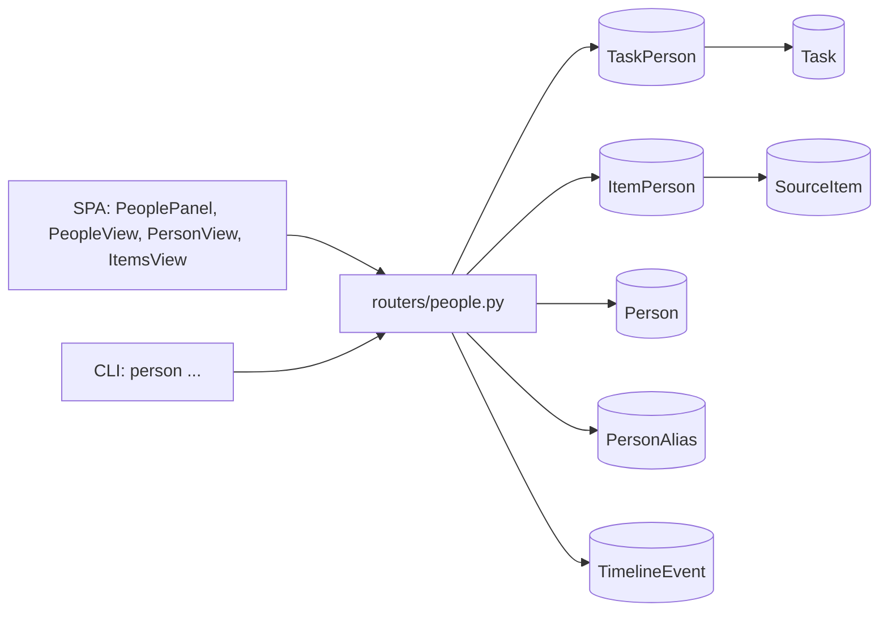
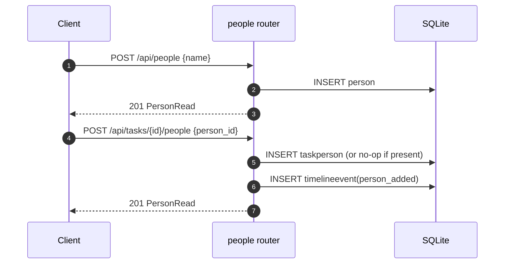
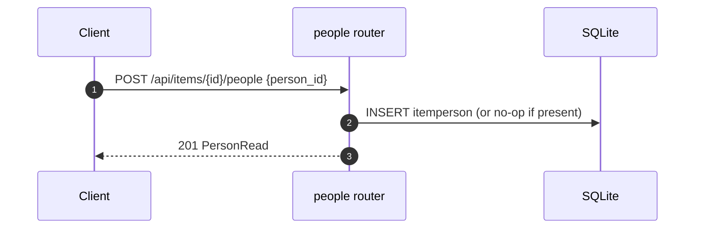
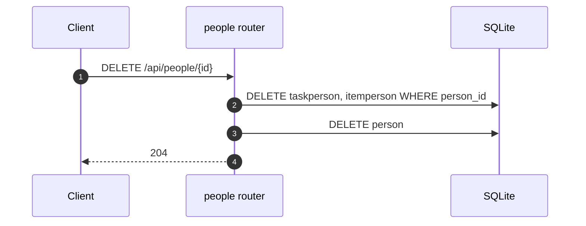
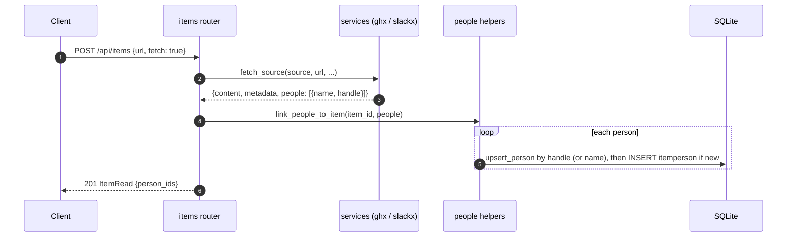

# Specification: People: associate tasks and items with specific individuals

## Overview

People are first-class rows in a new `person` table.
Linking stays many-to-many on both sides through two join tables, `taskperson` (task to person) and `itemperson` (item to person), mirroring the existing `taskrepository` and `association` patterns.
A `people` router owns the directory (create, read, update, delete, list with counts) and the link operations; task-side links live under `/api/tasks/{id}/people` and item-side links under `/api/items/{id}/people`.
Task links write a timeline event (`person_added`, `person_removed`).
A person can also be merged into another: the merge moves the source's aliases and its task and item links to the target, drops what the target already holds, and deletes the source.
The SPA adds a `PeoplePanel` on the task page, people rows and a linker on the Items page, and a `PeopleView` page plus a `PersonView` page in the sidebar.
The CLI adds a `person` command group (`list`, `get`, `create`, `update`, `delete`, `merge`, `link`, `unlink`).
People are also auto-populated from the source metadata of GitHub and Slack items: `services.py` extracts the people named by a `ghx` issue/PR payload or a `slackx` thread payload, and the items router upserts and links them.

## Architecture



## Data Models

### Person (new table `person`)

| Field | Type | Constraints | Description |
|---|---|---|---|
| id | string | PK, 12-char hex | The person's identifier |
| name | string | required | The display name; not unique |
| notes | string | default `""` | Free-form notes |
| created_at | datetime | default now | Creation time |
| updated_at | datetime | default now | Last update time |

Email and handle are aliases (see below), not columns.

### PersonAlias (new table `personalias`)

| Field | Type | Constraints | Description |
|---|---|---|---|
| id | string | PK | The alias's identifier |
| person_id | string | FK `person.id`, indexed | The person the alias belongs to |
| value | string | indexed | An identifier string: a handle (GitHub login, Slack user id) or an email |
| created_at | datetime | default now | Creation time |

Unique constraint on (`person_id`, `value`), named `uq_person_alias`.
Aliases are the identity used to de-duplicate auto-populated people across sources.

### TaskPerson (new table `taskperson`)

| Field | Type | Constraints | Description |
|---|---|---|---|
| id | string | PK | The link's identifier |
| task_id | string | FK `task.id`, indexed | The task |
| person_id | string | FK `person.id`, indexed | The person |
| created_at | datetime | default now | Link creation time |

Unique constraint on (`task_id`, `person_id`), named `uq_task_person`.

### ItemPerson (new table `itemperson`)

| Field | Type | Constraints | Description |
|---|---|---|---|
| id | string | PK | The link's identifier |
| item_id | string | FK `sourceitem.id`, indexed | The item |
| person_id | string | FK `person.id`, indexed | The person |
| created_at | datetime | default now | Link creation time |

Unique constraint on (`item_id`, `person_id`), named `uq_item_person`.

## API Contracts

The normative contract is in [`api.yaml`](api.yaml) (OpenAPI 3), scoped to the people surface this feature adds.
The table below is a summary.

| Method | Path | Purpose |
|---|---|---|
| GET | `/api/people` | List people with their task and item counts |
| POST | `/api/people` | Create a person (name required) |
| GET | `/api/people/{person_id}` | A person with the task ids and item ids they are linked to |
| PATCH | `/api/people/{person_id}` | Update a person's fields |
| DELETE | `/api/people/{person_id}` | Delete a person and their links |
| POST | `/api/people/{person_id}/merge` | Merge the person in `source_id` into `person_id`, which survives with their aliases and links |
| POST | `/api/tasks/{task_id}/people` | Link a person (existing `person_id`, or a new `name`) to a task |
| DELETE | `/api/tasks/{task_id}/people/{person_id}` | Unlink a person from a task |
| POST | `/api/items/{item_id}/people` | Link a person to an item |
| DELETE | `/api/items/{item_id}/people/{person_id}` | Unlink a person from an item |

`GET /api/tasks/{task_id}` gains `people: list[PersonRead]` on `TaskDetail`.
`GET /api/items` and `GET /api/items/{item_id}` gain `person_ids: list[str]` on `ItemRead`.

## Merge

Two people can describe the same human (one created by hand, one auto-populated from a source), so `POST /api/people/{person_id}/merge` folds one (the source) into another (the target, the person in the path) and deletes the source.
The request body is `{"source_id": "<id>"}` and the response is the surviving `PersonRead`.
Merging into itself is 400; an unknown source or target is 404.
`merge_people(session, target, source)` in `routers/people.py` performs the move:

1. Aliases: reassign each `personalias` row of the source to the target; when the target already carries the same value (case-insensitive), delete the source row instead.
2. Task links: reassign each `taskperson` row of the source to the target; when the target is already linked to that task, delete the source row instead. Record a `person_added` event on the task.
3. Item links: the same as task links, with no timeline (items have none).
4. Delete the source `person` row and bump the target's `updated_at`.

The target keeps its own name and notes; only the source's aliases and links move.
Each moved row is checked against the target first, so the `uq_person_alias`, `uq_task_person`, and `uq_item_person` constraints hold and no duplicate survives (NFR-8).

## Auto-population from sources

`fetch_source` (in `services.py`) returns a `people` list alongside `metadata` and `content`.
It never raises, and an empty or missing `people` list means "no people found".

| Source | People extracted | Identity (handle) |
|---|---|---|
| GitHub (`ghx issue view` / `ghx pr view --json`) | The issue/PR author, its assignees, and its comment authors | The login |
| Slack (`slackx conversations show --json`) | The distinct participants of the thread | The Slack user id |

Names are resolved best effort: a GitHub person's name is its login, and a Slack person's name comes from `slackx users list --json` (`real_name`, then `name`) with the message's `user_name` as a fallback.

The items router links the fetched people to the item (`link_people_to_item`), and the tasks router links an item's people to a task when the item is linked to it (`link_item_people_to_task`), so a linked source brings its people to the task.
Both go through `upsert_person`, which finds a person by handle (then by case-insensitive name) and creates one only when absent, so the same login or user id is one directory entry (NFR-7).
Auto-population is best effort: a missing or failing `ghx`/`slackx` leaves the item stored with no people (NFR-6).

Error codes shared with the rest of the API:

| Status | Code | Description |
|---|---|---|
| 400 | INVALID_INPUT | Name is required on create, neither `person_id` nor `name` is given when linking, or a merge names the same person as source and target |
| 404 | NOT_FOUND | Person, task, or item not found |

## Web UI

| Component | Change | Requirements |
|---|---|---|
| `PeoplePanel.vue` (new) | On the task page: the task's people as chips with a remove control, plus a picker to link an existing person or create a new one | FR-6 |
| `PeopleView.vue` (new) | Route `/people`: one row per person with their counts, links to their tasks, and a rename/delete control | FR-8 |
| `PersonView.vue` (new) | Route `/person/:id`: a person's aliases, notes, and relationships, a delete control, and a "Merge" picker of the other people | FR-8, FR-18 |
| `ItemsView.vue` | Each item shows its people chips and a `SearchSelect` to link a person | FR-7 |
| `TaskView.vue` | Renders `PeoplePanel` under `ItemsPanel` | FR-6 |
| `App.vue` | Sidebar and command palette gain a "People" entry | FR-8 |
| `store.js` | Holds `people` and `loadPeople`, plus `createPerson` and `linkPerson` helpers | FR-4, FR-6 |
| `api.js` | `api.people.*` (including `merge`) and `api.tasks.people.*` / `api.items.people.*` | FR-2, FR-3, FR-5, FR-18 |

## Sequences

### Create a person and link them to a task



### Link a person to an item



### Delete a person



### Merge a person into another

```mermaid
sequenceDiagram
    autonumber
    participant C as Client
    participant P as people router
    participant DB as SQLite
    C->>P: POST /api/people/{target}/merge {source_id}
    P->>DB: SELECT target and source (404 if missing; 400 if the same)
    P->>DB: move personalias source -> target (drop shared values)
    loop each source task link
        P->>DB: move taskperson to target (drop if the target is already linked)
        P->>DB: INSERT timelineevent(person_added)
    end
    loop each source item link
        P->>DB: move itemperson to target (drop if the target is already linked)
    end
    P->>DB: DELETE person(source)
    P-->>C: 200 PersonRead (target)
```

### Auto-populate people from a fetched source



## Non-Functional Considerations

- **Data integrity (NFR-1):** people live in their own table; links live in join tables with unique constraints, so a person cannot be linked twice to the same task or item.
- **Consistency (NFR-2):** the same link and unlink logic backs the API, the CLI, and the SPA; the SPA calls the same endpoints the CLI does.
- **Usability (NFR-3):** people chips, the picker, and the People page wrap and stay reachable at phone widths.
- **Reliability (NFR-4):** linking checks for an existing link first and returns the existing association, so a repeated link is a no-op.
- **Performance (NFR-5):** the list counts are computed in process over the people and links, which is fast at the few-hundred-person scale this single-user app targets.
- **Security:** there is no authentication; the app assumes a trusted, single-user environment, so the directory needs no access control.

## Technical Decisions

| Decision | Choice | Rationale |
|---|---|---|
| Storage | A `person` table plus `taskperson` and `itemperson` join tables | Two-sided many-to-many mirrors `taskrepository` and `association`; unique constraints enforce no duplicates (NFR-1) |
| Link semantics | Idempotent: link returns the existing row when present | Lets the SPA and CLI link without pre-checking (NFR-4) |
| Name uniqueness | Not enforced | Two people can share a name; identity is the id |
| Task-side events | `person_added` / `person_removed` timeline events | Matches the item-side `item_added` / `item_removed` events (FR-9) |
| Item-side events | None | Items have no timeline; the item row itself is the record |
| Cascades | Handled explicitly in the routers | SQLite enforces FKs and ORM delete ordering is unreliable |
| Auto-population identity | Dedupe by handle (login or Slack user id), then name | The same person recurs across items; the handle is the stable key (NFR-7) |
| Auto-population trigger | On item fetch and refresh, and on item-to-task link | The people exist only after the source is read; linking propagates them to the task (FR-11 to FR-13) |
| Auto-population failure | Best effort, never blocks the fetch | `fetch_source` already swallows CLI failures; people are an addition, not a requirement (NFR-6) |
| Merge direction | The person in the path survives; `source_id` is absorbed | Keeps the endpoint and the CLI (`--into`) reading as "merge SOURCE into TARGET" |
| Merge on a shared alias or link | Drop the source's row when the target already holds it | The alias and join tables are unique per pair, and a merge must not fail or duplicate on a task linked to both (NFR-8) |
| Merge fields | The target keeps its own name and notes | The user chose which person survives; renaming stays a separate update |
| Merge event | `person_added` for a task that gains the target | Reuses the existing event type, mirroring `link_item_people_to_task` |

## Risks and Unknowns

1. Counts and the People page scan the links in process; a link table with indexes would be the next step if the store grows large.
2. Auto-populated names are coarse: a GitHub person is named by login (no profile lookup), and a Slack person falls back to the message's `user_name` when `slackx users list` is unavailable.
3. Names are not unique, so a person created manually as "Ada" and auto-created as login "ada" can be two entries; the merge endpoint (FR-14 to FR-18) reconciles them, but it is chosen by id and is never automatic.
4. A merge is irreversible: the source's name is gone, though its aliases and links survive on the target. The confirmation names both people to make this explicit.

## Out of Scope

- Resolving a GitHub login to a real name and email via a profile lookup.
- A "primary" or owner person on a task.
- Adopting the source's name, notes, or contact fields onto the target during a merge (the target keeps its own).
- A distinct `person_merged` timeline event, a merge preview, batched merges, or auto-detecting duplicates.
- Per-person metrics or work measurements.
- Removing a task's people when the item that brought them is unlinked.
