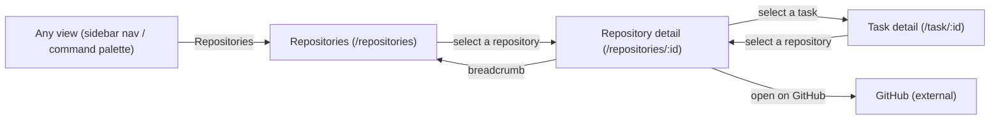

# Mockups: Repository navigation

## Overview

This feature has a small UI surface: two new views in the SPA, a Repositories page and a repository detail view, plus a link affordance on the task detail.
The primary user is the sole developer, whose goal is to open a repository, see the issues and PRs already tied to tasks, and jump to the task that uses one.
The per-screen HTML mockups live under `mockups/`; each is self-contained (inline CSS, no external assets) and renders every interaction state as its own labelled section.
The visual language matches the existing dark theme (`frontend/src/styles.css`).

## Screen Inventory

| Screen | Purpose | Entry From | Exits To | Mockup |
|---|---|---|---|---|
| Repositories page | List registered repositories with their task-associated issue/PR counts; add and remove repositories. | Sidebar nav, command palette | Repository detail | [`mockups/repositories.html`](mockups/repositories.html) |
| Repository detail | Show one repository's task-associated issues and PRs; filter and navigate to GitHub or to a task. | Repositories page, a task's repository link | Task detail, GitHub, Repositories page | [`mockups/repository-detail.html`](mockups/repository-detail.html) |
| Task detail repository link | Show a task's repositories as links to their detail pages. | Task detail | Repository detail | [`mockups/task-repository-link.html`](mockups/task-repository-link.html) |

## Wireframes

### Repositories page

**Mockup:** [`mockups/repositories.html`](mockups/repositories.html)

**Regions**

| Region | Content | Data source (spec ref) |
|---|---|---|
| App header | Brand and the primary icon nav, with Repositories active. | FEAT-p7 FR-1, FEAT-p10 |
| Page header | Title "Repositories" and the totals line (repositories · issues · PRs). | FR-9, RepositorySummary aggregates |
| Add controls | Path input, Browse… (directory picker), Add repository. | FR-2, `POST /api/repositories`, `POST /api/repositories/bulk` |
| Repository row | Name, default-branch badge, issue and PR counts, path (mono), remote; Remove action. | FR-1, `RepositorySummary` |

**Primary action:** open a repository (selecting its row).

### Repository detail

**Mockup:** [`mockups/repository-detail.html`](mockups/repository-detail.html)

**Regions**

| Region | Content | Data source (spec ref) |
|---|---|---|
| Breadcrumb | Repositories / &lt;repo name&gt;, back to the list. | FR-6 (not-found path) |
| Header | Repository name, default branch, remote. | FR-1, `RepositoryRead` |
| Filters | A title/number search; the list is split into Issues and Pull requests sections, each with a heading and count. | FR-7 |
| Item row | Kind badge, number, title link, GitHub link, task chips, fetched age. | FR-3, FR-4, `RepositoryItem` |

**Primary action:** select a linked task to open it (secondary: open the item on GitHub).

### Task detail repository link

**Mockup:** [`mockups/task-repository-link.html`](mockups/task-repository-link.html)

**Regions**

| Region | Content | Data source (spec ref) |
|---|---|---|
| Task meta row | The task's repositories as chips that link to their detail page (`RepositorySelect` with `linkToDetail`). | FR-8 |

**Primary action:** open a repository from the task.

## Component Breakdown

| Component | Status | Notes |
|---|---|---|
| `RepositoriesView.vue` | New | Page: totals, add controls, repository rows, states. |
| `RepositoryDetailView.vue` | New | Page: header, text filter, Issues and Pull requests sections, item rows, states. |
| `repositories.js` | New | Pure helpers: parse URL/remote, derive kind/number, group items. |
| `DirectoryPicker.vue` | Reuse | Used as-is for bulk add. |
| `store.js` | Extend | Add `items` plus `loadItems()`. |
| `main.js` | Extend | Register `/repositories` and `/repositories/:id`. |
| `App.vue` | Extend | Sidebar nav entry and command-palette entry. |
| `SettingsView.vue` | Extend | Remove the repositories management section; keep repository groups (no pointer). |
| `RepositorySelect.vue` | Extend | Add a `linkToDetail` flag so selected repositories link to their detail page. |
| `TaskView.vue` | Extend | Set `linkToDetail` on the repository control. |
| Existing `.panel` / `.item` / `.badge` / `.btn` styles | Reuse | No new design tokens. |
| `.badge.issue` / `.badge.pr` | New | Kind badges; their border colors are reserved for item kind (NFR-5) and are not reused for task status. The kind is carried by the label text plus the border, and the text uses `--text` for AA contrast. |
| `.btn.chip` | New | Small chips for the task links. |
| Task status chips | Reuse | The `StatusIcon` status icon (circle / play / X / check) with an `aria-label`, instead of status text. |

## Interaction States

### Repositories page

| State | What the user sees |
|---|---|
| Empty | "No repositories are registered yet" with the add controls inline. |
| Loading | A centred spinner with "Loading repositories…". |
| Populated | One row per repository (name, branch, counts, path, remote) plus the totals line. |
| Error | "Could not load repositories." with a Retry action. |

### Repository detail

| State | What the user sees |
|---|---|
| Empty | "No issues or PRs from this repository are associated to tasks yet." |
| Loading | A centred spinner with "Loading repository…". |
| Populated | The text filter, then the Issues and Pull requests sections with their headings, counts, and item rows. |
| Error | "Could not load this repository's items." with a Retry action. |
| Not found | "No repository with that id." with a link back to Repositories. |

### Item row

| State | What the user sees |
|---|---|
| Number derivable | `#42` shown next to the kind badge. |
| Number not derivable | The number is omitted; kind, title, GitHub link, and tasks still render (rendered as a defensive variant in the populated section). |
| No linked tasks | Not rendered at all (an item with no task association is excluded from the view). |

## Navigation Flow

## Responsive Behavior

| Viewport | Layout changes |
|---|---|
| Mobile (≤760px) | The sidebar becomes the off-canvas drawer, opened from the top-bar menu button. Repository rows stack: name and counts on one line, path and remote below. Item rows stack the title and the task chips. Filters wrap. |
| Tablet (761-1000px) | Sidebar narrows (240px); single-column rows use the full width of the main column. |
| Desktop (>1000px) | Sidebar visible at its full width; the main column is capped (about 900px) so rows stay readable. |

## Accessibility

- **Keyboard:** On mobile, the top-bar menu button (labelled "Toggle navigation") is the first focusable control and opens the drawer. Focus order then follows the page: nav, add controls, then repository rows (or breadcrumb, the filter, then the Issues and Pull requests sections). Repository rows and item title/GitHub/task links are reachable with Tab and activated with Enter. No focus traps.
- **Screen reader:** The nav entry is labelled "Repositories"; icon-only controls (Remove, Retry, expand) carry `aria-label`s; the task status is a `StatusIcon` carrying an `aria-label` (title) instead of text; the item kind is a text badge, not color alone; the text filter is a native `<input>` with a label, and each group heading names its kind and count.
- **Contrast:** Body and link text use `--text` / `--muted` / `--accent`, which meet WCAG AA (4.5:1) on the dark surfaces; the mockups avoid the lower-contrast `--faint` token for content.
- **Touch targets:** Interactive controls keep a comfortable tap size (about 38px, existing `.btn` height) with spacing on mobile.

## Copy Notes

- Page title "Repositories"; totals line "3 repositories · 5 issues · 2 PRs".
- Empty (list) "No repositories are registered yet. Add a local git checkout to group its issues and PRs by repository."
- Empty (detail) "No issues or PRs from this repository are associated to tasks yet." plus "Paste a GitHub issue or PR link on a task, or import one when creating a task."
- Error "Could not load repositories." / "Could not load this repository's items." with a "Retry" button.
- Not found "No repository with that id." with "Back to Repositories".
- Group headings "Issues" and "Pull requests", each with its count.
- Removing a repository confirms first: "Remove this repository from Agentic? (No files are deleted.)", unchanged from the current Settings action.

## High-Fidelity Needs

- None required. The views are static lists with a text filter; a static HTML mockup is sufficient, and the existing app styles carry the visual language. No motion, drag-and-drop, or canvas is involved.

## Out of Scope

- The task detail's overall layout (only the repository link affordance changes).
- The Settings page redesign (only the repositories management section is removed; repository groups stay).
- Importing a task from an unassociated issue or PR (deferred open question).
- Live open/closed state of items (the row links out to GitHub).
