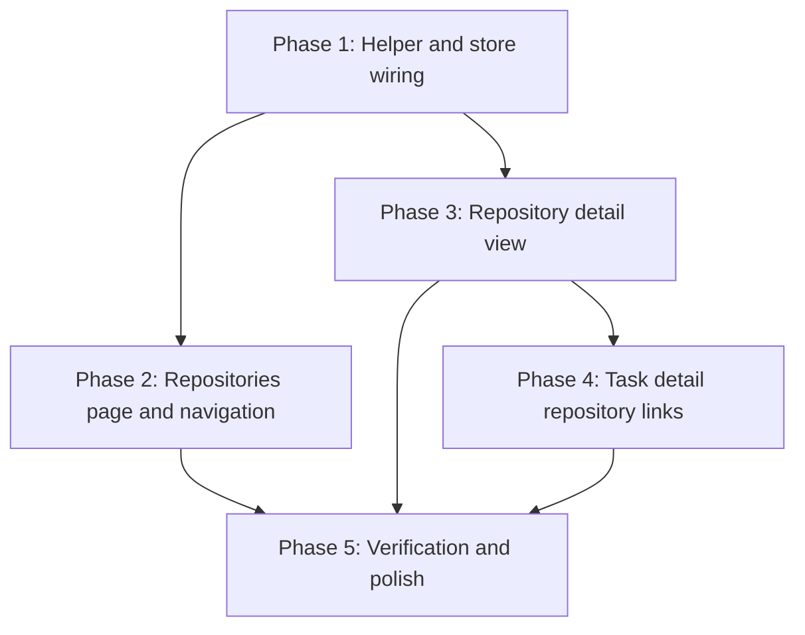

# Implementation Plan: Repository navigation

## Goal

Add a read-only Repositories page and a repository detail view to the SPA that group the GitHub issues and PRs already associated to tasks by the repository they belong to, move repository management out of Settings, and link a task's repositories back to their detail pages.
No backend change: the grouping is computed in the browser from `GET /api/repositories` and `GET /api/items`.

Plan structure: **unified** (`plan.md`). The work is one cohesive frontend feature (roughly five person-days) rather than several independently owned concerns, so a split `plan/` directory adds no value.

Skipped design phases (stated for traceability): `create-lifecycle` (no resource lifecycle), `create-telemetry` and `create-observability` (no analytics or monitoring surface in a local, backend-less view feature), and the `create-existing-solutions` / `create-codebase-analysis` / `create-feasibility` trio (skipped at the user's direction when going straight to specification).

## Phases

### Phase 1: Matching helper and store wiring

**Goal:** A pure, tested frontend helper turns the repositories and items already in the store into grouped view models.
**Effort:** ~1 person-day
**Depends on:** None

**Deliverables:**
- [ ] `frontend/src/repositories.js` with `parseGithubUrl(url)` (kind + number), `parseRemote(remoteUrl)` (https/ssh/`ssh://`, `.git` and trailing-slash tolerant, lowercased owner/repo), and `groupItemsByRepository(repositories, items)` returning `RepositorySummary[]` with per-item `task_ids` and issue/PR counts.
- [ ] `frontend/src/store.js`: add `items` plus `loadItems()`; reuse the existing `loadRepositories()`.
- [ ] Unit tests for the helper (parsing edge cases, exclusion rules, count aggregation).

### Phase 2: Repositories page and navigation

**Goal:** The `/repositories` route lists repositories with counts, and is reachable from the sidebar and the command palette.
**Effort:** ~1.5 person-days
**Depends on:** Phase 1

**Deliverables:**
- [ ] `frontend/src/views/RepositoriesView.vue`: totals line, add controls (path input, Browse via `DirectoryPicker`, Add), repository rows (name, branch, counts, path, remote, Remove with confirmation), and the loading/empty/error+retry states.
- [ ] `frontend/src/main.js`: register the `/repositories` route.
- [ ] `frontend/src/App.vue`: sidebar icon nav entry and a `go-repositories` command-palette entry; repoint the new-task modal's "Add one in Settings" hint to the Repositories page.
- [ ] `frontend/src/views/SettingsView.vue`: remove the repositories management section and keep repository groups (no pointer; repositories are reached from the nav).

### Phase 3: Repository detail view

**Goal:** The `/repositories/:id` route shows a repository's task-associated issues and PRs with filters and navigation.
**Effort:** ~1 person-day
**Depends on:** Phase 1

**Deliverables:**
- [ ] `frontend/src/views/RepositoryDetailView.vue`: breadcrumb, header, a text filter, the Issues and Pull requests sections (each with a heading and count) with item rows (kind badge, number, GitHub title link, task chips, fetched age), and the loading/empty/error+retry/not-found states.
- [ ] `frontend/src/main.js`: register the `/repositories/:id` route.

### Phase 4: Task detail repository links

**Goal:** A task's repositories link to their detail pages.
**Effort:** ~0.5 person-day
**Depends on:** Phase 3

**Deliverables:**
- [ ] `frontend/src/components/RepositorySelect.vue`: add a `linkToDetail` flag that renders each selected repository as a link to `/repositories/:id` (default off, so the new-task modal is unchanged).
- [ ] `frontend/src/views/TaskView.vue`: set `linkToDetail` on the task detail's repository control.

### Phase 5: Verification and polish

**Goal:** The feature behaves as specified at phone and desktop widths and the helper is covered by tests.
**Effort:** ~1 person-day
**Depends on:** Phases 2, 3, 4

**Deliverables:**
- [ ] Run the helper unit tests and the existing frontend build (`npm run build`) green.
- [ ] Measure NFR-3: with 50 repositories and 500 items, both views become interactive in under 300 ms (production build, warm local API, excluding the initial fetch).
- [ ] Check NFR-5: icon-only controls carry `aria-label`s, item kind is shown as text, and rows and links are keyboard reachable and activatable.
- [ ] Manual verification at 375px and desktop: navigation reachable (sidebar + drawer + palette), counts correct, the filter works, issues and PRs are separated, states render, repository rows open the detail, item rows open GitHub and the task, task repository chips open the detail.
- [ ] Confirm no `--faint` content text, per the mockups' accessibility notes.
- [ ] Capture the visual proof for the PR (validate-implementation).
- [ ] No release step beyond rebuilding the SPA (`npm run build` writes to `backend/static`); no backend deploy, migration, or feature flag.

## Phase Dependencies

Phases 2 and 3 can proceed in parallel once Phase 1 lands.
Critical path: Phase 1 → Phase 3 → Phase 4 → Phase 5.

## Milestones

| Milestone | Phase | Success Criteria |
|---|---|---|
| M1: Grouping works | Phase 1 | Helper unit tests pass; an item URL matches its repository for both https and ssh remotes; unassociated and non-issue items are excluded. |
| M2: Repositories page reachable | Phase 2 | `/repositories` lists repositories with counts and is reachable from the sidebar and the palette; add and remove work. |
| M3: Detail view works | Phase 3 | `/repositories/:id` shows the task-associated items, filters them, and renders all five states. |
| M4: Round-trip navigation | Phase 4 | A task's repository chip opens the detail view. |
| M5: Verified | Phase 5 | Tests and build green; the manual checklist passes at 375px and desktop; visual proof captured. |

## Dependencies

| Dependency | Type | Owner | Risk if Delayed |
|---|---|---|---|
| `GET /api/items` returning `task_ids` | Internal | Backend (unchanged) | Blocks all grouping; already implemented. |
| `DirectoryPicker.vue` reused for bulk add | Internal | Frontend (unchanged) | Bulk add falls back to the single-path input. |
| `RepositorySelect.vue` extendable with a link flag | Internal | Frontend | Phase 4 blocked; task detail keeps plain chips. |
| Existing `.panel` / `.item` / `.badge` styles | Internal | Frontend (unchanged) | Cosmetic rework only. |

No external dependency (no new service, library, or API).

## Risk Register

| Risk | Likelihood | Impact | Mitigation |
|---|---|---|---|
| Remote parsing misses a form (enterprise host, unusual ssh form) | Med | Low | Helper returns null for unmatched remotes; the repository shows zero counts and a test covers the known forms. |
| Item `kind` values vary (`pr` vs `pull_request`, empty) | Med | Low | Derive kind from the URL path first, fall back to a normalized map; covered by tests. |
| Fetching every item is slow as the collection grows | Low | Med | Target scale is hundreds; if exceeded, add a `repository_id` filter or a server-side count without changing the view contract (noted in the spec). |
| Removing the Settings repositories section breaks group management | Low | Low | Groups are a separate section and are untouched; repositories stay reachable from the sidebar nav and the command palette. |
| Mobile layout regressions (drawer, stacked rows) | Low | Med | Check at 375px in Phase 5 and reuse the existing responsive styles. |

## Assumptions

- The browser can compute the grouping from a full items fetch at the target scale (tens of repositories, hundreds of items); no server-side join is needed.
- Item URLs are GitHub `issues`/`pull` URLs for the items this view shows, so owner/repo and number can be parsed from them.
- Repository management (add/remove) is acceptable to move off Settings, with groups staying there.

None of these carries enough risk to warrant a separate `/create-assumption` record: each is verifiable by reading the existing code or by the Phase 1 tests, and none is a technical bet that could invalidate the design.

## Timeline

No calendar can be committed for a solo project with no external deadline, so this is a duration-only view (about five person-days total). Phase 2 and Phase 3 can run in parallel after Phase 1.

| Phase | Duration | Can start after |
|---|---|---|
| Phase 1: Helper and store wiring | 1 day | — |
| Phase 2: Repositories page and navigation | 1.5 days | Phase 1 |
| Phase 3: Repository detail view | 1 day | Phase 1 |
| Phase 4: Task detail repository links | 0.5 day | Phase 3 |
| Phase 5: Verification and polish | 1 day | Phases 2-4 |
