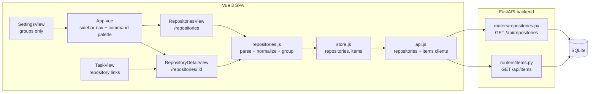
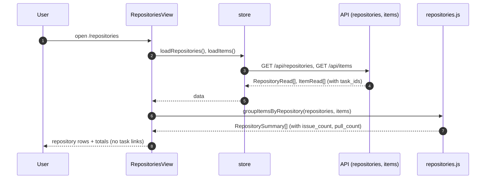
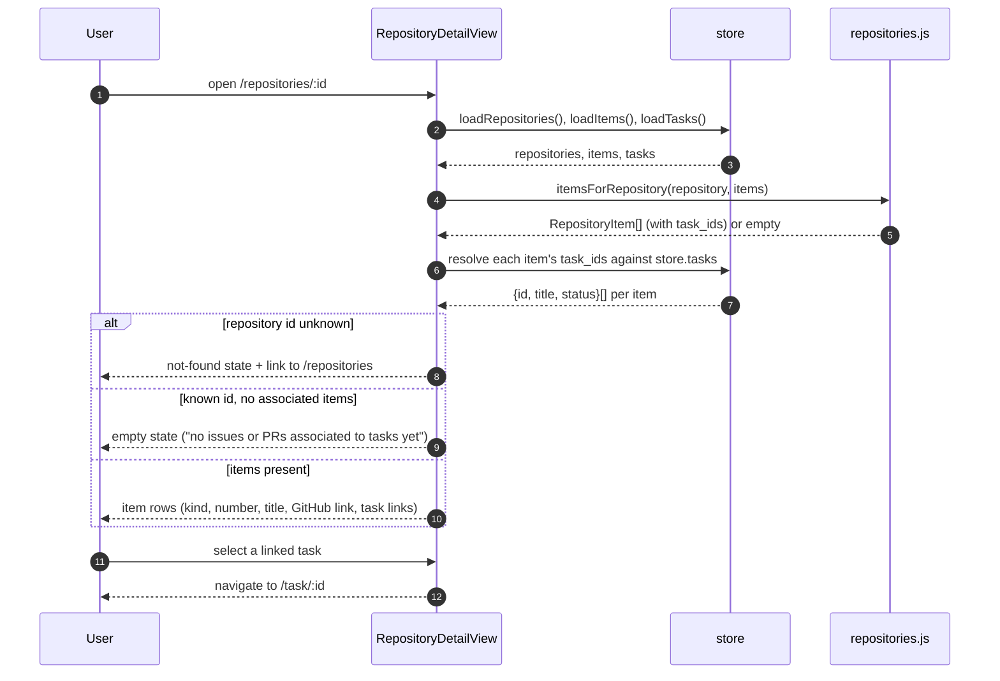
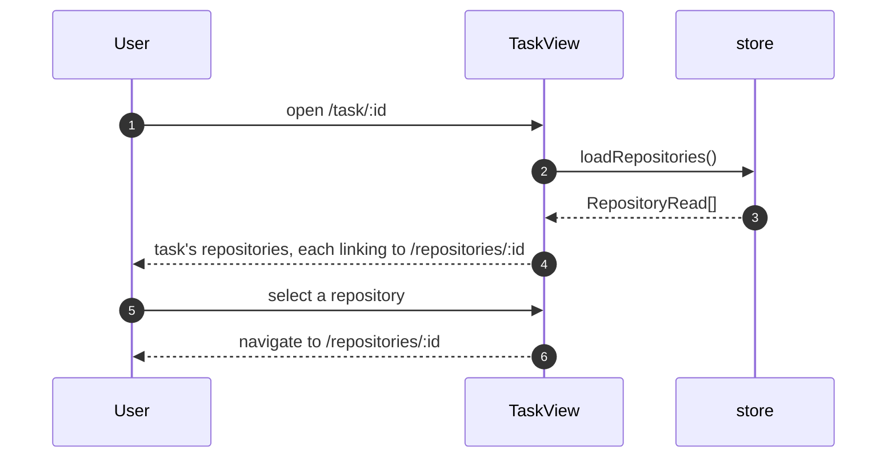

# Specification: Repository navigation

## Overview

This is a read-only view layer in the SPA.
It adds two routes, `/repositories` and `/repositories/:id`, that join the existing `GET /api/repositories` and `GET /api/items` responses in the browser, group the GitHub issue and PR items that are associated to at least one task under the repository whose GitHub owner/repo matches the item's URL, and render each item with a link to GitHub and to the tasks that use it.
No table, column, endpoint, or background job is added: the grouping, matching, and number derivation all happen in a small frontend helper, and the server is unchanged.
Repository management (add single, add bulk via the directory picker, remove) moves from the Settings page to the Repositories page, while repository groups stay under Settings.

## Architecture

Components and responsibilities:

| Component | Responsibility | Change |
|---|---|---|
| `frontend/src/views/RepositoriesView.vue` | List registered repositories with derived issue/PR counts; add (single + directory picker) and remove repositories; show totals; render loading, empty (no repositories), and error + retry states. | New |
| `frontend/src/views/RepositoryDetailView.vue` | Show one repository's task-associated issues and PRs in separate sections, filter them by a text query, and link items to GitHub and to tasks; render loading, not-found, empty, and error + retry states. | New |
| `frontend/src/repositories.js` | Pure helpers: parse a GitHub issue/PR URL, normalize a git remote (https/ssh) to owner/repo, derive an item's kind and number, and group items by repository. | New |
| `frontend/src/store.js` | Cache `repositories` and a loaded `items` list with a `loadItems()` action. | Extend |
| `frontend/src/main.js` | Register the two routes. | Extend |
| `frontend/src/App.vue` | Add the sidebar nav entry and the command-palette entry. | Extend |
| `frontend/src/views/SettingsView.vue` | Remove the repositories management section, keep repository groups (no pointer; the page is reached from the nav). | Extend |
| `frontend/src/components/RepositorySelect.vue` | Render each of a task's selected repositories as a link to `/repositories/:id` when a `linkToDetail` flag is set. | Extend |
| `frontend/src/views/TaskView.vue` | Set `linkToDetail` on the task detail's repository control so each repository links to its detail page. | Extend |
| `frontend/src/components/DirectoryPicker.vue` | Reused as-is for bulk add from the Repositories page. | Reuse |
| Backend (`routers/repositories.py`, `routers/items.py`) | Serve the list endpoints the views consume. | Unchanged |

## Data Models

No persisted entity is added or changed.
The spec defines two derived (in-memory) view models the helper produces.

### RepositorySummary (derived)

| Field | Type | Source | Description |
|---|---|---|---|
| id | string | `Repository.id` | Repository primary key. |
| name | string | `Repository.name` | Display name. |
| path | string | `Repository.path` | Absolute local path. |
| remote_url | string \| null | `Repository.remote_url` | Git remote, may be null. |
| default_branch | string \| null | `Repository.default_branch` | Default branch, may be null. |
| owner | string \| null | derived from `remote_url` | Lowercased GitHub owner; null when the remote is missing or not GitHub. |
| repo | string \| null | derived from `remote_url` | Lowercased GitHub repo; null when the remote is missing or not GitHub. |
| items | RepositoryItem[] | derived | Task-associated GitHub issue/PR items matching `owner/repo`. |
| issue_count | integer | derived | `items` whose kind is `issue`. |
| pull_count | integer | derived | `items` whose kind is `pr`. |

### RepositoryItem (derived)

| Field | Type | Source | Description |
|---|---|---|---|
| id | string | `SourceItem.id` | Item primary key. |
| kind | `issue` \| `pr` | derived, fallback `SourceItem.kind` | Normalized kind. |
| number | string \| null | derived from URL or `external_id` | Issue/PR number; null when it cannot be derived. |
| title | string | `SourceItem.title` | Item title (may be empty; fall back to the URL). |
| url | string \| null | `SourceItem.url` | Link to GitHub; null when absent. |
| task_ids | string[] | `ItemRead.task_ids` | Tasks the item is associated with. |
| tasks | {id, title, status}[] | resolved from `store.tasks` by RepositoryDetailView | Linked tasks, in `task_ids` order, unknown ids dropped. |
| fetched_at | datetime \| null | `SourceItem.fetched_at` | Last fetch time, for a relative age. |

### Derivation rules

- **Item eligibility.** An item is included only when `source == "github"`, its derived kind is `issue` or `pr`, `task_ids` is non-empty, its URL yields an owner/repo, and that owner/repo matches a registered repository. Everything else is excluded.
- **Kind.** Prefer the URL path: `/pull/<n>` is `pr`, `/issues/<n>` is `issue`. When the URL path is absent, accept `SourceItem.kind` in {`pr`, `pull`, `pull_request`} as `pr` and `issue` as `issue`; any other value is excluded.
- **Number.** Prefer the trailing digits of `/issues/<n>` or `/pull/<n>` in the URL; otherwise the suffix after `#` in `external_id`. When neither is present, `number` is null and the row omits it.
- **Remote normalization.** `parseRemote` accepts `https://github.com/<owner>/<repo>`, `http://...`, `git@github.com:<owner>/<repo>`, and `ssh://git@github.com/<owner>/<repo>`, strips a trailing `.git` and any trailing slash, and lowercases owner and repo. A remote that is not GitHub yields null.
- **Matching is case-insensitive.** owner/repo are lowercased on both sides. An item appears under every repository whose owner/repo matches; with distinct remotes there is exactly one.
- **Task resolution.** The helper returns each item's `task_ids` only. `RepositoryDetailView` loads tasks and resolves them to `{id, title, status}`; the Repositories page renders no task links and therefore does not load tasks.
- **No persisted state.** All of the above is computed per render from the repositories and items already in the store.

### Forward compatibility

- The helper reads a fixed set of fields from existing schemas and ignores unknown fields, so new fields on `RepositoryRead`/`ItemRead` do not break it.
- `kind` is normalized through an open map with a text fallback, so a future source value degrades to "excluded", never a crash.
- No positional coupling: items are matched by their own URL, not by array order.

## API Contracts

This feature defines **no new API surface** and therefore ships no `api.yaml`; it consumes two existing endpoints. The summary below is a consumption contract, not a new specification.

| Method | Path | Purpose | Fields relied on |
|---|---|---|---|
| GET | `/api/repositories` | List registered repositories. | `id`, `name`, `path`, `remote_url`, `default_branch` |
| GET | `/api/items` | List source items with their task ids. | `id`, `source`, `kind`, `title`, `url`, `external_id`, `fetched_at`, `task_ids` |

The views tolerate additional or unknown fields in both responses (they read the fields above and ignore the rest), so a future additive change to either schema requires no change here.

## Sequences

### Load the Repositories page

### Open a repository detail and navigate to a task

### Navigate from a task to a repository

## View States and Behavior

Both views are sections built from the existing `.panel`, `.item`, and `.btn` styles, and each has an explicit loading, empty, and error state.

### Repositories page states

| State | Trigger | Rendering |
|---|---|---|
| Loading | The first load is pending | A spinner (`.empty` + `.spinner`), matching the other views. |
| Empty | The load succeeds with no repositories | A message that no repositories are registered, with the add controls (path input, Browse, Add) available inline. |
| Error | The repositories or items load fails | An error message plus a Retry action that re-runs the load; the failure is also surfaced through `store.notify`. |
| Loaded | At least one repository | One row per repository with name, path, remote, default branch, and issue/PR counts, plus the page totals (FR-9). |

### Repository detail states

| State | Trigger | Rendering |
|---|---|---|
| Loading | The first load is pending | A spinner. |
| Not found | The `:id` matches no repository | A not-found message with a link back to `/repositories` (FR-6). |
| Empty | The repository has no associated items | A message that no issues or PRs are associated to tasks yet. |
| Error | The repositories or items load fails | An error message plus a Retry action. |
| Loaded | One or more items | The text filter, then the Issues and Pull requests sections, each with its heading, count, and one row per item (kind badge, number, title, GitHub link, task links). |

### Responsiveness (NFR-4)

- Rows stack in one column below the 760px breakpoint, reusing the existing responsive panel styles; there are no fixed-width columns.
- At 375px a repository row shows its name untruncated and an item row shows its kind and number untruncated, with no horizontal scrolling.
- The add controls and the text filter use the existing touch-friendly `.input` / `.btn` / `.select` styles.

### Accessibility (NFR-5)

- Icon-only buttons (retry, expand, remove) carry `aria-label`s.
- Item kind is rendered as a text badge (for example "issue" or "PR"), never color alone.
- Repository rows are links, and item GitHub links and task links are focusable and activatable from the keyboard; the text filter is a native control.
- The filter state (query) is reflected in the control value, so a screen reader reports it; each group heading names its kind and count.

## Technical Decisions

| Decision | Choice | Rationale |
|---|---|---|
| Where the join happens | In the SPA (`repositories.js`), over `GET /api/repositories` and `GET /api/items` | Meets NFR-1 (no schema change) and keeps the backend unchanged; the item volume at the target scale is small (NFR-3). A server-side join remains the fallback if scale grows. |
| How items are matched to repositories | Parse the item URL's owner/repo and the repository's remote (https/ssh) to lowercased owner/repo | `GET /api/items` carries no repository id; parsing the URL is enough and needs no backend change. |
| Navigation surface | A sidebar icon link plus a command-palette entry; Settings keeps repository groups only | Matches the existing pattern for every other top-level view (FEAT-p7 FR-4, FEAT-p10) and works on mobile through the sidebar drawer. |
| Repository management placement | Add/remove move to the Repositories page; Settings keeps groups only, with no pointer | FR-2; repositories become a navigation surface reached from the nav, not a settings concern. |
| Which items are shown | Only `source == "github"` items whose kind is issue or PR and that are associated to at least one task | FR-3/FR-5; excludes commits, plain URLs, and unassociated issues. |
| Open/closed state | Not shown; the row links out to GitHub | `SourceItem` stores no state, and NFR-2 requires rendering without a GitHub call. |
| New task import from an unassociated issue/PR | Out of scope | The requirements' remaining open question; keeps this feature read-only navigation. |

## Risks and Unknowns

1. **Remote parsing edge cases.** Remotes may be https, ssh, `ssh://`, or carry `.git`; a host other than `github.com` (an enterprise host) is not matched. A shared regex in `repositories.js` covers the known forms; an unrecognized remote yields no match (the repository shows zero counts).
2. **`SourceItem.kind` drift.** Items created before `kind` was normalized (or created with an explicit kind) may carry an unexpected value; the URL path is therefore the primary source of kind, with `kind` only a fallback.
3. **Repositories sharing a remote.** Two registered repositories with the same owner/repo (for example two checkouts of one repo) each show the same items; this is accepted and noted rather than deduplicated.
4. **Scale.** The view fetches every item to compute counts. At hundreds of items this is fine on a local machine; if the collection grows, the response should be narrowed (a server-side count or a `repository_id` filter on `/api/items`) without changing the view contract.
5. **Stale item metadata.** Titles and fetched_at come from the last fetch; the page does not refresh items, so an item's title may lag GitHub until it is refreshed elsewhere.

## Out of Scope

- Any new endpoint, table, column, migration, or background job.
- Fetching live open/closed state or new issues/PRs from GitHub.
- Importing a task from an unassociated issue or PR (the deferred open question).
- A CLI surface for repository navigation.
- Grouping non-GitHub sources (Slack, Drive, notes) by repository.
- Repository groups (they stay under Settings; only the repository list and management move).
