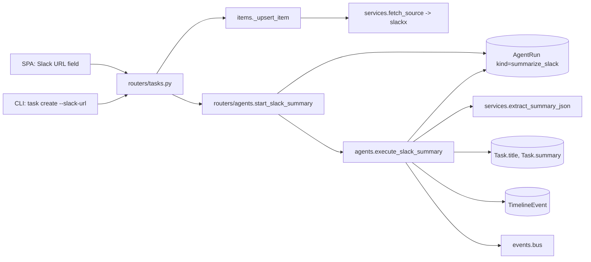
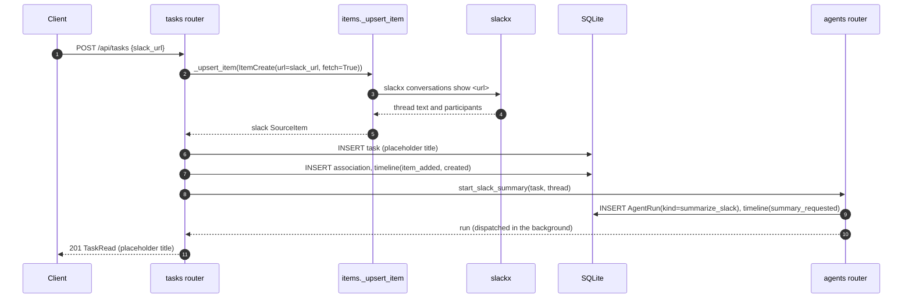
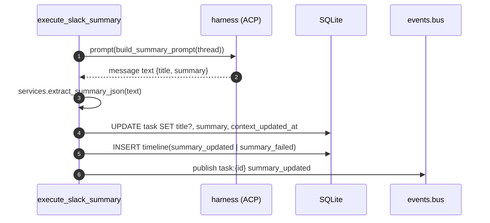

# Specification: Create a task from a Slack thread

## Overview

The feature is a second import path on the existing create-task endpoint, alongside the GitHub import.
The task router accepts a new optional `slack_url`.
When it is present, the router fetches the thread through the existing `_upsert_item` (which calls `slackx` via `services.fetch_source`) and associates the resulting `slack` item, then dispatches a background `summarize_slack` agent run.
The run hands the conversation to the harness and asks for a `{title, summary}` JSON object.
When it finishes, the executor writes the title (only if the user gave none) and the summary onto the task, and records the outcome on the timeline.
The SPA new-task modal gains a Slack URL field, and the CLI gains `task create --slack-url`.
A task imported from Slack can re-run the delegation from the task's Context panel (`POST /api/tasks/{id}/summary/refresh`), so a failed or interrupted import is recoverable.
On startup the backend also marks any run left `queued` or `running` by a previous process as failed (`agents.reconcile_orphaned_runs`), because runs live in-process and a restart (including a dev auto-reload) drops them silently.

## Architecture

## Data Models

No new table or column is introduced (NFR-2); the feature uses existing rows.

### TaskCreate (request, extended)

| Field | Type | Constraints | Description |
|---|---|---|---|
| slack_url | string \| null | optional | A Slack thread permalink; when set, the task is created from it (FR-1) |

### AgentRun (existing row, new kind)

| Field | Value | Description |
|---|---|---|
| kind | `summarize_slack` | Distinguishes the import delegation from `chat` and `refresh_context` |
| prompt | string | `services.build_summary_prompt(thread)`, the instructions plus the gathered conversation |
| cwd | string | Resolved by `_resolve_cwd` (active worktree, else a task repository, else the worktree root) |

### Task (existing columns written)

| Field | Written when | Description |
|---|---|---|
| title | The user supplied none | The agent's title; otherwise the user's title is kept (FR-3) |
| summary | The agent returned one | The agent's summary of the discussion |
| context_updated_at | With the summary | Marks the summary fresh, as a context refresh does |
| updated_at | Always | Advanced when the run writes back |

## API Contracts

No new endpoint is added; the create-task request gains one optional field.
The rest of the tasks API is unchanged and documented in [`p1-tasks/specification.md`](../p1-tasks/specification.md); the item fetch is documented in [`p2-source-items/specification.md`](../p2-source-items/specification.md).

| Method | Path | Change |
|---|---|---|
| POST | `/api/tasks` | Accepts `slack_url`; associates the fetched thread and dispatches the summary run |
| POST | `/api/tasks/{task_id}/summary/refresh` | Re-dispatches the summary run for the task's associated Slack thread (FR-10) |

Error codes shared with the rest of the API:

| Status | Code | Description |
|---|---|---|
| 400 | INVALID_INPUT | No title, `github_url`, or `slack_url` on create; no Slack thread to summarize on refresh |
| 404 | NOT_FOUND | Task not found |
| 502 | BAD_GATEWAY | (GitHub import only) the issue could not be read |

A failed Slack fetch does not raise: `_upsert_item` degrades to a URL-titled item, and the task is still created (FR-7).

## Web UI

| Component | Change | Requirements |
|---|---|---|
| `App.vue` (new-task modal) | A single "Import from GitHub or Slack" field that detects the source: a GitHub URL previews and prefills the title and description, a Slack URL is marked for the background agent; Create is enabled with a title, a GitHub URL, or a Slack URL | FR-5, NFR-4 |
| `ContextPanel.vue` | When the task has an associated Slack item, a **Name & summarize** button re-dispatches the summary run (`api.runs.refreshSummary`) | FR-10 |
| `api.js` | Adds `api.runs.refreshSummary(taskId)`; `api.tasks.create` posts the whole body, including `slack_url` | FR-5, FR-10 |

The modal keeps one import field; the source is detected from the pasted URL, so GitHub and Slack share the same input.
Leaving a GitHub preview for a Slack URL undoes the preview's auto-filled title and description (only where the user has not edited them), so the Slack import starts fresh and the agent can name the task.

`TaskView.vue` already reloads the task when it receives a `task` SSE event, so it picks up the title and summary when the run finishes (FR-4).

## Sequences

### Create a task from a Slack URL

### Title and summarize when the run finishes

## Non-Functional Considerations

- **Integration (NFR-1):** the fetch reuses `items._upsert_item` and `services.fetch_source`, so `slackx` is called exactly as the Items page calls it; no new dependency is added.
- **Data integrity (NFR-2):** only existing `Task` and `AgentRun` rows are written; there is no migration.
- **Consistency (NFR-3):** the router sets a non-empty placeholder title before the run so a task always has a title, even if the agent fails.
- **Usability (NFR-4):** the Slack field is a normal text input in the modal, which stacks to a single column at phone widths.
- **Security:** there is no authentication; the app assumes a trusted, single-user environment.

## Technical Decisions

| Decision | Choice | Rationale |
|---|---|---|
| Delegation timing | Background agent run, not a blocking request | Agent turns take 10-60s+; the app already runs harnesses in the background and streams results (FR-4) |
| Prompt output | A single JSON object `{title, summary}` | Reuses the parse-and-salvage approach of the context refresh (`extract_context_json`) |
| Parser | New `extract_summary_json`, sharing `_extract_json` with the context parser | One candidate/enumerate strategy; either key is enough, so a summary still lands when the title is missing |
| Title policy | Overwrite only when the user gave no title | A user's intent should not be silently replaced |
| Failure handling | On an unparseable reply, record `summary_failed` and keep the task; on an empty gather, skip the run and record the fetch failure | The item and the task are valuable even when naming fails (FR-7) |
| Run kind | `summarize_slack` | Keeps the delegation visible in a task's runs alongside `chat` and `refresh_context` |
| Orphaned runs | Reconcile on startup: `queued`/`running` rows become failed | Runs are in-process, so a restart drops them; without this the UI shows a dead session forever (FR-9) |
| Harness exit | `run_agent` also awaits the harness process and fails the turn if it exits first | A crashed harness otherwise leaves the prompt pending and the run hung |
| Retry | `POST /api/tasks/{id}/summary/refresh` plus a Context panel button | Recovers a failed or interrupted import without recreating the task (FR-10) |
| Prompt text | `services.build_summary_prompt(thread)` capped at 20k chars | Bounds the prompt while covering a realistic thread |

## Risks and Unknowns

1. If the task page is opened after the run finishes, the `summary_updated` SSE event is missed and the title lags until the next reload; a later refresh reconciles it.
2. The agent may return prose that `extract_summary_json` cannot salvage, leaving the placeholder title; the timeline records the failure for the user to correct.
3. A large thread is truncated at 20k characters, so the summary may miss late detail.
4. `slackx` may be absent or unauthenticated; the item falls back to its URL, no run is dispatched, and a `summary_failed` event records why the task is still just a link.

## Out of Scope

- Inferring a description or next steps during the import.
- Refreshing an existing task when the same Slack URL is re-imported (the item is de-duplicated, the task is not).
- Watching a Slack thread for new messages after the import.
- Summarizing a team's messages or a whole channel rather than one thread.
