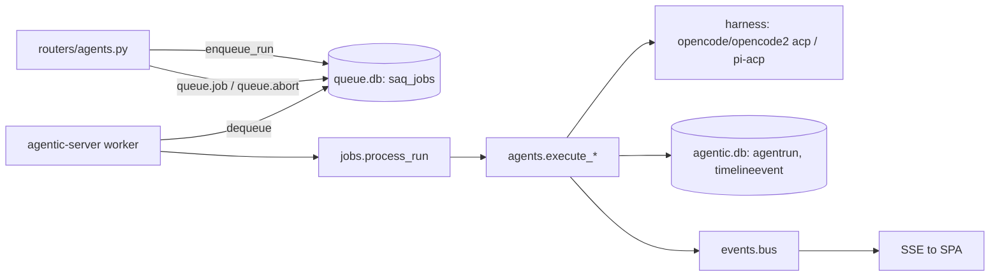
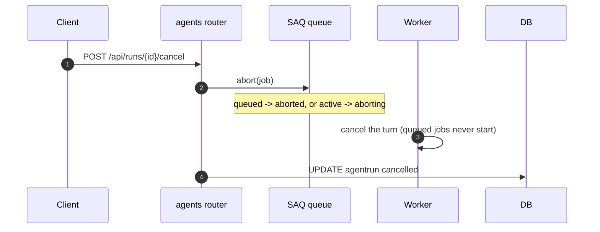
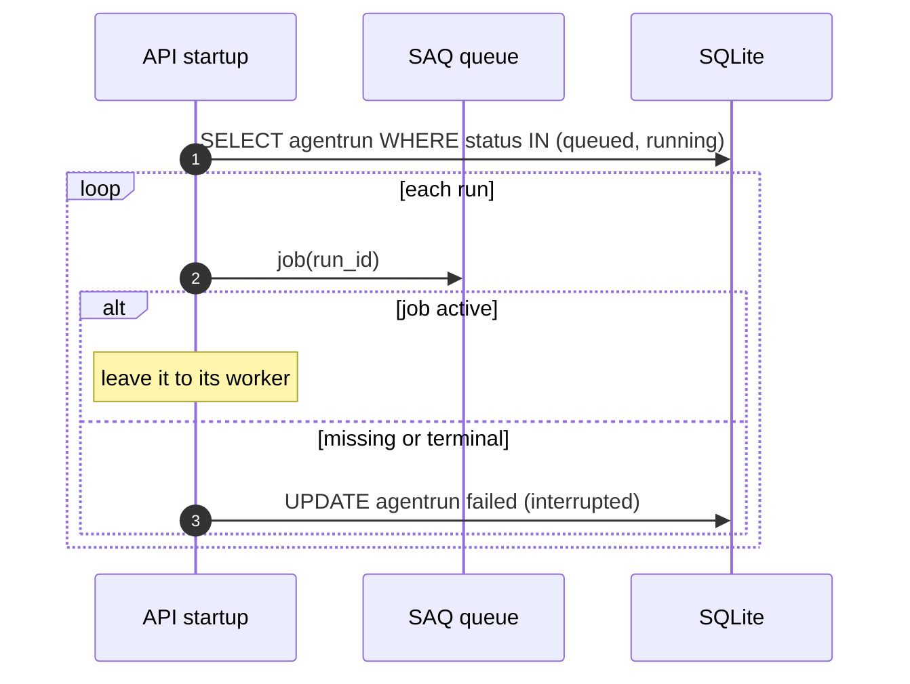

# Specification: Durable agent-run queue and worker

## Overview

`agentic.jobs` owns the queue. `enqueue_run(run_id)` writes a SAQ job keyed by the `AgentRun` id; `process_run(ctx, run_id)` is the worker entrypoint, dispatched by `run.kind` to the existing executors (`execute_run`, `execute_context_refresh`, `execute_slack_summary`).
The API never executes a run: it creates the `AgentRun` row, enqueues it, and lets a `agentic-server worker` process do the work.
The queue defaults to a SQLite file next to the application database, and its jobs are independent of the app schema.

## Architecture



## Data Models

No new application table or column is introduced (NFR-2).

### AgentRun (existing, status now mirrors the job)

| Field | Driven by | Description |
|---|---|---|
| status | `process_run` (running) and the executors (succeeded/failed/cancelled) | The run lifecycle |
| kind | creator | `chat`, `refresh_context`, or `summarize_slack`; selects the executor in `process_run` |
| cwd / prompt / harness_id | creator | Read back by the worker, so the job carries only the run id |
| session_id | `execute_run.record_session` | Written as soon as the harness session exists (created or resumed), so an interrupted run leaves a resumable handle |

### SAQ job (queue.db, framework-owned)

| Field | Value | Description |
|---|---|---|
| key | `AgentRun.id` | The mapping between a task and its job, so no side table is needed |
| function | `process_run` | The registered worker function |
| kwargs | `{"run_id": ...}` | The only payload |
| timeout / heartbeat / retries | settings | See Configuration |

## API Contracts

No new HTTP endpoint; the create-run, context-refresh, and summary-refresh endpoints now enqueue instead of executing. `/api/runs/{id}/cancel` aborts the job.

| Method | Path | Change |
|---|---|---|
| POST | `/api/tasks/{id}/runs` | Enqueues a `chat` job |
| POST | `/api/tasks/{id}/context/refresh` | Enqueues a `refresh_context` job |
| POST | `/api/tasks/{id}/summary/refresh` | Enqueues a `summarize_slack` job |
| POST | `/api/runs/{id}/cancel` | Aborts the job and marks the run cancelled |

## Configuration

| Setting | Env | Default | Meaning |
|---|---|---|---|
| queue_url | `AGENTIC_QUEUE_URL` | `sqlite:///<data_dir>/queue.db` | Queue backend |
| worker_concurrency | `AGENTIC_WORKER_CONCURRENCY` | 4 | Runs a worker processes at once |
| worker_sweep | `AGENTIC_WORKER_SWEEP` | 60 | Seconds between sweeps for a dead worker's job |
| job_timeout | `AGENTIC_JOB_TIMEOUT` | 0 (off) | Per-run timeout in seconds |
| job_heartbeat | `AGENTIC_JOB_HEARTBEAT` | 120 | Seconds before an untouched job is stuck |
| job_retries | `AGENTIC_JOB_RETRIES` | 1 | Automatic retries after failure or a dead worker |

## Sequences

### Enqueue and process a run

```mermaid
sequenceDiagram
    autonumber
    participant C as Client
    participant R as agents router
    participant Q as SAQ queue
    participant W as Worker
    participant DB as SQLite
    C->>R: POST /api/tasks/{id}/runs
    R->>DB: INSERT agentrun (queued)
    R->>Q: enqueue(key=run_id, function=process_run)
    R-->>C: 201 queued
    W->>Q: dequeue
    W->>DB: UPDATE agentrun running
    W->>DB: run the executor; persist events
    W->>Q: finish(COMPLETE | FAILED)
```

### Cancel



### Recover after a restart



## Non-Functional Considerations

- **Operability (NFR-1):** the SQLite backend needs no service; `make run` starts the API and worker together.
- **Data integrity (NFR-2):** the queue is a separate file; the app schema is untouched.
- **Reliability (NFR-3):** `job_heartbeat` plus SAQ's sweep retries a job whose worker died; the startup reconciliation fails any run whose job is gone.
- **Concurrency:** SAQ runs up to `worker_concurrency` jobs in one worker; multiple workers can share a queue.

## Technical Decisions

| Decision | Choice | Rationale |
|---|---|---|
| Library | SAQ, `tomzxforks/saq` `dev` branch, `saq[sqlite]` | The `dev` branch adds the SQLite backend and Python 3.14 support the project needs |
| Backend | SQLite by default | Keeps the app local-first with no external service |
| Placement | A separate worker process | SAQ's `Worker.start()` installs signal handlers, so embedding it in the API would fight uvicorn |
| Job identity | key = `AgentRun.id` | One job per run, no side table; cancel and reconcile look a run up directly |
| Payload | Only `run_id` | The worker re-reads the run, so a large prompt is not duplicated in the queue |
| Rename policy | Decided in the worker | `generate_title` is derived at run time from the task title, not stored |
| Recovery | Heartbeat + sweep + startup reconcile | A dead worker's job is retried; an orphaned run row is failed |
| Session handle | Recorded as soon as the session exists, resumed on retry | Keeps the conversation context across a crash instead of restarting the turn |
| Resume transport | ACP `session/resume` (not `session/load`) | `resume` continues the session without replaying its history; `load` replays it |
| Cancellation | `queue.abort` | Works across processes, unlike the old in-memory event |
| Event streaming | The run/task SSE endpoints replay and then poll the database | The worker is another process, so its in-process event bus cannot reach the API's subscribers; polling the persisted rows does |

## Risks and Unknowns

1. Two stores (the app database and the queue) can disagree briefly; `reconcile_runs` only runs at API startup, so a run orphaned while the API stays up waits for the worker's sweep.
2. SQLite is single-writer; the API and worker share one queue file over WAL with a busy timeout, which suits one machine but not a shared network filesystem.
3. The dependency pins a fork; it must be kept in sync with upstream or replaced when the SQLite backend lands upstream.
4. Runs now require a worker to make progress; forgetting to start one leaves runs queued.

## Out of Scope

- Scheduling (SAQ cron) and delayed jobs.
- Per-task serialization (`group_key`) so two runs on one task cannot overlap.
- A queue metrics/admin UI.
- Retrying a run automatically more than once.
