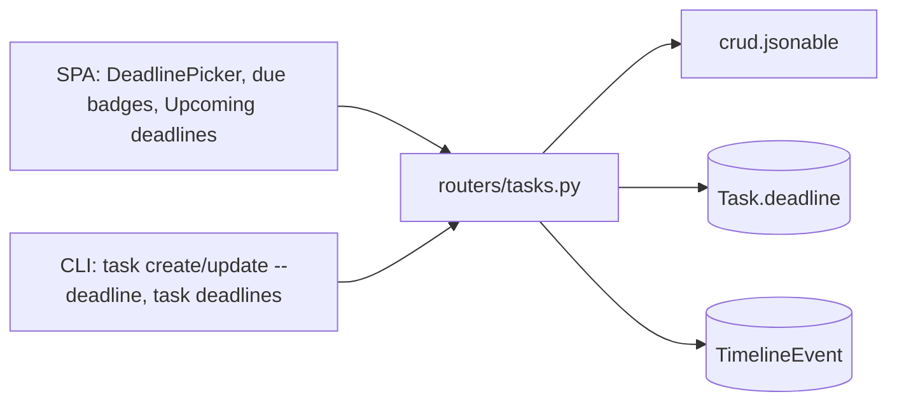
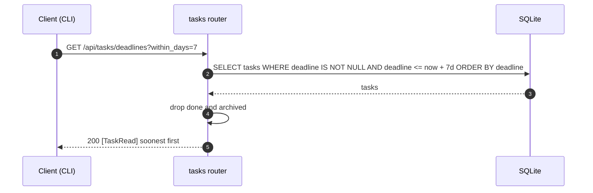
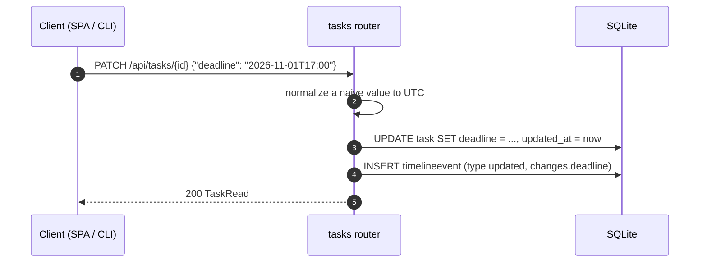

# Specification: Task deadlines

## Overview

A deadline is a new nullable `deadline` column on the `Task` row, so no new table is introduced and an existing database gains the column through `db._ensure_columns()`.
The tasks router accepts `deadline` on create and update (setting or clearing it), normalizes a timezone-naive value to UTC, records the change on the timeline like any other field, and serves the upcoming deadlines through `GET /api/tasks/deadlines`.
The SPA adds a `DeadlinePicker` (an inline datetime editor) used on the task header and the new-task form, a due-state badge on task rows, and an "Upcoming deadlines" section on the tasks page whose window can be widened.
The CLI adds `--deadline` / `--clear-deadline` to `task create` and `task update`, and a `task deadlines` command.

## Architecture

## Data Models

### Task.deadline (new column)

| Field | Type | Constraints | Description |
|---|---|---|---|
| deadline | datetime, nullable | UTC | When the task should be done by; `null` means no deadline |

Added by `db._ensure_columns()` as `ALTER TABLE task ADD COLUMN deadline DATETIME` for existing databases; a fresh database gets it from `create_all`.

### Deadline state (derived, not persisted)

The web app derives a label and tone from the deadline relative to now, by calendar day.

| Field | Type | Description |
|---|---|---|
| overdue | bool | The deadline is in the past |
| tone | string | Badge tone: `danger` (overdue), `warn` (today or tomorrow), or empty |
| label | string | Human text: `Overdue`, `Overdue <n>d`, `Due today`, `Due tomorrow`, or `Due in <n>d` |

## API Contracts

The tasks API is documented in [`p1-tasks/specification.md`](../p1-tasks/specification.md); this feature adds one endpoint and one field.

| Method | Path | Purpose |
|---|---|---|
| GET | `/api/tasks/deadlines?within_days=<n>` | In-flight tasks with a deadline at or before now plus `within_days`, soonest first (overdue included) |
| POST | `/api/tasks` | Create a task; accepts an optional `deadline` |
| PATCH | `/api/tasks/{task_id}` | Update a task; `deadline` sets it, an explicit `null` clears it |

Shared error codes:

| Status | Code | Description |
|---|---|---|
| 400 | INVALID_INPUT | Missing title and no GitHub/Slack URL on create |
| 404 | NOT_FOUND | Task not found |
| 422 | VALIDATION_ERROR | The deadline is not a parseable date or date-time |

A deadline with no timezone is read as UTC, so the column always holds an aware datetime.

## Web UI

| Component | Change | Requirements |
|---|---|---|
| `DeadlinePicker.vue` (new) | Inline datetime editor: shows the deadline with its due-state badge, opens a `datetime-local` input, and clears the deadline. A new deadline defaults to today at 17:00 so only the date needs picking; Enter confirms the shown value, and clicking away without a change cancels | FR-3, FR-4 |
| `TaskView.vue` | Renders `DeadlinePicker` in the task header; saving calls `PATCH /api/tasks/{id}` with the new value; the command palette can jump to it | FR-3 |
| `TasksView.vue` | An "Upcoming deadlines" section above the in-flight list (soonest first, overdue leading, window selector) plus a due-state badge on each in-flight row | FR-4 |
| `App.vue` | The new-task form includes a `DeadlinePicker`; the palette gains a "Set deadline" entry for the current task | FR-3 |
| `store.js` | `deadlineInfo(iso, now)` derives the label and tone; `formatDeadline(iso)` renders it in local time | FR-4 |

The SPA computes the "Upcoming deadlines" section from the tasks it has already loaded (like the tag filter), using the same window rule as the endpoint; it does not call the endpoint, which serves the CLI.

## Sequences

### List upcoming deadlines

### Set or clear a deadline

## CLI

| Command | Behavior | Requirements |
|---|---|---|
| `agentic task create --deadline <when>` | Sets the deadline on the new task | FR-5 |
| `agentic task update <task> --deadline <when>` | Sets or changes the deadline | FR-5 |
| `agentic task update <task> --clear-deadline` | Clears the deadline (sends an explicit null) | FR-5 |
| `agentic task deadlines [--within-days <n>]` | Lists the upcoming deadlines, overdue first (default 7 days) | FR-5 |

`task list` and `task deadlines` append `due <iso>` to each line that carries a deadline.
