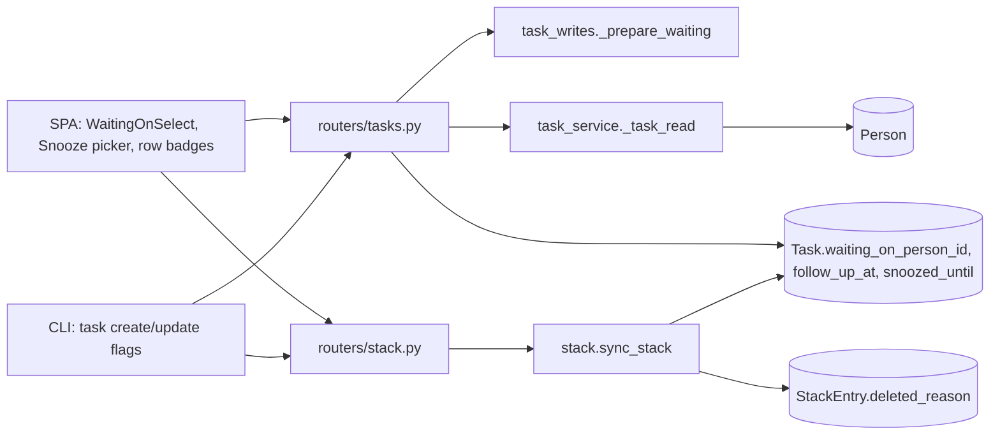
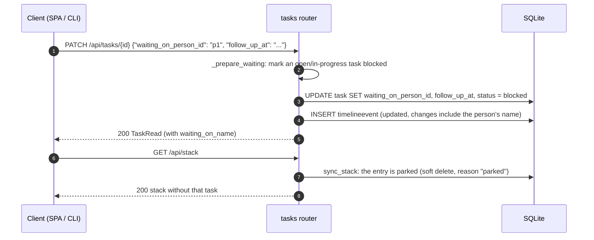
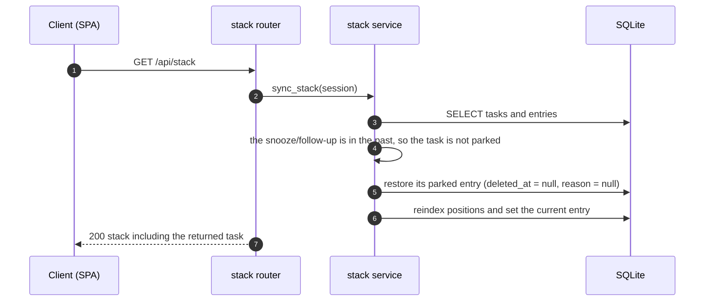

# Specification: Waiting on a person and snoozing a task

## Overview

Three nullable `Task` columns carry the deferrals: `waiting_on_person_id` (FK `person.id`), `follow_up_at`, and `snoozed_until`.
A fourth nullable `StackEntry.deleted_reason` records why an entry left the stack (`popped`, `removed`, or `parked`), so a parking can be undone without confusing it with a deliberate pop or removal.
`stack.sync_stack()` owns the whole rule: a parked task's entry is soft-deleted with reason `parked`, and the same entry is restored when the date passes.
The task writer keeps the wait and the status coherent (waiting marks an open task blocked, clearing it reopens), and the SPA adds a waiting/follow-up control and a snooze control on the task page plus badges on task and stack rows.
The CLI adds the matching flags to `task create` and `task update`.

## Architecture

## Data Models

### Task.waiting_on_person_id, Task.follow_up_at, Task.snoozed_until (new columns)

| Field | Type | Constraints | Description |
|---|---|---|---|
| waiting_on_person_id | varchar, nullable | FK `person.id` | Who the task waits on; `null` means it is not waiting |
| follow_up_at | datetime, nullable | UTC | When to check back with that person; `null` means no check-back date, so the wait has no end until cleared |
| snoozed_until | datetime, nullable | UTC | When the task returns to the stack; a date in the past has no effect |

Added by `db._ensure_columns()` as `ALTER TABLE task ADD COLUMN ...` for existing databases; a fresh database gets them from `create_all`.
Deleting the person clears `waiting_on_person_id` and `follow_up_at` for the tasks waiting on them (the FK would otherwise block the delete).
Merging a person into another moves `waiting_on_person_id` to the target.

### StackEntry.deleted_reason (new column)

| Field | Type | Description |
|---|---|---|
| deleted_reason | varchar, nullable | `popped`, `removed`, or `parked`; rows written before the column existed read as `null` |

### Parked state (derived, not persisted)

`stack.parked_reason(task, now)` returns why a task is off the stack, or `null` when it belongs on it.
The SPA mirrors the rule in `parkedInfo(task, now)`.

| Condition | Result |
|---|---|
| `snoozed_until > now` | `snoozed` |
| `waiting_on_person_id` set and `follow_up_at` is null or `> now` | `waiting` |
| otherwise | `null` (not parked) |

A waiting person stays on the task after the follow-up date passes, so the UI keeps naming them; only the parking ends.

## API Contracts

The task and stack APIs are documented in [`p1-tasks/specification.md`](../p1-tasks/specification.md); this feature adds fields to existing payloads and changes the stack's behavior.

| Method | Path | Change |
|---|---|---|
| POST | `/api/tasks` | Accepts `waiting_on_person_id`, `follow_up_at`, `snoozed_until` |
| PATCH | `/api/tasks/{task_id}` | Sets or clears the three fields (an explicit `null` clears) |
| GET | `/api/tasks`, `/api/tasks/{task_id}` | Return the three fields plus `waiting_on_name` |
| GET | `/api/stack` | A parked task is absent; a passing deferral returns it to the stack |
| GET | `/api/stack/current` | Syncs the stack first, so an expired deferral can become current |
| GET | `/api/stack/history` | Excludes entries deleted because they parked |
| POST | `/api/stack` | Pushing a parked task clears its snooze and wait and reopens a blocked task |

Worked rules:

- Setting `waiting_on_person_id` on a task that is `open` or `in_progress` sets `status: blocked`; clearing it clears `follow_up_at` and turns a `blocked` task `open`.
- An explicit `status` in the same request wins over both rules.
- Setting, changing, or clearing any field records an `updated` timeline event with the before and after values; the waiting person is recorded with their name (`field_label` reads "waiting on", "follow up", "snoozed until").
- A deferral date with no timezone is read as UTC.

Shared error codes:

| Status | Code | Description |
|---|---|---|
| 404 | NOT_FOUND | Task not found, or the waiting person does not exist |
| 422 | VALIDATION_ERROR | A date is not parseable |

## Web UI

| Component | Change | Requirements |
|---|---|---|
| `WaitingOnSelect.vue` (new) | Shows the waiting person as a chip with a clear action, or a person picker; once a person is set, a "check back" `DeadlinePicker` appears | FR-1, FR-8 |
| `TaskView.vue` | New "Waiting on" and "Snooze" properties; each edit is a `PATCH /api/tasks/{id}` of one field; the palette can jump to both | FR-8 |
| `DeadlinePicker.vue` | `showState` prop hides the due-state badge for a field that is not a due date (a snooze, a check-back date) | FR-8 |
| `TaskCard.vue` | A "Snoozed until …" badge, a "Waiting on <name>" badge (danger when the follow-up is due), and the check-back date beside it | FR-8 |
| `StackList.vue` | A "Waiting on <name>" badge on a stack row whose task still names a person | FR-8 |
| `store.js` | `snoozeInfo(task, now)`, `waitingInfo(task, now)`, and `parkedInfo(task, now)` derive the badges and mirror the server's parking rule | FR-3, NFR-3 |

Parked tasks remain on the tasks page (they are still in flight) and are only absent from the focus stack.
A snooze in the past shows no badge and does not park.

## Sequences

### Park on a waiting-on edit

### A deferral ends

## CLI

| Command | Behavior | Requirements |
|---|---|---|
| `agentic task create --waiting-on <person> [--follow-up <when>]` | Creates the task already waiting | FR-9 |
| `agentic task create --snooze <when>` | Creates the task already snoozed | FR-9 |
| `agentic task update <task> --waiting-on <person> [--follow-up <when>]` | Waits on that person until that date | FR-9 |
| `agentic task update <task> --clear-waiting` | Stops waiting and clears the follow-up date | FR-9 |
| `agentic task update <task> --snooze <when>` | Snoozes until that date | FR-9 |
| `agentic task update <task> --clear-snooze` | Clears the snooze | FR-9 |

`task list` and `task show` append `waiting on <name>` (with `check back <when>` when set) and `snoozed until <when>` when the snooze is still in the future.

The waiting person is a person id, the same identifier the rest of the CLI uses for people.
