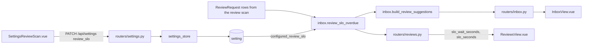
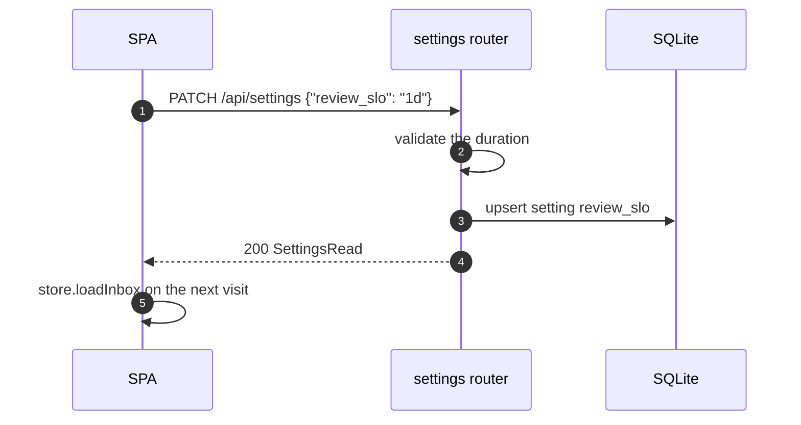
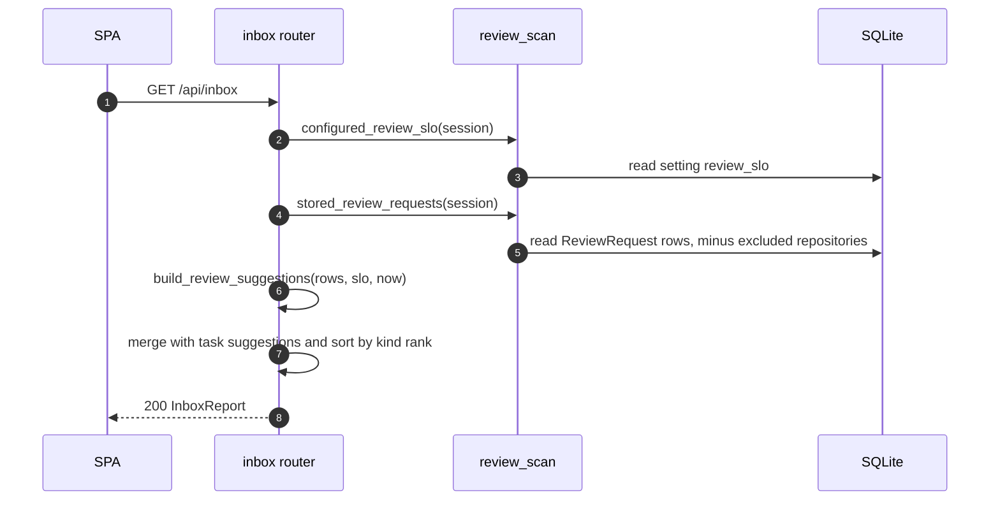

# Specification: Review SLO

## Overview

The review SLO is one overridable setting, `review_slo`, parsed as a duration.
The inbox reads the review scan's stored `ReviewRequest` rows, keeps the ones still awaiting the user's review, and offers each whose `ready_for_review_at` (or `first_seen_at` when the timeline has no ready event) is older than the SLO.
`review_slo_overdue` holds that rule once; the review queue calls it too, so a row the inbox offers is highlighted there, with a colored edge whose tooltip gives the reason.
No table or column is added, and neither the inbox nor the queue stores anything.

## Architecture



## Data Models

### Setting `review_slo` (existing table)

| Field | Type | Description |
|---|---|---|
| key | varchar | `review_slo` |
| value | varchar | A duration such as `8h` or `1d`; empty or `off` disables it |

Added to `OVERRIDABLE_KEYS` and `env_defaults`; the environment fallback is `AGENTIC_REVIEW_SLO`.
The Settings page override wins over the environment value.

### ReviewRequest (existing table, read only)

| Field | Use |
|---|---|
| `repository`, `number`, `title`, `url` | Identify and link the pull request in the suggestion |
| `source` | Only `requested` counts; `reviewed` is a pull request the user already reviewed |
| `draft` | A draft is not ready for review and is left out |
| `state` | Only `OPEN` (or unread) counts; a stale `MERGED`/`CLOSED` row is left out |
| `ready_for_review_at` | The start of the wait: the latest `ready_for_review` event in the pull request's timeline, read during the requested search |
| `first_seen_at` | The fallback start when the timeline has no ready event; it survives across scans |

The wait is `now - (ready_for_review_at or first_seen_at)`, with a naive stored value read as UTC.
The suggestion is produced when the wait is strictly greater than the SLO.
`ready_for_review_at` comes from the scan, not from `first_seen_at`, so a scan that drops and re-adds a row (an empty cache, a failed search) keeps the true wait.

## API Contracts

| Method | Path | Change |
|---|---|---|
| GET | `/api/settings` | `review_slo` appears in `effective`, `overrides`, and `defaults` |
| PATCH | `/api/settings` | Accepts `review_slo`; a non-empty malformed duration is a 422 naming the field |
| GET | `/api/inbox` | Adds `review_pr_past_slo` suggestions |
| GET | `/api/reviews` | A row past the SLO carries `slo_wait_seconds` and `slo_seconds`; both are null otherwise |
| GET | `/api/reviews/scan` | Unchanged; the scan still supplies the rows |

An inbox suggestion for a review has no task:

```json
{
  "id": "review_pr_past_slo:o/r:42",
  "kind": "review_pr_past_slo",
  "reason": "Has awaited your review for 2d 3h; the SLO is 1d.",
  "task_id": null,
  "task_title": "",
  "task_status": "",
  "repository": "o/r",
  "number": 42,
  "title": "Fix the thing",
  "url": "https://github.com/o/r/pull/42",
  "actions": [
    {
      "id": "open:o/r:42",
      "kind": "open_url",
      "label": "Review PR",
      "url": "https://github.com/o/r/pull/42"
    }
  ]
}
```

Shared error codes:

| Status | Code | Description |
|---|---|---|
| 422 | VALIDATION_ERROR | `review_slo` is not a duration and is not blank |

## Web UI

| Component | Change | Requirements |
|---|---|---|
| `SettingsReviewScan.vue` | A **Review SLO** field, saved on blur, with the same duration grammar and a blank to disable it | FR-1, FR-7 |
| `InboxView.vue` | A **Reviews past SLO** section listed first; a non-task row links its title and its **Review PR** action to the pull request | FR-5, FR-8 |
| `InboxSuggestion` schema | `task_id`, `task_title`, and `task_status` become optional; `repository`, `number`, `title`, and `url` are added | FR-5 |
| `InboxAction` schema | `task_id` becomes optional and `url` is added, carrying the `open_url` target | FR-5 |
| `ReviewsView.vue` | A tinted row with a colored edge on its first cell, the wait and SLO in the edge's hover tooltip, and a `N past SLO` total in the header while any filtered row is highlighted | FR-9 |

The review row is an anchor, not a form button, so it opens GitHub in a new tab and needs no API call.

## Sequences

### An SLO is set



### The inbox is read



## Rules

- `review_slo` uses the same duration grammar as the other duration settings, so `30m`, `1h`, `1d`, `2w`, `off`, and blank all behave as they do elsewhere.
- A suggestion is offered only when the wait is greater than the SLO; exactly at the SLO does not count.
- The wait starts at the latest `ready_for_review` event, which is when the current review round began; a re-request after a draft does not reset it, but converting the pull request back to ready does.
- `first_seen_at` is not reset by a scan, but it is the fallback, not the SLO's primary clock: a pull request with a ready event keeps its true wait even if the row is dropped and re-added.
- The suggestion carries no task even when a task links the pull request; linking it to a task is left to the user.
- The queue judges a row's draft flag and state from the row's live values (ghx or its tracked item), not the scan row's snapshot, so a draft that became ready is marked once it is past the wait.
- A row with no scan row has neither timestamp, so it is never marked: the wait needs the scan's timeline date (or its first sighting).
