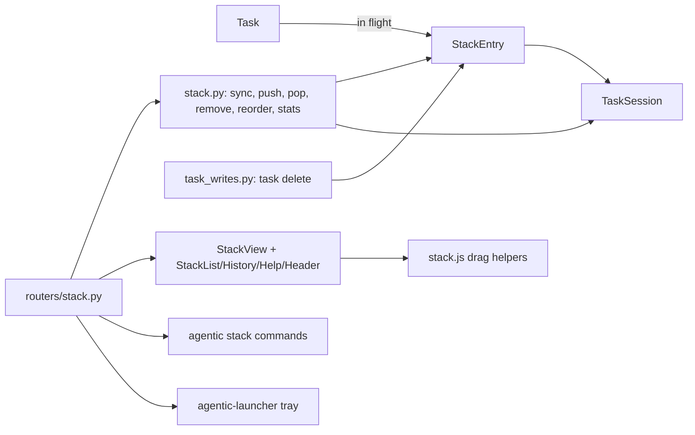
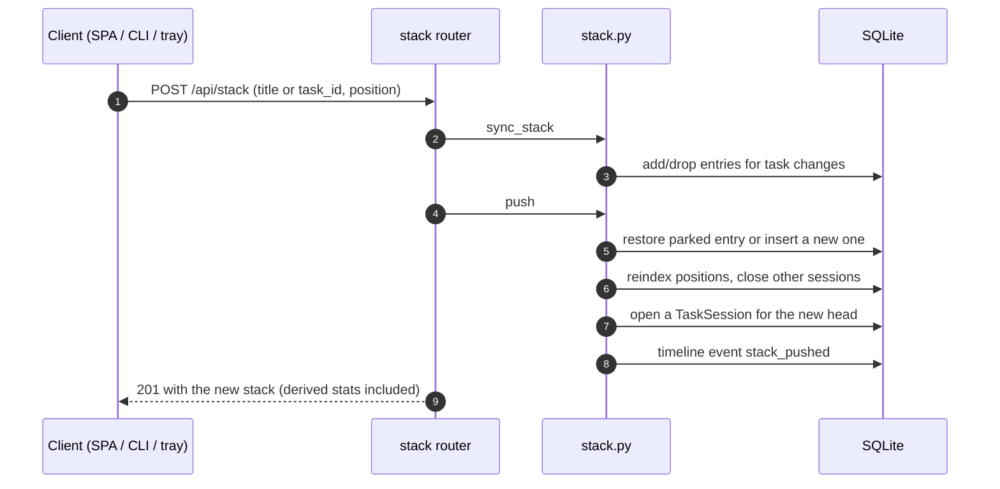
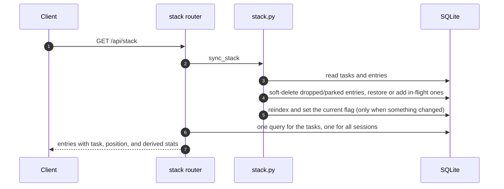

# Specification: Focus stack and launcher

## Overview

The backend owns the queue: `models/tasks.py` defines a `StackEntry` (a task's place on the stack) and a `TaskSession` (one stretch of focus), and `stack.py` is the service that materializes, mutates, and measures it.
Every task that is open, in progress, or blocked and is not parked belongs on the stack; a read or a mutation first runs `sync_stack`, which adds never-stacked in-flight tasks at the bottom, drops entries whose task left the in-flight statuses or became parked, and restores a parked entry when its deferral ends.
Becoming current opens a session and losing the focus closes one; the read models derive `execution_count` and `duration` from those sessions instead of storing counters.
Pop and remove soft-delete entries so `history` survives, and `routers/stack.py` exposes the whole surface over `/api/stack`.
Three clients share it: the SPA's Stack page, the `agentic stack` CLI commands, and the `agentic-launcher` workspace package, a tray companion with a global hotkey and a Mark Done action.

## Architecture

- `backend/src/agentic/stack.py`, the service: `sync_stack`, `push`, `pop`, `remove`, `reorder`, `promote`, `update_entry`, `current_entry`, `active_entries`, `history_entries`, `entry_stats`, and the parking helpers `parked_reason` and `is_parked`.
- `backend/src/agentic/routers/stack.py`, the FastAPI router; every endpoint calls `sync_stack` first, so the stack is materialized lazily on access.
- `backend/src/agentic/schemas/stack.py`, the request and response models.
- `frontend/src/views/StackView.vue` with `StackList.vue`, `StackHeader.vue`, `StackHistory.vue`, `StackHelp.vue`, plus `stack.js` (drag midpoint math, array move, progressive timestamps).
- `cli/src/agentic_cli/commands/stack.py`, the CLI surface, rendered through `render._stack_line`.
- `launcher/` (package `agentic-launcher`, console script `agentic-stack`): `app.py` (tray and listener), `hotkey.py` (spec parser), `_hotkey_subprocess.py` (macOS listener), `client.py` (httpx), `opener.py` (app-window detection), `icon.py`, `macos_permissions.py`.

## Data Models

### StackEntry

| Field | Type | Constraints | Description |
|---|---|---|---|
| id | string | PK | Entry id |
| task_id | string | FK task, index, not null | The task on the stack |
| position | int | default 0, index | 0 is the current task |
| is_current | bool | default false | True for the head of the stack |
| created_at | datetime | not null | When the entry was created |
| deleted_at | datetime | nullable | Set when the entry left the stack |
| deleted_reason | string | nullable | popped, removed, or parked |

### TaskSession

| Field | Type | Constraints | Description |
|---|---|---|---|
| id | string | PK | Session id |
| stack_entry_id | string | FK stackentry, index, not null | The focused entry |
| started_at | datetime | not null | When the entry became current |
| ended_at | datetime | nullable | Open while the entry is current |

Derived stats (never stored on the entry):

| Field | Derivation |
|---|---|
| started_at | The first session's start |
| last_current | The last session's end, or its start while it is still open |
| duration | The sum of the closed sessions plus the elapsed time of the open one |
| execution_count | The number of sessions |

## Materialization and removal reasons

`sync_stack` runs on every stack read and mutation:

| Rule | Behavior |
|---|---|
| In flight | Status open, in_progress, or blocked (`IN_FLIGHT_STATUSES`) |
| Parked | `snoozed_until` in the future, or `waiting_on_person_id` set with a future or absent follow-up date |
| Dropped | An active entry whose task is missing or not in flight is soft-deleted with no reason; a parked task's entry is soft-deleted with reason `parked` |
| Added | An in-flight, not parked task with no entry joins at the bottom; a task whose latest entry left as `parked` restores that entry (sessions and count survive) |
| Re-added | A task whose entry was popped or removed stays off the stack until it is pushed again |
| Rebalanced | After a change, positions are re-indexed 0..n-1 and the head is flagged current (closing other sessions, opening one for the new head) |

History rules:

| Rule | Behavior |
|---|---|
| Listed | Entries with `deleted_at` set, most recently removed first |
| Excluded | Entries with reason `parked`, because a parked task is still in flight |
| Purged | Deleting a task deletes its sessions and entries in explicit FK-safe order (`task_writes.py`) |

## API Contracts

| Method | Path | Purpose |
|---|---|---|
| GET | /api/stack | The stack, current task first (materializes first) |
| GET | /api/stack/history | Soft-deleted entries, most recently removed first |
| GET | /api/stack/current | The current entry, or null when the stack is empty |
| POST | /api/stack | Push a new task (title) or an existing task (task_id) at top, next, or last |
| POST | /api/stack/pop | Mark the current task done, soft-delete its entry, promote the next |
| POST | /api/stack/reorder | Move an entry to a position |
| POST | /api/stack/{entry_id}/promote | Move an entry to position 0 |
| PATCH | /api/stack/{entry_id} | Edit the task behind an entry (title, description) |
| DELETE | /api/stack/{entry_id} | Soft-delete an entry (the task is kept) |

Request bodies: `StackPush` (title, description, task_id, position), `StackReorder` (entry_id, position), `StackEntryUpdate` (title, description).
Every mutation returns the full stack except `DELETE` (204) and `GET /current` (one entry or null).

`StackEntryRead` fields: `id`, `task_id`, `task` (a `TaskRead` or null), `position`, `is_current`, `created_at`, `deleted_at`, and the derived `started_at`, `last_current`, `duration`, `execution_count`.

Status codes: 201 on push; 204 on delete; 400 for a push with a blank title and no task_id; 404 for an unknown task_id or entry; 409 for a task already on the stack.

CLI mapping (`agentic stack ...`): `list`, `current`, `history`, `push --title/--task-id --position`, `pop`, `promote ENTRY`, `reorder ENTRY POSITION`, `edit ENTRY --title/--description`, `remove ENTRY`, where ENTRY is a stack entry id.

Launcher behavior (`agentic-stack`, package `agentic-launcher`):

| Concern | Behavior |
|---|---|
| Tray | pystray icon with the current task title as tooltip and a stack depth badge; refreshed every 30 s |
| Menu | Current task (disabled), Open Stack (with hotkey label), Mark Done (pop, disabled when empty), Quit |
| Hotkey | `AGENTIC_STACK_HOTKEY` spec (default `ctrl+shift+t`); an invalid spec warns and falls back to the default |
| Opening | `AGENTIC_STACK_OPEN` template, else a detected Chromium browser launched with `--app=` and the URL, else the default browser |
| macOS | The pynput listener runs in a subprocess that prints `FIRE` lines and exits when the parent dies; first run prompts for Accessibility and Input Monitoring and reports Secure Input |
| Config | `AGENTIC_API_URL` (default `http://127.0.0.1:8600`), `AGENTIC_STACK_URL` (default: the API URL with /stack appended), `AGENTIC_STACK_DEBUG_HOTKEY` |

## Sequences

### Push and the session lifecycle

### Read-time materialization

## Technical Decisions

| Decision | Choice | Rationale |
|---|---|---|
| Queue source | Materialize the stack from task statuses on access | No add-by-hand bookkeeping, and the queue cannot drift from the task list |
| Focus time | `TaskSession` rows instead of stored counters | Counters drift; sessions also answer "how many times" (NFR-1) |
| Removal | Soft delete with a reason | History survives, and a parked entry can be restored with its sessions intact |
| Park | A deferral is a soft delete excluded from history | A waiting or snoozed task is still in flight, so it is not "removed" |
| Sync timing | Lazy, inside each stack endpoint | Task mutations need no second write path to keep the stack in step |
| Launcher | A separate workspace package (tray plus global hotkey) | A browser cannot own a global hotkey or a tray icon |
| macOS hotkey | The pynput listener in a subprocess | Sharing the AppKit runloop with the tray crashes inside CFRunLoop |
| Open behavior | Chromium `--app=` window, then a command template, then the default browser | Closest to a native window while keeping the deep link to /stack |

## Risks and Unknowns

1. `sync_stack` loads every task on each stack read; the cost grows with the task count and is acceptable only at single-user scale.
2. A session left open by a crash is closed at the next focus change, so that stint's duration overstates the time.
3. The launcher has no automated tests; pystray and pynput need a desktop session, so it is verified by hand.
4. The parked-entry restore path assumes one entry per task; a task with several soft-deleted entries reuses only the latest parked one.

## Out of Scope

- The task page, the Gantt view, and the wider task lifecycle (separate features).
- The process view that reads `TaskSession` for throughput, documented with its own feature.
- Remote or multi-user access to the launcher and its HTTP client.
- Native app packaging of the PWA beyond the browser app window and the tray.
