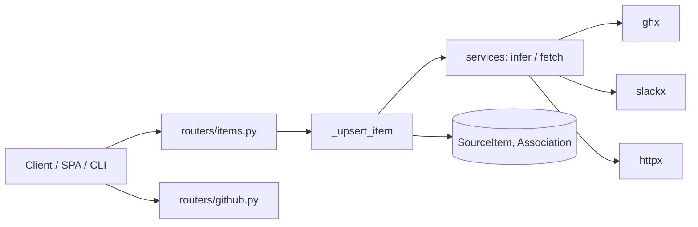
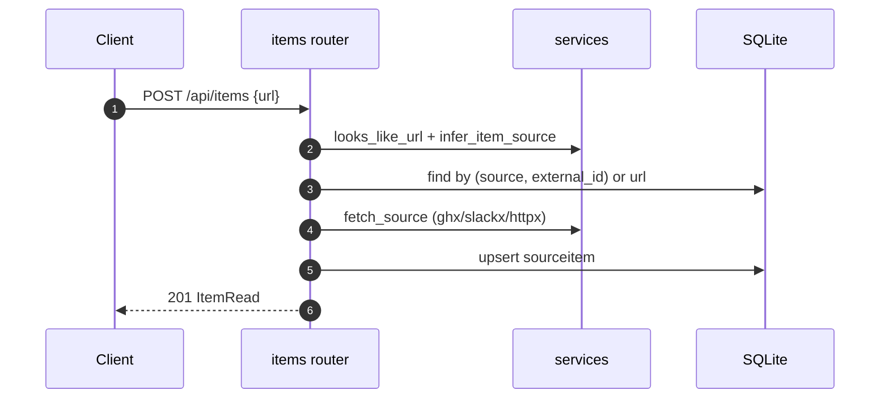

# Specification: Source items, associations, and GitHub import

## Overview

Items are served by `routers/items.py`.
The shared upsert helper `_upsert_item` infers source, kind, and external id, deduplicates, and optionally fetches content.
`services.py` holds the parsing (`parse_github`, `parse_slack`, `GOOGLE_DOC_RE`), classification (`looks_like_url`, `infer_item_source`), and fetching (`fetch_source` plus the `ghx`/`slackx`/HTTP helpers).
GitHub import is served by `routers/github.py`, which lists and fetches issues through `services.list_github_issues` and `services.fetch_github_issue`.

## Architecture

## Data Models

### SourceItem

| Field | Type | Constraints | Description |
|---|---|---|---|
| id | string | PK | Item id |
| source | string | not null | slack, github, gdrive, url, note, commit, file |
| kind | string | default "" | thread, issue, pr, doc, ... |
| title | string | default "" | Display title |
| url | string | nullable | Link when the value is a URL |
| external_id | string | nullable | Dedup key (for example `o/r#42`) |
| metadata_json | JSON | default {} | Fetched metadata |
| content | string | default "" | Pulled text |
| fetched_at | datetime | nullable | Last fetch |

Unique constraint on `(source, external_id)`.

### Association

| Field | Type | Constraints | Description |
|---|---|---|---|
| id | string | PK | Link id |
| task_id | string | FK task, index | Owning task |
| item_id | string | FK sourceitem, index | Linked item |
| note | string | default "" | Optional note |

## API Contracts

The normative contract is in [`api.yaml`](api.yaml) once written; the table below is the summary.

| Method | Path | Purpose |
|---|---|---|
| GET | /api/items | List items (filter: source) |
| POST | /api/items | Create or upsert an item |
| GET | /api/items/{item_id} | Read an item |
| PATCH | /api/items/{item_id} | Update an item |
| POST | /api/items/{item_id}/refresh | Re-fetch content |
| DELETE | /api/items/{item_id} | Delete an item and its associations |
| POST | /api/tasks/{task_id}/items | Associate an item (existing or inline) |
| DELETE | /api/tasks/{task_id}/items/{item_id} | Unassociate an item |
| GET | /api/github/issue | Fetch one issue or PR by URL |
| GET | /api/github/issues | List a repository's issues |

## Sequences

### Create with inferred source and fetch

## Technical Decisions

| Decision | Choice | Rationale |
|---|---|---|
| Source inference | Regex parsers per source, with a bare-domain check | Lets callers omit the source entirely |
| Non-URL text | Stored as a note in `content` | Avoids storing and rendering a bogus link |
| Fetch safety | `fetch_source` catches all exceptions | A network or CLI failure must not block capture |
| GitHub access | Always through `ghx`, never `gh` | Consistent JSON shape and repo selection |

## Risks and Unknowns

1. Fetching depends on external CLIs; when they are absent the item is stored without content.
2. The GitHub list endpoint caps at 100 issues per call.

## Out of Scope

- OAuth, webhooks, or continuous sync for any source.
- Rich rendering of fetched content (only text is stored).
