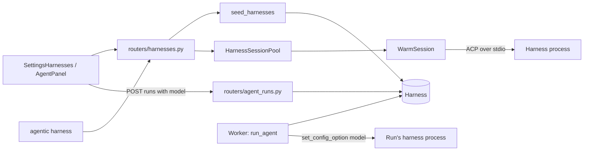
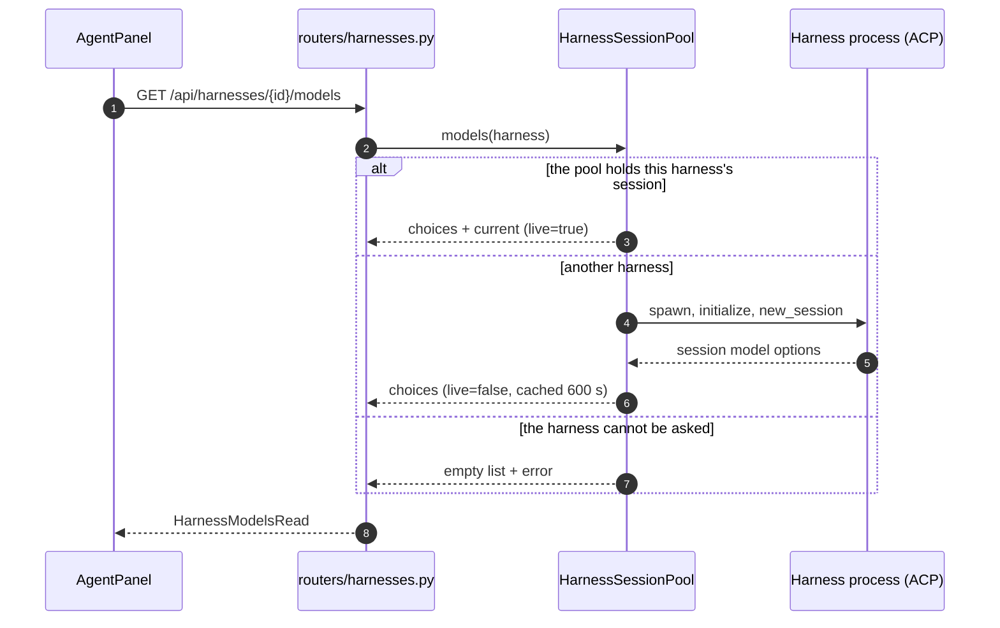
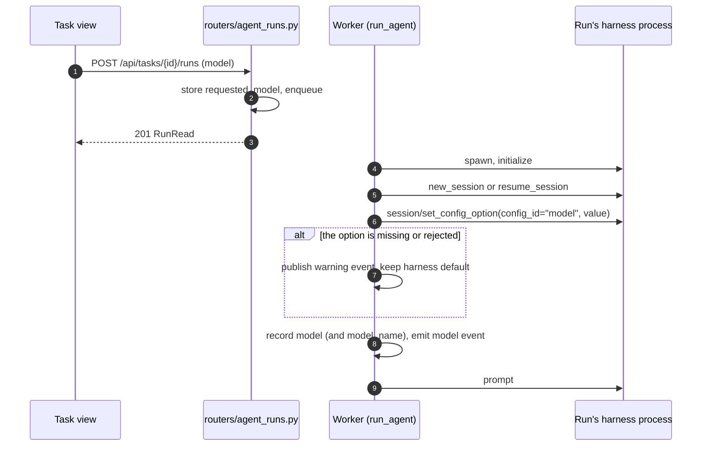

# Specification: Agent harnesses and model selection

## Overview

A `harness` table row describes one coding agent: how to spawn it over ACP (command, args, env), how to resume one of its sessions in a terminal (`resume_command`), which model to ask it for (`model`), and where its own default model is configured (`default_model_source`).
`agents/harnesses.py` seeds the built-in presets, picks and protects the single default (guarded by the `harness_default_seeded` setting), resolves a harness for a run, checks availability on PATH, and reads a harness's config file for its default model.
`agents/pool.py` holds one warm ACP session for the default harness, started in the API lifespan, for introspection only (the model picker); it is gated by `AGENTIC_WARM_HARNESS_SESSION`.
`agents/runner.py` applies the model to a run's own session with the ACP `session/set_config_option` request and records what answered.
`routers/harnesses.py` exposes CRUD, availability, the default model display, and the per-harness models endpoint.
The Settings page edits harnesses, the task view's run panel picks harness and model per run, and the CLI offers `agentic harness` commands.

## Architecture

The pool's session is never used to run prompts.
A run always spawns its own harness process in the worker, so a run survives an API restart.

## Data Models

### Harness

| Field | Type | Constraints | Description |
|---|---|---|---|
| id | string | PK | Preset id (`opencode`, `opencode2`, `pi`) or a generated id |
| name | string | not null | Display name |
| description | string | default "" | What this harness is |
| command | string | not null | Executable to spawn (`opencode`, `pi-acp`, ...) |
| args | list | JSON column, default [] | Command arguments, typically `["acp"]` |
| env | dict | JSON column, default {} | Extra environment for the process |
| model | string | nullable | The model a run asks this harness for |
| default_model_source | string | nullable | `<json file>#<template>` pointing at the harness's own config, read only for display |
| resume_command | string | nullable | Template to reopen a session in a terminal, placeholders `{session}` `{cwd}` `{harness}` |
| is_default | bool | default false | The harness used when a task picks none |
| created_at | datetime | not null | Bookkeeping |

### AgentRun model columns

| Field | Type | Description |
|---|---|---|
| requested_model | string, nullable | The model this run asked for, chosen in the task view; takes precedence over the harness's model for this run only |
| model | string, nullable | The model the session answers with, read from the ACP session's `model` config option |
| model_name | string, nullable | The harness's own label for that model (for example "GLM 5.3"), read from the session's model list |

### Setting

| Key | Meaning |
|---|---|
| `harness_default_seeded` | Marker set once the default harness has been picked, so seeding never overrides a later deliberate choice |

## Model selection rules

Precedence for the model a run requests:

1. The run's `requested_model`, chosen per run in the task view.
2. The harness's `model`, configured in Settings.

The requested model is applied with `session/set_config_option(config_id="model")` after the session is created or resumed, never as a command-line flag (`opencode acp` rejects `--model`).
The option is matched by id `model` or by category `model`, so a harness that renames the option is still understood.
When the harness exposes no model option, rejects the value, or does not answer, the runner publishes a `warning` event into the transcript and the run continues with the harness's own default.

What the run records, in order of preference:

1. The model the session reports after the selection.
2. The model the session reported when it was created or resumed.
3. The model the run asked for.

`model_name` is the matching entry's `name` in the session's model list, and the transcript heads with a `model` event naming the label or the id.
A harness that reports no model leaves all three empty, so the transcript says nothing rather than guessing.

## API Contracts

| Method | Path | Purpose |
|---|---|---|
| GET | /api/harnesses | Status list: availability, PATH detail, default flag, model, resolved default model |
| GET | /api/harnesses/full | Full rows for Settings, including args, env, and resume command |
| GET | /api/harnesses/{harness_id}/models | The harness's model choices, with `current`, `live`, and `error` |
| POST | /api/harnesses | Create a harness (201) |
| PATCH | /api/harnesses/{harness_id} | Update a harness; `is_default: true` demotes the others |
| DELETE | /api/harnesses/{harness_id} | Delete and detach tasks, runs, and sessions (204) |
| POST | /api/tasks/{task_id}/runs | Create a run; the optional `model` is stored as `requested_model` |

Error codes shared across endpoints:

| Status | Condition |
|---|---|
| 404 | Unknown harness id |
| 422 | Invalid payload (FastAPI validation) |

Every write refreshes the pool, so a changed harness is picked up by the warm session loop within seconds (idle poll 15 s, wake on refresh).
`GET /api/harnesses/{harness_id}/models` answers from the held session (`live: true`) when it matches, else from a short-lived session cached for 600 s keyed by the harness fingerprint, else reports the reason in `error` with an empty list.

## Sequences

### List models for the picker

### Run with a model

## Non-Functional Considerations

- NFR-1: `resolve_default_model` reads one local JSON file (rejected over 1 MB) and spawns nothing; anything unreadable, absent, or malformed resolves to `None`.
- NFR-2: the pool is best effort; a failed spawn or a dead process drops the held session, logs, and retries with backoff from 5 s doubling to a 300 s cap, and the API starts either way.
- NFR-3: a model selection failure becomes a transcript warning, never a failed run.
- NFR-4: every spawned harness process gets `AGENTIC_ACTOR=agent` merged over its configured env.
- NFR-5: `conftest.py` sets `AGENTIC_WARM_HARNESS_SESSION=0`, so tests use fake spawns or no pool at all.

## Technical Decisions

| Decision | Choice | Rationale |
|---|---|---|
| Model application | ACP `session/set_config_option` on the `model` option | `opencode acp` rejects `--model` as an unknown flag, so a flag would break startup; the config option is the protocol-native way |
| Model choices source | A live ACP session | The list exists only on a session; there is no offline registry |
| Warm session | One held session for the default harness, in the API process | Answers the picker in one request instead of spawning per load; runs are untouched, so a run survives an API restart |
| On-demand reads | Short-lived session cached 600 s by fingerprint | A non-default harness lists its models without being pooled forever |
| Fingerprint | id, command, args, model, env | A changed harness invalidates the held session, because the session was built from the old values |
| Default selection | Picked once, guarded by a setting row | Seeding must add presets on upgrade without ever overriding a deliberate default |
| Default model display | Read the harness's config file, display only | Says what a model-less run would get without spawning the harness (about 1.7 s over ACP); never selects |
| Seed strategy | Insert missing presets, never overwrite | Custom edits survive upgrades; resume commands and model sources are backfilled onto old rows |

## Risks and Unknowns

1. The model picker is only as complete as the harness's reporting; a harness that hides its model option shows an empty picker and runs use its default.
2. The default model display reads the user-level config only, so a project config in a run's working directory can make a run use a different model than the display shows.
3. The warm session keeps one harness process alive while the API runs; a harness that leaks on session close leaves that cleanup to the harness.

## Out of Scope

- Run queue and worker mechanics (the agent-run feature).
- Transcript storage and streaming (the agent-run feature).
- Usage, pricing, or per-model analytics.
- Harnesses that do not speak ACP.
