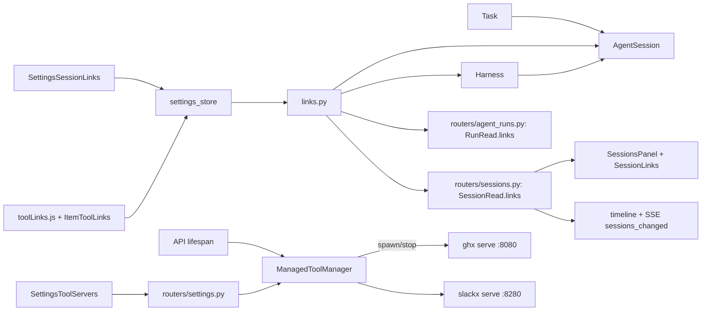
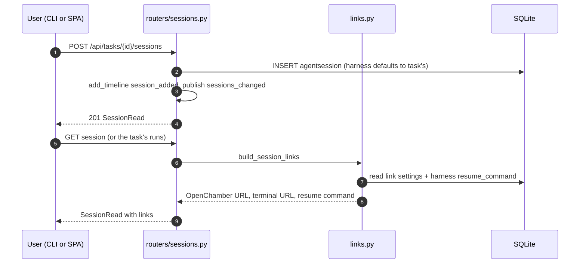
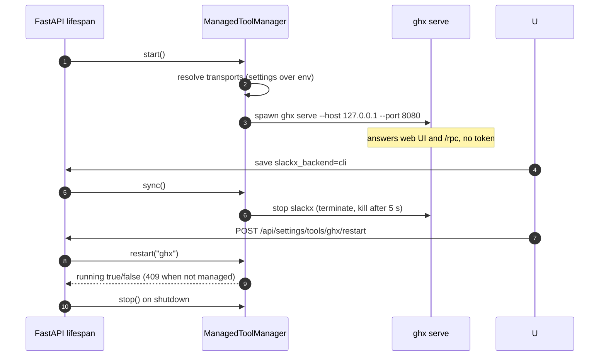

# Specification: Agent sessions, session links, and managed tools

## Overview

An `agentsession` row records one agent session against a task: the ACP (or agent) session id, an optional harness, a label, and a working directory.
Run-produced sessions live on their run rows; this entity carries sessions attached by hand, for example one started in OpenChamber.
`links.py` builds the reopen links for both: an OpenChamber URL, a terminal URL, and a copyable resume command, all rendered at read time from `settings_store` values and the harness's `resume_command`.
`services/managed_tools.py` runs the ghx and slackx helper CLIs in serve mode when their transport is `managed`: one process per tool, started by the API lifespan, bound to loopback, and stopped with the API, with the JSON-RPC endpoint the fetchers call supplied as `<serve url>/rpc`.
The Settings page edits the link templates and the per-tool transports, the task page lists sessions with their links, and the CLI records sessions with `agentic session`.

## Architecture

## Data Models

### AgentSession

| Field | Type | Constraints | Description |
|---|---|---|---|
| id | string | PK | Record id |
| task_id | string | FK task, index, not null | Owning task |
| harness_id | string | FK harness, nullable | Harness the session ran on; defaults to the task's at create time |
| session_id | string | not null | The ACP (or agent) session id |
| label | string | default "" | Display label |
| cwd | string | nullable | Working directory the session ran in, `~` expanded |
| created_at | datetime | not null | Bookkeeping |

### SessionLink (response schema, not a table)

| Field | Type | Description |
|---|---|---|
| id | string | `openchamber`, `terminal`, or `command` |
| label | string | Button text ("Open in OpenChamber", "Open in terminal", "Resume command") |
| url | string, nullable | The link to open |
| command | string, nullable | The command to copy |

`RunRead` and `SessionRead` both carry `links: list[SessionLink]`.

### Settings keys

| Key | Purpose |
|---|---|
| `openchamber_url` | OpenChamber base (`http://host:port` or `openchamber://session`) |
| `openchamber_session_path` | Path template, default `/?session={session}`; `/{session}` for the native deep link |
| `terminal_url_template` | Terminal URL template, placeholders `{session}` `{cwd}` `{harness}` |
| `editor_url_template` | Editor URL for the worktree Open-in-editor button (`{path}`); consumed by the worktree feature, stored alongside these keys |
| `ghx_backend` / `slackx_backend` | `cli`, `rpc`, or `managed` |
| `ghx_rpc_url` / `ghx_rpc_token` | Endpoint for `rpc` transport |
| `slackx_rpc_url` / `slackx_rpc_token` | Endpoint for `rpc` transport |
| `ghx_url` / `slackx_url` | Web UI bases the item links use; for a managed tool with no stored URL the serve URL stands in |

## Link building rules

`build_session_links` fills the placeholders `{session}`, `{cwd}`, and `{harness}` (the harness's name) into each configured template:

- OpenChamber link when `openchamber_url` is set: base joined with `openchamber_session_path` (default `/?session={session}`).
- Terminal link when `terminal_url_template` is set.
- Resume command when the harness has a `resume_command`: the filled template, prefixed with `cd <cwd> &&` when a working directory is known.

No session id, no links; an unconfigured target, no link of that kind.

## Managed tool rules

| Transport | Meaning |
|---|---|
| `cli` | Each command line spawns the binary itself; the server starts nothing |
| `rpc` | Commands call a server the user runs (`<url>/rpc` with a token) |
| `managed` | The server runs `<tool> serve --host 127.0.0.1 --port <fixed>` and calls `<serve url>/rpc` with no token |

Fixed ports: ghx 8080, slackx 8280, loopback only.
Resolution is per call: the stored Settings value wins over the environment value, and a blank stored value means no opinion.
`AGENTIC_MANAGED_TOOLS` forces managed for both tools, except that an explicit `rpc` always keeps pointing at the user's own server.
`ManagedToolManager.sync()` starts the tools that should run and stops the others; the settings update endpoint calls it after saving a transport, so changes apply live.

## API Contracts

| Method | Path | Purpose |
|---|---|---|
| GET | /api/tasks/{task_id}/sessions | List a task's recorded sessions, newest first, with links |
| POST | /api/tasks/{task_id}/sessions | Attach a session (201); blank session id is 400, unknown harness is 404 |
| GET | /api/tasks/{task_id}/sessions/{session_id} | Read one recorded session with links |
| PATCH | /api/tasks/{task_id}/sessions/{session_id} | Update label, cwd, or harness |
| DELETE | /api/tasks/{task_id}/sessions/{session_id} | Remove the record, not the session (204) |
| POST | /api/settings/tools/{tool}/restart | Restart a managed tool's serve process; 409 when not managed |

Error codes shared across the session endpoints:

| Status | Condition |
|---|---|
| 400 | Blank session id on create |
| 404 | Unknown task, session (or session of another task), or harness |
| 409 | Restarting a tool this server does not run |

Session creates, updates, and deletes append timeline entries (`session_added`, `session_updated`, `session_removed`) and publish `sessions_changed` on the task's SSE channel.

## Sequences

### Attach a session and reopen it

### Managed tool lifecycle

## Non-Functional Considerations

- NFR-1: managed processes are pinned to `127.0.0.1`, so the endpoint needs no token and is unreachable off-machine.
- NFR-2: a tool that cannot start is logged and skipped; startup proceeds, and `stop()` terminates then kills after a 5 s grace period.
- NFR-3: `restart()` replaces a running process, starts one that never came up, and reports the outcome.
- NFR-4: deleting a task deletes its sessions in ordered deletes; deleting a harness nulls `agentsession.harness_id` instead of deleting rows.
- NFR-5: the panel's confirmation says the session itself is untouched, and declining changes nothing.

## Technical Decisions

| Decision | Choice | Rationale |
|---|---|---|
| Hand-attached sessions | Separate `agentsession` rows, not fields on a run | A session started in OpenChamber has no run; the task still needs to carry it and its links |
| Links rendered at read time | Build from current settings on every read | No stored URL goes stale; changing a template fixes every past session at once |
| Resume command from the harness | Template on the `harness` row | Only the harness knows how to resume its own sessions |
| Managed transport | Server-owned serve process on fixed loopback ports | Saves the user from running ghx/slackx by hand; the URL and token a `rpc` user would supply stop being configuration |
| Explicit rpc never taken over | `AGENTIC_MANAGED_TOOLS` skips tools already on `rpc` | The flag exists to help a user who runs nothing by hand, not to seize a server they deliberately run |
| Transport read per call | `backend_for` reads the settings store each time | A Settings change applies live, the same way the shell transport does |
| Serve URL stands in for `ghx_url` | `get_settings` fills it when managed and unset | Items link into a UI the server is already running, with nothing to configure |

## Risks and Unknowns

1. Fixed ports mean a user cannot run their own ghx or slackx serve alongside a managed one; the managed ports are chosen to be unlikely conflicts, but they are not configurable.
2. A recorded session is a pointer; an id typed wrong is only discovered when the reopen link fails on the harness side.
3. The serve process is a child of the API process; an API killed without running its lifespan shutdown could orphan it until the next start replaces it via restart.

## Out of Scope

- Run production of sessions (the agent-run feature records its own sessions on run rows).
- The editor URL's consumer, the worktree Open-in-editor button (the worktree feature).
- The ghx and slackx CLIs' own behavior, caching, and web UI routes.
- Verifying recorded session ids against the harness.
