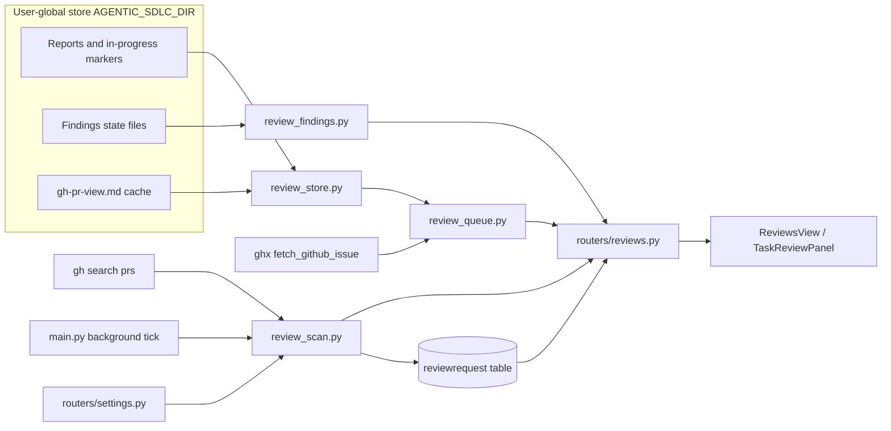
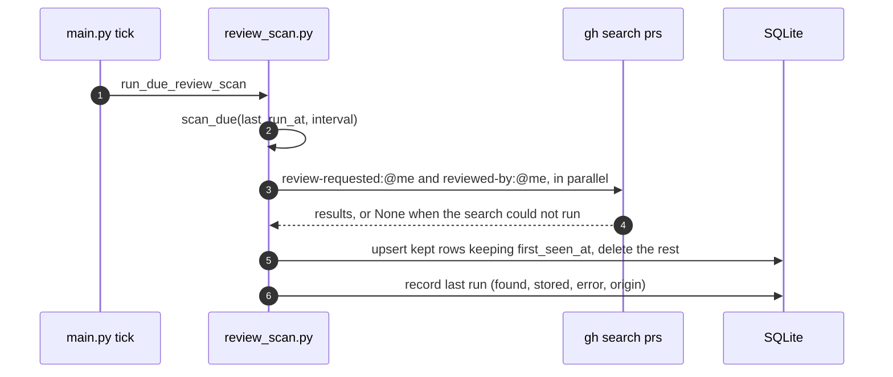
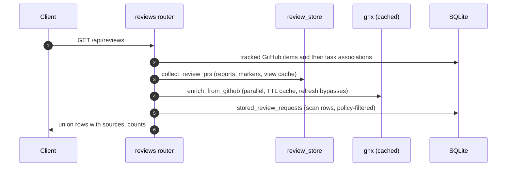
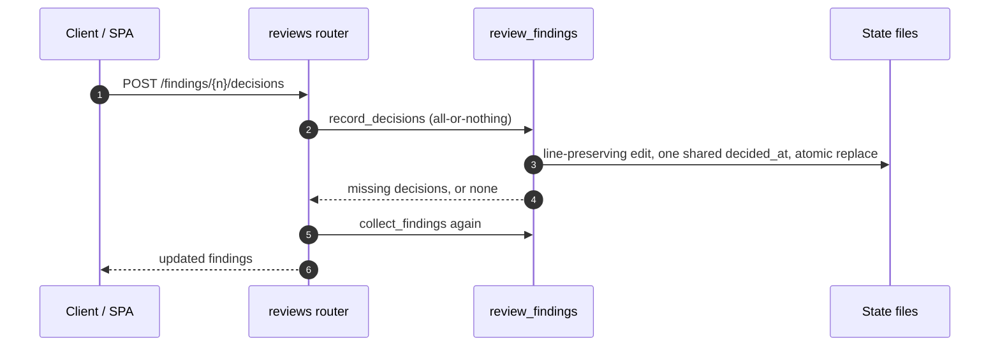

# Specification: Pull-request review queue

## Overview

`review_store.py` reads the report store into one row per pull request, `review_scan.py` asks GitHub on a cadence and keeps the found set in the `reviewrequest` table, `review_queue.py` overlays ghx metadata behind a short cache, and `review_findings.py` reads and updates the skills' findings-state files.
`reviews.py` resolves report directories and serves report content, `routers/reviews.py` exposes the queue, scan, findings, and report endpoints, and `routers/settings.py` and the repository router validate the scan settings.
`main.py` runs the scan in a background thread on a `review_scan_tick` timer.
The SPA serves the queue at `/reviews` (`ReviewsView.vue`), the same panels inside a task (`TaskReviewPanel.vue`), the findings selector and share modal (`FindingsSelector.vue`, `ShareFindingsModal.vue`), and the settings section (`SettingsReviewScan.vue`).

## Architecture

## Data Models

### ReviewRequest (table `reviewrequest`)

| Field | Type | Constraints | Description |
|---|---|---|---|
| id | string | PK | Row id |
| repository | string | index, not null | "owner/name", in GitHub's own casing |
| number | int | not null | Pull request number |
| source | string | not null, default requested | requested (a review is asked of the user) or reviewed (an open one the user already reviewed) |
| title | string | default "" | From the search |
| url | string | default "" | From the search |
| author | string | default "" | Search author login |
| state | string | default "" | GitHub's own state |
| draft | bool | default false | Draft flag at scan time |
| created_at | string | nullable | GitHub's creation time as text |
| first_seen_at | datetime | not null | Set on first storage, preserved across scans |
| updated_at | datetime | not null | Touched on each upsert |

Unique constraint `(repository, number)` (`uq_review_request`).
Every scan replaces the set, so a row exists only while GitHub still reports the pull request as waiting.

### Report store (files, not database)

The queue reads `{owner}/{repo}/pull-requests/{number}/` (a bare `{repo}/pull-requests/{number}/` is accepted), with the directory name as the PR number.

| File | Writer | What the queue reads from it |
|---|---|---|
| `<step>.<short-sha>.md` | review skills | The step's newest report: verdict from the JSON marker comment, risk and confidence for assess-pr-risk, the reviewed commit from the file name |
| `<step>.report.md` | review skills (symlink) | Skipped as a duplicate of its target; its step is still credited with the verdict when no committed report exists |
| `<step>.<sha>.in-progress` | review skills | The step is evaluating that commit now; the mtime is the start time |
| `gh-pr-view.md` | review skills | Fallback snapshot of the PR's title, state, author, branches, labels, creation time, review decision, and last comment |
| `*.yaml` state files | review-pr, validate-pr, verify-pr | The must/should/may findings and the reviewer's decisions |

The six steps, in the order the queue weighs them: `assess-pr-risk`, `summarize-behavior-changes`, `analyze-test-coverage`, `validate-pr`, `verify-pr`, `review-pr`.

### Findings state entry

| Field | Description |
|---|---|
| severity | must, should, or may; an entry without one is not offered |
| title | The finding's identity within its skill's file |
| description | Free text, often a scalar real YAML cannot parse |
| status | The skill's own state (open, addressed, fails, unverified, and so on) |
| first_seen_sha | The commit the finding was recorded at |
| decision, decided_at | The reviewer's include or skip, written by the app |

## Queue semantics

Staleness:

- The newest reviewed commit is the newest commit any step report covers.
- A step is stale when its newest report does not cover that commit.
- The two parallel steps (assess-pr-risk, summarize-behavior-changes) and analyze-test-coverage are stale independently.
- A stale chain step marks every chain step after it stale too (a stale validate-pr makes verify-pr and review-pr stale).

Readiness:

| Light | Rule |
|---|---|
| red | Any chain verdict (validate-pr, verify-pr, review-pr) is fail, or the assess route is block or hold |
| green | Non-draft, nothing stale, review-pr passed, analyze-test-coverage not fail, assess route not decide or investigate |
| yellow | Everything else, including a row with no reports |

Row union:

- Store rows and scan rows merge on (owner, repo, number), lowercased.
- A store row the scan also found takes the scan's source (`request_source`).
- A scan row without reports has empty steps, readiness yellow, status `unreviewed`.
- Status is `ready` (nothing stale) or `needs-review` for store rows, `unreviewed` for scan-only rows.

Scan semantics:

- `review_scan_interval` holds a duration (`30m`, `1h`); empty or one of off/never/none/`-` disables the scan.
- The background tick (default 300 s) calls `run_due_review_scan`, which runs when the cadence has elapsed.
- A run replaces the set: upserts keep `first_seen_at`, rows the search no longer finds are deleted.
- A run whose searches all fail records the error and changes nothing.
- Repository policy comes from each `Repository.review_scan` column (default/include/exclude); with default, the app-wide `review_scan_default` decides.

## API Contracts

| Method | Path | Purpose |
|---|---|---|
| GET | /api/reviews | The whole queue, live from ghx unless cached (`?refresh=true` bypasses) |
| GET | /api/reviews/task/{task_id} | The queue scoped to the pull requests the task's items link to |
| GET | /api/reviews/scan | The scan's cadence, policy, stored count, and last pass |
| POST | /api/reviews/scan | Run the scan now, ignoring the cadence |
| GET | /api/reviews/findings/{number} | One PR's must/should/may findings (`?repository=owner/name`) |
| POST | /api/reviews/findings/{number}/decisions | Record include/skip decisions in one all-or-nothing write |
| GET | /api/reviews/report/{number}/{name} | One report's Markdown by relative path (`?repository=owner/name`) |
| PATCH | /api/settings | Validates and stores review_scan_interval, review_scan_default, review_slo, review_nudge_slo |
| PATCH | /api/repositories/{id} | Accepts a per-repository review_scan policy |

Error codes:

| Status | Condition |
|---|---|
| 400 | A finding decision outside include or skip |
| 404 | Unknown task, finding, or report |
| 422 | A malformed review_scan_interval, review_scan_default, review_slo, or review_nudge_slo |

`GET /api/reviews` returns `root` (the store path), `generated_at`, `counts` (total, ready, blocked), and `prs`.
Each row carries the PR identity and live fields (repository, number, title, url, author, state, draft, created_at, labels, review_decision, head_branch, base_branch, last_comment_at, last_comment_by), the review state (head_commit, reviewed_at, steps, in_progress, stale_steps, reviewed_steps, readiness, status), and the links (item_id, task_ids, request_source, store_dir).
Each step state carries step, commit, verdict, risk, confidence, report, modified_at, and stale.

## Sequences

### Background scan

### Queue read

### Record findings decisions

## Technical Decisions

| Decision | Choice | Rationale |
|---|---|---|
| Report source | Read the skills' own store, no copy into SQL | The skills stay the writers of record, so the app cannot drift from what a run produced |
| Live fields | ghx overlay with a 300 s cache and a 60 s failure TTL | GitHub is the truth for a PR's own fields, while a page reload must not shell out per row |
| Scan search | `gh search prs` through the CLI, two searches in parallel | ghx caches reads but has no search qualifiers |
| Staleness reference | Newest reviewed commit, not the head | The queue answers "is the review current"; matching against the head would mark everything stale on every push |
| Running signal | The skills' in-progress markers, matched to ghx's head when known | No app-side run state to start or clean up |
| Scan rows | Replace-set upsert preserving `first_seen_at` | The set mirrors GitHub, while the review SLO (p18) needs a stable first-seen time |
| Findings decisions | Written back into the skill's state file, line-preserving | One source of truth both sides read; real files are not always valid YAML, so they are edited per line rather than re-serialized |
| Decision batch | All or nothing with one shared timestamp | A select-all cannot half-land or stamp twice |
| Notifications recovery | Not ported | Needs the notifications API plus a batched GraphQL drop check, and the plain searches never surface those pull requests |
| Settings section | One section owns the scan cadence, policy, and SLO durations | The scan, its policies, and the SLO are one concern in the UI |

## Risks and Unknowns

1. The store layout is an implicit contract with the skills' shared documentation; a naming change there breaks the queue silently.
2. The queue re-reads and re-parses every report on each request; very large stores will slow the read (see open question 2 in the requirements).
3. The metadata cache lives in process memory, so a restart shells out again for every row.
4. ghx and gh must be installed and authenticated; the queue degrades to snapshots, but the scan stops entirely.

## Out of Scope

- The review skills themselves and the report format they write.
- The review SLO inbox nudge (`p18-review-slo`) and the inbox nudge SLO.
- Posting findings or replies to GitHub; an agent run does that.
- The PR feedback triage queue (`p23-pr-feedback-triage`).
- Diff size, approvers, and the open-PR stack a PR blocks.
