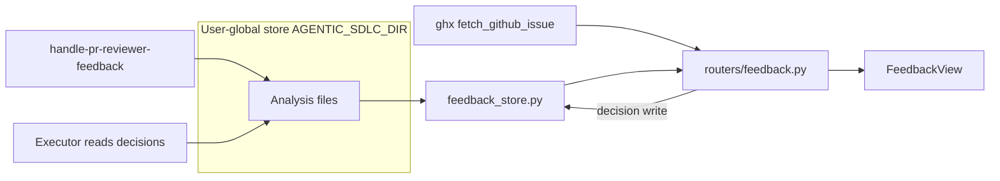
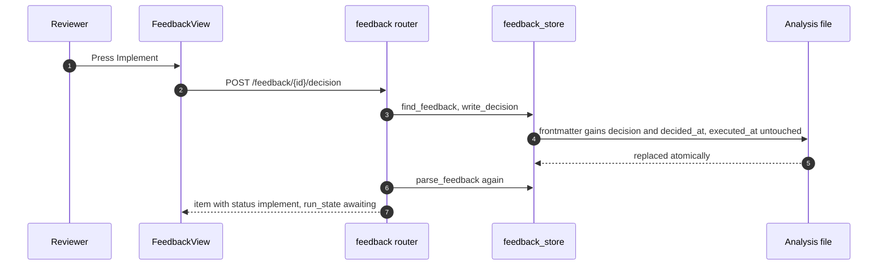
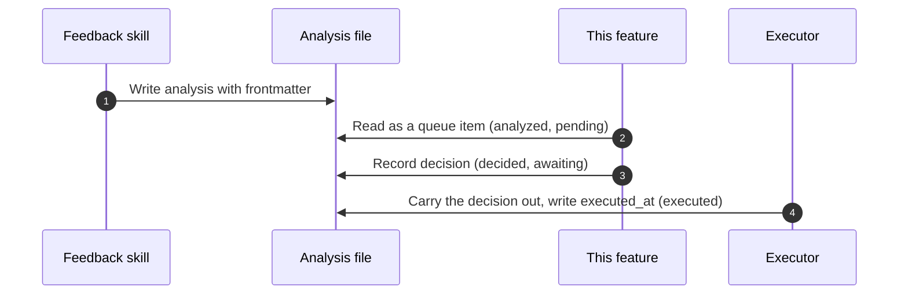

# Specification: PR reviewer-feedback triage

## Overview

`feedback_store.py` parses the analysis files the feedback skill writes and writes decisions back into their frontmatter, as a file-only module.
`routers/feedback.py` serves the triage queue, overlays each item's live PR state through the shared ghx cache, and records decisions.
`FeedbackView.vue` with `feedback.js` renders the queue as cards with filters, grouping, and sorting, and `main.py` mounts the `/feedback` route.

## Architecture

## Data model

The rows are files, not database records.
One analysis file per reviewer comment, at `{owner}/{repo}/pull-requests/{number}/feedback/{id}.md`, found by the glob `**/pull-requests/*/feedback/*.md`.

### Analysis file

| Part | Content |
|---|---|
| Frontmatter | feedback_id, kind, repo, pr, author, created_at, head_commit, analyzed_at, recommendation, confidence, session_link, and the decision keys (decision, decided_at, executed_at) |
| Body | A `#` title, then `##` sections; the named ones are Comment, Analysis, Recommended action, Suggested reply, Suggested change, and any other section is kept after them |

### FeedbackItem (parsed row)

| Field | Description |
|---|---|
| feedback_id | The frontmatter value, or the file stem when absent |
| kind, repo, pr, author | Provenance from the frontmatter |
| created_at, head_commit, analyzed_at | Provenance, timestamps normalized to ISO-8601 UTC |
| recommendation, confidence, session_link | The analysis' advisory fields |
| decision, decided_at, executed_at | The decision keys, each present or absent |
| title, path, sections | The body's title, the file's absolute path, and the named sections as raw Markdown |
| status | Derived: the decision, or `pending` |
| run_state | Derived: `executed` (executed_at set), `awaiting` (decision without executed_at), or `none` |

## State machine

| State | Condition | Meaning |
|---|---|---|
| analyzed | The file exists with usable frontmatter | The skill analyzed the comment |
| pending | No `decision` key (run_state `none`) | Waiting for the reviewer |
| decided, awaiting run | `decision` set, no `executed_at` (run_state `awaiting`) | The pending work the dashboard and the executor contract rely on |
| executed | `executed_at` set (run_state `executed`) | The executor carried the decision out |

Transitions:

- Record a decision: writes `decision` and `decided_at`, leaves `executed_at` alone (pending to awaiting).
- Record the same decision again: keeps `decided_at` and `executed_at` (idempotent repeat click).
- Record a different decision: restamps `decided_at` and drops a stale `executed_at` (back to awaiting).
- Reset to none: removes `decision`, `decided_at`, and `executed_at` (back to pending).
- The executor, not this feature, writes `executed_at` (awaiting to executed).

## API Contracts

| Method | Path | Purpose |
|---|---|---|
| GET | /api/feedback | Every analysis file with its derived state, PR state, and counts (`?refresh=true` bypasses the ghx cache) |
| POST | /api/feedback/{feedback_id}/decision | Record a decision (implement, decline, defer) or reset it with null |

Error codes:

| Status | Condition |
|---|---|
| 404 | No analysis file carries that feedback id |
| 422 | The file has no frontmatter to write into, or could not be re-read after the write |
| 400-class | A decision outside implement, decline, defer, or null fails Pydantic validation |

`GET /api/feedback` returns `root` (the store path, or null when missing), `generated_at`, `counts` (pending, implement, decline, defer, to_run), and `items`.
Each item carries the fields above plus the derived `status`, `run_state`, the PR's `state` (open/closed, empty when unknown), and a `pr_url` GitHub link.

## Sequences

### Triage a comment

### From analysis to execution

## Technical Decisions

| Decision | Choice | Rationale |
|---|---|---|
| Decision storage | In the analysis file's frontmatter | The skill and its executor already consume those keys, so one file is the single source of truth and nothing else can drift |
| Derived state | Computed properties (`status`, `run_state`), not stored columns | The file is the record; derived state cannot fall out of sync |
| Same-decision rewrite | Keeps `executed_at` | A repeat click must not re-queue work that already ran |
| Changed decision | Drops a stale `executed_at` | A new decision has not been carried out, so the executor must pick it up again |
| File writes | Temp file beside the target, then replace | A crash cannot leave a truncated analysis file |
| Timestamps | Normalized to ISO-8601 UTC on read | YAML parses unquoted timestamps into datetimes that would otherwise render in the machine's zone |
| Ordering | Undecided first, then repository, PR number, oldest comment | Matches the triage view at rest: what needs a decision leads |
| PR state | open/closed only, unknown allowed, through the shared ghx cache | The view only needs open versus closed, and a failed lookup must not drop the item |
| Module split | File-only store, router maps errors | The store stays testable without a web stack (NFR-1) |

## Risks and Unknowns

1. Two writers (the app and the executor) touching one file at once resolve to last write wins; there is no lock (open question 1 in the requirements).
2. Discovery globs the whole store on every read, so a store with many pull requests and feedback files pays the scan each time.
3. A file whose frontmatter is not valid YAML is skipped entirely, so one broken file silently leaves its comment out of the queue.
4. `executed_at` is written by the executor, so the executed state is trusted rather than verified.

## Out of Scope

- Producing the analysis files and carrying the decisions out (the skill and its executor).
- Anything that writes to GitHub, including posting the suggested reply or applying the suggested change.
- Per-user or per-repository access rules; the store is single-user.
- The review queue and findings sharing (`p22-review-queue`).
