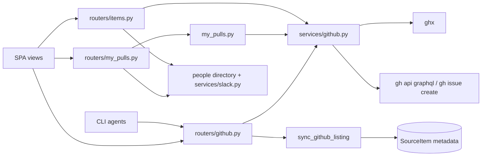
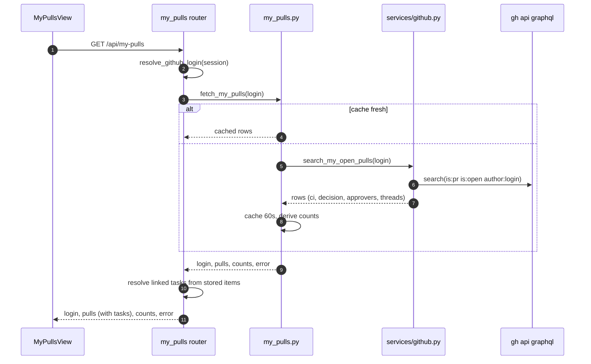
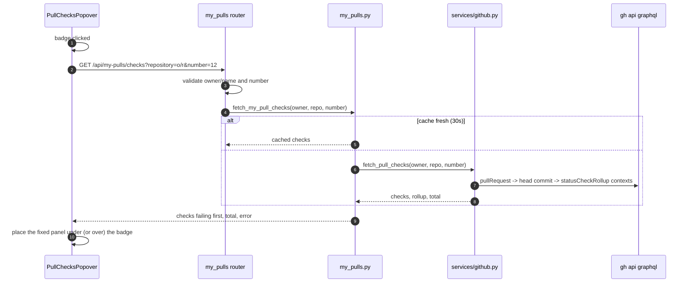
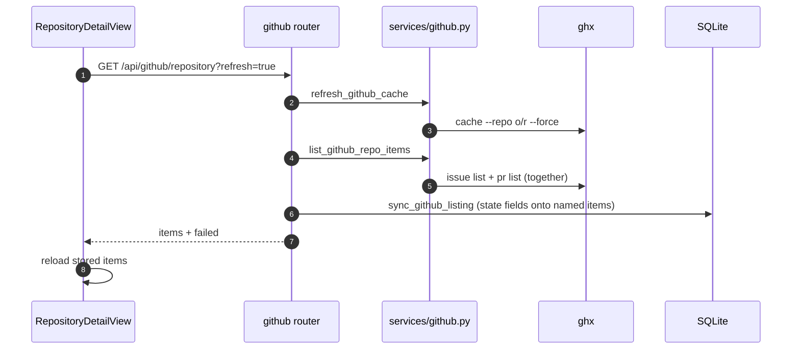

# Specification: GitHub read surface: issues, pull requests, My PRs

## Overview

`services/github.py` holds every GitHub read: `ghx`-backed listings and single-object fetches (`list_github_issues`, `list_github_pulls`, `list_github_repo_items`, `fetch_github_issue`), the `gh` GraphQL exception where `ghx` does not reach (`search_my_open_pulls`, `fetch_github_pull_reviewers`, the cycle-time reads), and the one `gh` write (`create_github_issue`).
`my_pulls.py` wraps the My PRs search with a short per-login cache and derives the header counts, so a page reload does not re-query GitHub.
`routers/github.py` exposes the repository read surface, `routers/my_pulls.py` the My PRs read and poke, and `routers/items.py` adds a pull request item's reviewer read and poke.
The repository listing runs the issue and PR listings together and, through `sync_github_listing` in `routers/items_refresh.py`, merges its state fields onto the stored items it names.
The SPA side is `MyPullsView.vue` with its pure helpers in `myPulls.js`, the standalone `IssueView.vue` and `PullRequestView.vue` pages, `TaskIssuePanel.vue` and `GithubItemPanel.vue` for the task's issue and PR modes, and the repository detail view's `RepositoryItemsGrid.vue`.

## Architecture

## Data Models

No table is added or changed.
The read surface stores nothing for My PRs and the reviewers, and the repository listing writes only state keys into `SourceItem.metadata_json` (`state`, `is_draft`, `merged_at`, `created_at`, `author`), plus a non-custom title when the stored title came from a fetch.

Response models (`schemas/github.py`, `schemas/my_pulls.py`, `schemas/items.py`):

| Model | Carries |
|---|---|
| GithubIssue | number, title, url, state, author, labels, body |
| GithubRepoItem | number, kind (issue / pr), title, url, state, is_draft, merged_at, created_at, author, labels |
| GithubRepoListing | items, failed (each kind `ghx` could not list) |
| MyPullRead | repository, number, title, url, draft, created_at, updated_at, review_decision, approved, approvers, ci, open_threads, threads_total, reviewed, requested_reviewers, tasks (id, title, status) |
| MyPullsRead | login, generated_at, counts, error, pulls |
| MyPullCheck / MyPullChecksRead | name, state, description, url / repository, number, rollup, checks, total, error |
| MyPullPokeRead | poked (login, name, slack_user_id, ts), failed (login, reason) |
| ItemGithubReviewer / ItemGithubReviewers | login, state, submitted_at, requested / reviewers, error |

Derived My PRs fields:

- `ci` maps the head commit's check rollup to `success`, `pending` (a `PENDING` or `EXPECTED` state), `failure` (a `FAILURE` or `ERROR` state), or `none`.
- `approved` is true only when GitHub's review decision is `APPROVED`, which means the reviews the branch requires are in, not merely that someone approved.
- `approvers` lists the logins whose latest opinionated review is an approval, so a later plain comment neither drops nor adds one and a dismissal drops it.
- `reviewed` is true when anyone but the author submitted any review, a comment included; a review page that overflows its read count also counts as reviewed.
- `open_threads` counts the first page of review threads that are unresolved; `threads_total` comes from the connection and stays exact.
- `tasks` lists each task whose stored GitHub PR item carries `owner/repo#number` as its external id, matched case-insensitively and resolved per request so linking a task shows without a GitHub refresh; an untracked pull request carries none.

The header `counts` are `total`, `attention` (failing checks, requested changes, or an unresolved thread), `approved`, `failing`, `open_threads`, and `draft`.

## API Contracts

The normative contract is in [`api.yaml`](api.yaml) once written; the table below is the summary.

| Method | Path | Purpose |
|---|---|---|
| GET | /api/github/issue?url= | Fetch one issue or PR by URL (ghx) |
| GET | /api/github/issues | List a repository's issues (repository_id or owner/repo, state, limit) |
| POST | /api/github/issues | Create an issue from a title and body (gh) |
| GET | /api/github/repository | List every issue and PR, all states by default; `refresh=true` forces a ghx re-fetch first; syncs stored items |
| GET | /api/my-pulls | The configured login's open pull requests; `refresh=true` bypasses the cache |
| GET | /api/my-pulls/checks | One pull request's individual checks, failing first, read on demand for the CI badge's popover (`refresh=true` bypasses the 30-second cache) |
| POST | /api/my-pulls/poke | DM a pull request's named reviewers on Slack |
| GET | /api/items/{item_id}/reviewers | A PR item's reviewers, read live from GitHub |
| POST | /api/items/{item_id}/poke | DM one reviewer of a PR item |

Error codes shared across endpoints:

| Status | Condition |
|---|---|
| 400 | Not a GitHub issue or PR URL, missing repository coordinates, a repository without a GitHub remote, a blank issue title, an empty poke login list, or a checks read without `owner/name` and a positive number |
| 404 | Unknown repository_id or item_id |
| 502 | `ghx` or `gh` could not run, or the read failed |

SPA routes: `/issue/:owner/:repo/:number`, `/pr/:owner/:repo/:number`, `/my-pulls`.
CLI: none for this surface; an agent reproduces the data with `gh search prs` and `gh pr view`.

## Sequences

### My PRs page load

### Checks popover

### Repository listing and item sync

## Technical Decisions

| Decision | Choice | Rationale |
|---|---|---|
| Listings and single objects | `ghx` | Consistent JSON shape, repository selection, and an on-disk cache the refresh can force |
| My PRs, reviewers, checks, threads | `gh` GraphQL | `ghx` carries no review threads, check rollup, or reviews, and `gh --json` exposes neither |
| My PRs source | One paginated search per lookup | One read answers the whole page (state, checks, threads, approvers) |
| My PRs storage | A pull request is not stored; its task links read the stored items | A merged pull request leaves the page on the next refresh, while task links come from the app's own items and stay current |
| My PRs cache | 60 seconds per login, 30 for a failure | A reload does not re-query GitHub, and an offline host is retried later rather than on every request |
| Individual checks | Read on demand when the CI badge's popover opens, cached 30 seconds | The page needs only the rollup state, and a check list per pull request would dwarf the search's payload |
| Checks panel position | Fixed from the badge's rectangle | The table scrolls sideways in a wrapper, which would clip a panel positioned inside the cell |
| PR row links | `ghx` and `gh` first, then the number opens the app's PR page, with a linked task after the title | The two external copies belong with the PR identity; the app page stays the one actionable view beside it, and the linked task sits with the row it belongs to |
| Repository list links | `ghx` and `gh` in their own `Links` column | The list is where a checkout is identified, so both its cached UI and its GitHub page belong there, without crowding the name |
| Repository item links | The title opens the app's issue or PR page, with `ghx` and `gh` in the `Links` column | The app page is the actionable view; the external copies stay one click away |
| Links column order | Right after the name on the repositories list | It belongs with the repository identity, before the path and counts |
| Approvers | Latest opinionated reviews only | A plain comment must not undo an approval, and a dismissal must drop one |
| Listing write-back | State fields only, merged onto matching items | The repository view is never staler than its items; bodies and people still come from full fetches |
| Issue creation | `gh issue create` | `ghx` has no issue-create command |
| Partial listing failure | `failed` list in the response | One kind failing must not read as an empty section |
| Page logic | Pure helpers in `myPulls.js` | Labels, attention ranking, grouping, filters, search, and counts test without rendering |

## Risks and Unknowns

1. Every read depends on `ghx` or `gh` being installed and authenticated; the failure modes are explicit errors, but nothing works without them.
2. `open_threads` counts only the first 100 review threads; the total stays exact but the unresolved count under-reports a pull request with more than a hundred threads.
3. `ghx` serves listings from its cache, so a repository view is current only as of the last refresh.
4. The GraphQL reads consume the authenticated account's GitHub rate limit.

## Out of Scope

- Importing GitHub issues and PRs as source items (p2).
- The review queue and review reports (p18) and PR feedback (the feedback feature).
- Cycle-time reads (`fetch_github_cycle_time`), which the metrics feature owns.
- Any GitHub write other than issue creation (no comment, label, or merge writes).
