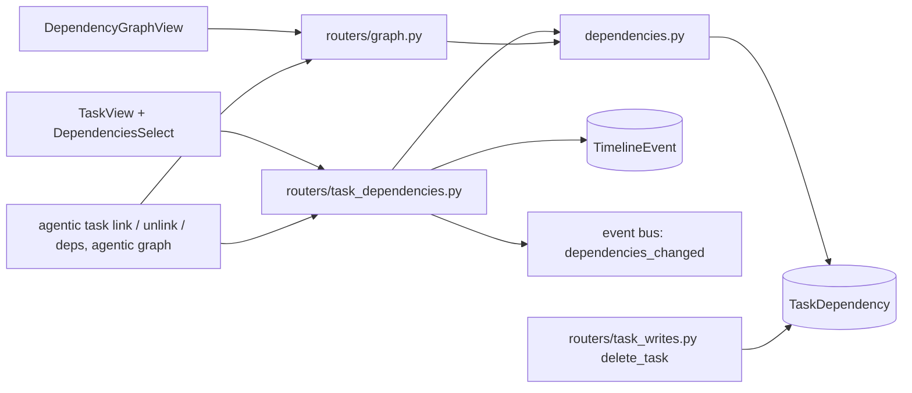
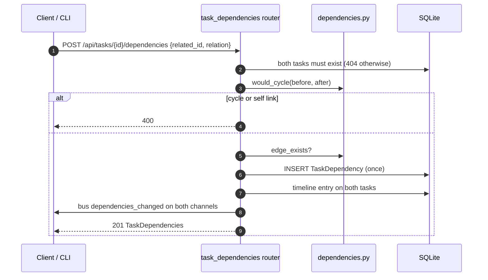
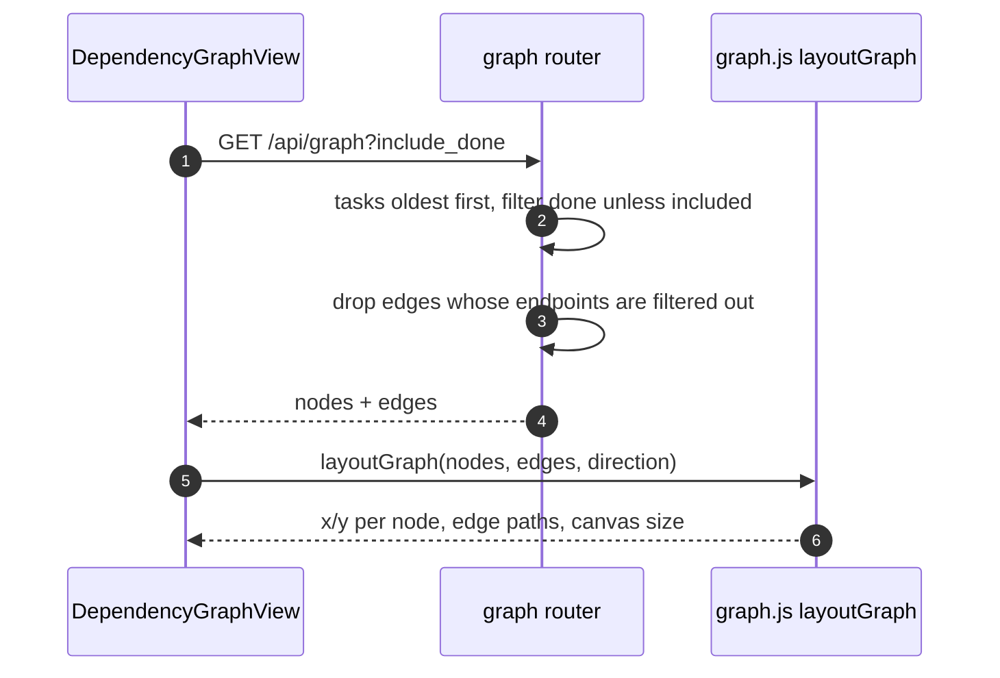

# Specification: Task dependencies and the dependency graph

## Overview

`dependencies.py` holds the edge logic: `edge_exists` for the exact pair, `would_cycle` for the acyclicity rule (a self link, or a link whose `after` already reaches its `before`), `dependencies` for a task's `(before_ids, after_ids)` oldest first, and `all_edges` for the whole set.
`routers/task_dependencies.py` mounts the link CRUD under the task prefix and reuses the task read shape for neighbours, writing timeline entries on both tasks and publishing `dependencies_changed` events.
`routers/graph.py` returns every task as a node (oldest first) plus the edges between them, hiding done and archived tasks and dropping the edges that would dangle.
`models/tasks.py` defines the `TaskDependency` table (also in `.sdlc/context/schema.dbml` as `taskdependency`), and `routers/task_writes.py` deletes a task's edges in the ordered delete that precedes the task row.
The SPA side is the Graph page (`DependencyGraphView.vue`) with the pure layered layout in `graph.js`, and the task page's inline editors (`DependenciesSelect.vue`).

## Architecture

## Data Models

### TaskDependency

| Field | Type | Constraints | Description |
|---|---|---|---|
| id | string | PK | Edge id |
| before_id | string | FK task.id, index | The task that must be done first |
| after_id | string | FK task.id, index | The task that follows |
| created_at | datetime | not null | Orders the links oldest first |

Unique constraint `uq_dependency_edge` on `(before_id, after_id)`.
`DependencyRelation` (`models/base.py`) is the `before` / `after` enum the create payload uses, defaulting to `after`.

Request and response models (`schemas/tasks.py`):

| Model | Shape |
|---|---|
| DependencyCreate | related_id, relation (before or after, default after) |
| TaskDependencies | task_id, before (list of TaskRead), after (list of TaskRead) |
| GraphNode | id, title, status, priority |
| GraphEdge | before_id, after_id |
| DependencyGraph | nodes, edges |

## API Contracts

The normative contract is in [`api.yaml`](api.yaml) once written; the table below is the summary.

| Method | Path | Purpose |
|---|---|---|
| GET | /api/tasks/{task_id}/dependencies | The tasks before and after this one, resolved to full tasks |
| POST | /api/tasks/{task_id}/dependencies | Link a task before or after this one; a cycle is refused |
| DELETE | /api/tasks/{task_id}/dependencies/{related_id} | Remove the link between the two tasks |
| GET | /api/graph | Every task as nodes and the edges between them; `include_done=true` adds done and archived tasks |

CLI: `agentic task deps <task>`, `agentic task link <task> <other> --relation before|after`, `agentic task unlink <task> <other>`, and `agentic graph [--include-done]`.

Error codes:

| Status | Condition |
|---|---|
| 400 | The task is linked to itself, or the link would close a cycle |
| 404 | Unknown task or related task, or no edge between the pair on delete |

Status 201 on link, 200 on reads, 204 on unlink.
A repeated link answers 201 with the unchanged edge set (no duplicate row, no extra timeline entry).

## Sequences

### Link two tasks

### Draw the graph

## Key Behaviours

- Edge semantics: `before_id -> after_id` means `before` must be done before `after`.
- Cycle rule: a link `a -> b` is refused when `a` equals `b`, or when `b` already reaches `a` following edges forward, so the stored set is always a DAG.
- Relation view: `relation="before"` and `relation="after"` name the same edge from opposite ends; posting the mirrored relation creates the same stored pair.
- Task page editing: the before and after chip groups list the linked tasks with an unlink button each, and the two search selects offer every task except the task itself and the tasks already linked either way.
- Graph drawing: nodes sit in layers by longest path from a source, aligned to the row (or column) of the node they link from, so a chain reads on one line; direction LR or TB is remembered per device under `agentic.graphDirection`.
- Graph interaction: clicking a node opens the task; dragging from a source handle to a target handle links (`target` gets the new edge with `relation="before"`); clicking an edge removes it.

## Technical Decisions

| Decision | Choice | Rationale |
|---|---|---|
| Acyclicity | Refuse the link at write time with a reachability walk | Every reader sees a DAG; no repair or normalization passes |
| Edge storage | Own table with a unique pair | Links survive task edits and vanish with task deletion; the pair cannot duplicate |
| Neighbour reads | Reuse the full task read shape | The task page renders neighbours exactly like other task references |
| Duplicate link | Idempotent no-op | A retry or a double click must not double-record |
| Graph filtering | Drop hidden tasks and their edges | The graph thins out when filtered instead of showing dangling arrows |
| Layout | Pure layered function in `graph.js` | Deterministic columns, testable without rendering, shared by both directions |
| Graph rendering | Vue Flow | Node/edge interaction (drag to link, click to unlink) comes from the library |

## Risks and Unknowns

1. The reachability walk is a per-add graph traversal, fine at this scale but linear in edges per link.
2. Edges are an ordering statement only; nothing enforces that a `before` task is done before an `after` task starts.
3. The layout has no zoom or pan control; a very wide graph relies on scrolling (noted in `docs/views/graph.md`).

## Out of Scope

- Automatic dependency inference from deadlines, agent runs, or issue links.
- Gaps (finish-to-start offsets) or lag between linked tasks.
- Per-edge notes or weights.
