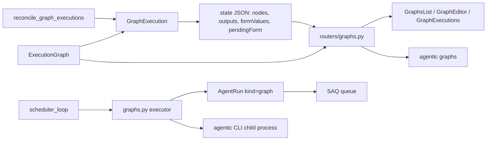
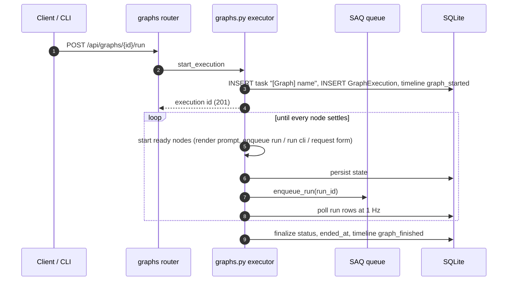
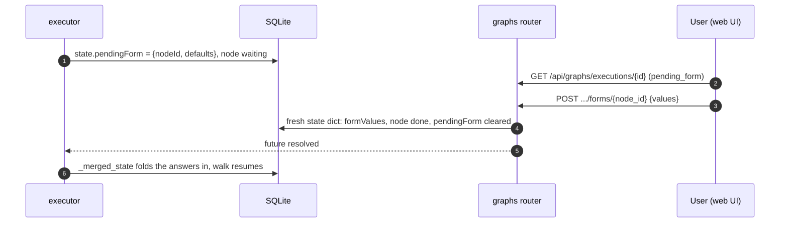

# Specification: Execution graphs

## Overview

`graphs.py` owns the orchestration: a definition contract (`normalize_definition`, `validate_definition`, `render_template`, `topological_order`), an async executor that walks the DAG in the API process, the form answer handoff, cron firing, and startup reconciliation.
`models/graphs.py` defines two tables: `ExecutionGraph` holds the saved definition (nodes and edges as JSON, there are no graph node or edge tables) with its optional cron trigger, and `GraphExecution` holds one run of it, including the executor's working state as a JSON column.
`routers/graphs.py` exposes CRUD, a validate-without-saving endpoint, run-now, the execution history and detail, cancel, and the form-answer endpoint that unblocks a paused execution.
Every run node becomes an `AgentRun` (kind `graph`) linked to the execution and node through `graph_execution_id` and `graph_node_id`, attached to a task the execution creates.
The SPA adds the `/graphs` page (`GraphsList`, `GraphEditor`, `GraphExecutions`, `GraphMetaForm`, `ExecutionGraphsView`, plus the pure `executionGraph.js` editor logic), and the CLI adds an `agentic graphs` command group.

## Architecture

## Data Models

### ExecutionGraph

| Field | Type | Constraints | Description |
|---|---|---|---|
| id | string | PK | Graph id |
| name | string | not null | Label shown in lists and the task title |
| description | string | default "" | What the graph does |
| schedule | string \| None | None | 5-field cron expression; None means manual only |
| timezone | string \| None | None | IANA zone the cron is read in; None uses the server's zone |
| enabled | bool | default true | Paused graphs never fire |
| definition | JSON | default {} | `{"nodes": [...], "edges": [...]}` as the editor arranged it |
| next_run_at | datetime \| None | None | Recomputed on create, edit, and fire |
| last_run_at | datetime \| None | None | When the graph last started an execution |
| created_at / updated_at | datetime | not null | Bookkeeping |

### GraphExecution

| Field | Type | Constraints | Description |
|---|---|---|---|
| id | string | PK | Execution id |
| graph_id | string | FK executiongraph, index, not null | Owning graph |
| task_id | string | FK task, index, not null | Task that groups the execution's runs |
| trigger | string | default manual | manual or schedule |
| status | GraphExecutionStatus | default running | running, succeeded, failed, cancelled |
| error | string | default "" | Settling error, empty on success |
| state | JSON | default {} | Executor state: `order`, per-node `nodes` (status, runId, error, startedAt, endedAt), `outputs`, `formValues`, `pendingForm` |
| started_at | datetime | not null | When the execution started |
| ended_at | datetime \| None | None | Stamped when it settles |

`state` is written on every node transition.
Writers assign a fresh dict to the column (in-place edits are invisible to SQLAlchemy) and the executor merges concurrent writes with `_merged_state`, so a form answer the endpoint stored is folded into the working copy.

### AgentRun link columns

| Field | Type | Description |
|---|---|---|
| graph_execution_id | string \| None, index | The execution this run belongs to |
| graph_node_id | string \| None | The definition node this run implements |

### Definition contract

A node is one of three kinds:

| Kind | Fields | Output |
|---|---|---|
| run | harnessId, model, cwd, promptTemplate, inputs `[{id, name}]` | The run's final answer (messages, falling back to thoughts) |
| cli | command, cwd, inputs | The command's stdout, run in JSON mode |
| form | fields: id, title, type (text, textarea, number, date, time, select, slider, checkbox), required, placeholder, defaultValue, select options (max 20), numeric min/max/step | One value per field |

An edge is `{id, source, sourceFieldId, target, targetInputId, targetFieldId}`: a run or cli source feeds its single output, a form source feeds one field, and the target is a named input (run, cli) or a field default (form).
Caps: 32 nodes, 20 fields per form, 20 select options, 20,000 characters of output.
The template language is `{{name}}` (join values with newlines), `{{name[2]}}` (one value), and `{{name.join(", ")}}` (join with a separator); an unknown name or out-of-range index fails the node and leaves the placeholder in place.
Node statuses are pending, waiting (a form waiting for an answer), running, done, failed, and skipped.

## API Contracts

| Method | Path | Purpose |
|---|---|---|
| GET | /api/graphs | List graphs (enabled first, soonest next run first) |
| POST | /api/graphs | Create a graph |
| POST | /api/graphs/validate | Check a definition, schedule, and timezone without saving |
| GET | /api/graphs/executions | Every execution across graphs, newest first (limit 1-500, default 100) |
| GET | /api/graphs/executions/{execution_id} | One execution's nodes, outputs, and pending form |
| POST | /api/graphs/executions/{execution_id}/cancel | Cancel a running execution |
| POST | /api/graphs/executions/{execution_id}/forms/{node_id} | Answer or cancel the form the execution waits on |
| GET | /api/graphs/{graph_id} | Read one graph |
| PATCH | /api/graphs/{graph_id} | Update name, description, schedule, timezone, enabled, definition |
| DELETE | /api/graphs/{graph_id} | Delete the graph and its execution history |
| POST | /api/graphs/{graph_id}/run | Start an execution now, in the background |

Status codes: 201 on create and run; 200 on read, update, validate, cancel, and form answers; 204 on delete; 400 for a blank name, an invalid cron, an unknown timezone, or a definition that fails validation at run time; 404 for a missing graph or execution; 409 when the graph already has a running execution, the execution is not running, or it is not waiting on that form.

`ExecutionGraphRead` adds `running_execution_id` so the list can badge what is in flight.
The execution detail reads the live run row as the truth about a run node: succeeded maps to done, failed to failed, cancelled to skipped, and queued or running pass through.

## Key Flows

### Run now and walk the DAG

### Form answer unblocks a paused execution

### Failure, cancel, and restart

- A run that fails, a command that exits non-zero, or a render error fails the node; every downstream node is skipped; the execution settles as failed and names the first failed node.
- Cancelling cancels the orchestrator task, whose handler aborts active runs (marked skipped), releases any pending form, and settles the row as cancelled.
- `reconcile_graph_executions` runs at startup and marks every execution still `running` as failed with "Interrupted by a server restart"; the agent runs it had enqueued finish on the queue on their own.

## Technical Decisions

| Decision | Choice | Rationale |
|---|---|---|
| Definition storage | JSON column on the graph, no node or edge tables | A graph is edited and read as one document; separate tables would buy nothing the editor needs |
| Walk location | The API process, runs durable on SAQ | The walk is cheap orchestration; the expensive runs survive a restart as queue jobs, so only the walk needs reconciliation |
| Run settlement | Poll the run row at 1 Hz instead of subscribing to streams | A run lasts seconds to minutes, so polling is imperceptible and avoids stream plumbing |
| Form pause | Pending request in state plus an in-process future | The API answers the form on any process copy of the state; the merge step keeps the executor's copy current |
| CLI nodes | Shell out to the app's own `agentic` CLI in JSON mode | Lets a graph call every CLI capability without new internal APIs |
| Scheduled fires | Advance the occurrence before starting, skip when busy | A slow execution is never fired twice for one occurrence, and a busy graph drops the tick rather than queueing it |
| Restart handling | Mark lost executions failed, never resume | The walk holds in-process futures that cannot be reconstructed; the runs themselves are safe |
| Editor checks | Mirror server validation locally in `executionGraph.js` | Instant feedback while typing, with the server as the authority at save and run time |

## Risks and Unknowns

1. A restart kills a paused execution, so a user answering a form after a restart gets a 409 and the execution shows as failed; reconciliation is the designed behavior, not a bug, but it is worth knowing.
2. Outputs and form defaults are truncated at 20,000 characters, so a very long answer loses its tail as a downstream input.
3. A scheduled fire on a busy graph is skipped entirely, not queued; a graph that runs longer than its interval silently loses ticks.
4. The user documentation site covers the dependency graph page but not execution graphs: no `docs/views` page, no `/api/graphs` section in the HTTP API reference, and no `agentic graphs` section in the CLI reference.

## Out of Scope

- Parallel branches beyond what the DAG already allows (nodes run in dependency order, not with concurrency controls).
- Retries, per-node timeouts beyond the CLI timeout, or resuming a failed execution.
- Versioning of definitions or an execution audit beyond the state column and timeline entries.
- Nested graphs (a graph node that runs another graph).
