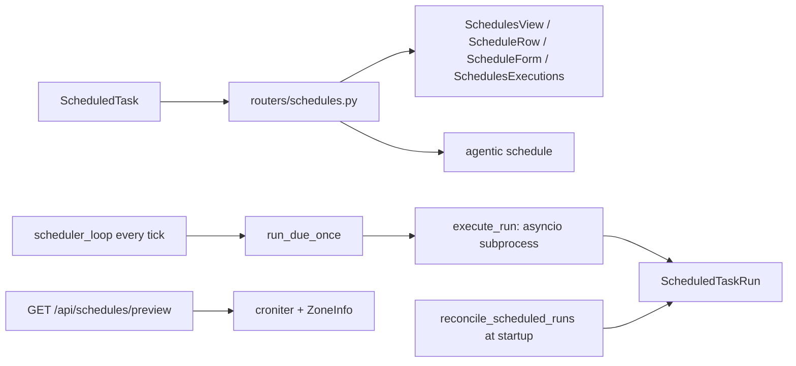
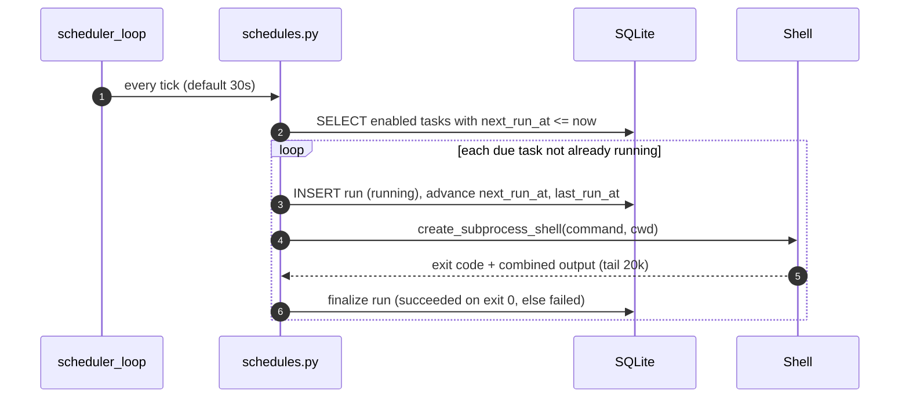
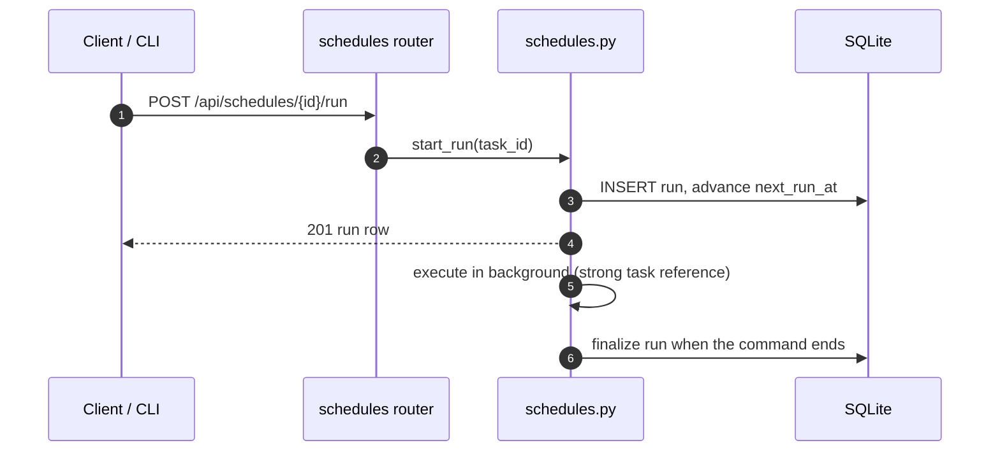

# Specification: Scheduled shell tasks

## Overview

`schedules.py` holds the cron machinery: schedule validation (`validate_schedule`, 5 fields checked with croniter), timezone resolution (`resolve_timezone`, an IANA zone defaulting to the server's local zone from tzlocal, with UTC aliases collapsed), next-occurrence computation (`compute_next_run`, always stored as UTC), occurrence previews (`upcoming_runs`), run creation and execution, the tick loop, and startup reconciliation.
`models/schedules.py` defines two tables: `ScheduledTask` (command, cron, timezone, enabled, next_run_at) and `ScheduledTaskRun` (status, exit code, output tail).
`routers/schedules.py` is the CRUD surface plus run-now, run history, the preview endpoint, and delete-with-history.
The SPA adds the `/schedules` page (`SchedulesView`, `SchedulesList`, `ScheduleRow`, `ScheduleForm`, `SchedulesExecutions`), with the browser-side cron preview in `cron.js`, and the CLI adds an `agentic schedule` command group.
Both graphs and scheduled tasks share the tick and timeout settings; the graph scheduler in `graphs.py` calls `compute_next_run` from this module.

## Architecture

## Data Models

### ScheduledTask

| Field | Type | Constraints | Description |
|---|---|---|---|
| id | string | PK | Task id |
| name | string | not null | Label shown in the list |
| command | string | not null | Shell command, run with the shell so pipes and `&&` work |
| cwd | string \| None | None | Working directory; None runs in the server's own directory |
| schedule | string | not null | 5-field cron: minute hour day-of-month month day-of-week |
| timezone | string \| None | None | IANA zone the cron is read in; None uses the server's zone |
| enabled | bool | default true | Paused tasks keep their schedule but never fire |
| last_run_at | datetime \| None | None | When a run was last started |
| next_run_at | datetime \| None | None | Recomputed on create, edit, and fire; null when disabled |
| created_at / updated_at | datetime | not null | Bookkeeping |

### ScheduledTaskRun

| Field | Type | Constraints | Description |
|---|---|---|---|
| id | string | PK | Run id |
| scheduled_task_id | string | FK scheduledtask, index, not null | Owning task |
| status | ScheduledRunStatus | default running | running, succeeded, failed |
| exit_code | int \| None | None | None when the command never started or timed out |
| output | string | default "" | Combined stdout and stderr, kept as the last 20,000 characters |
| started_at | datetime | not null | When the run row was created |
| ended_at | datetime \| None | None | Stamped when the run settles |

`ScheduledRunStatus` is `running`, `succeeded`, `failed`.
There is no retention setting: history lives until the task is deleted.

## API Contracts

| Method | Path | Purpose |
|---|---|---|
| GET | /api/schedules | List tasks with last_status and last_exit_code (enabled first, soonest next run first) |
| POST | /api/schedules | Create a task (validates name, command, cron, timezone) |
| GET | /api/schedules/preview | Next occurrences of an expression in a zone (query `schedule`, `timezone`, `count` 1-20) |
| GET | /api/schedules/runs | Every task's runs newest first, with task name and command (limit 1-500) |
| GET | /api/schedules/runs/{run_id} | One run with its output |
| GET | /api/schedules/{task_id} | Read one task |
| PATCH | /api/schedules/{task_id} | Update name, command, cwd, enabled, schedule, timezone |
| DELETE | /api/schedules/{task_id} | Delete the task and its run history |
| POST | /api/schedules/{task_id}/run | Start a run now, in the background |
| GET | /api/schedules/{task_id}/runs | The task's run history newest first (limit 1-200) |

Status codes: 201 on create and run-now; 200 on read, update, and preview; 204 on delete; 400 for a blank name or command, an invalid cron expression, or an unknown timezone; 404 for an unknown task or run id.

The list read resolves the display timezone through `schedules.resolve_timezone`, so a task saved without a zone reports the server's zone.

## Key Flows

### The scheduler fires a due task

### Run now

Failure and restart behavior:

- A command that exits non-zero records the code; a start failure (missing cwd, spawn error) records a message with no exit code; a timeout kills the process and records "Timed out after Ns" as a failure.
- `reconcile_scheduled_runs` runs at startup: every run still `running` becomes failed, its output gains the note "Interrupted before the server finished it", and ended_at is stamped.

## Technical Decisions

| Decision | Choice | Rationale |
|---|---|---|
| Execution location | The API process, as asyncio subprocesses | Keeps the feature usable with a plain `agentic-server serve` and no worker; agent runs get durability from SAQ, scripts do not need it |
| Cron engine | croniter, validated as exactly 5 fields | Standard expressions, clear errors for the common 6-field or symbolic mistakes |
| Timezones | tzlocal for the server zone, ZoneInfo for named zones, results stored as UTC | A named zone keeps 09:00 at 09:00 across DST; UTC storage makes comparisons unambiguous |
| Double-fire prevention | Advance next_run_at before the command starts, plus an in-process running set | A slow or overrunning command is never started twice for one occurrence |
| Output capture | Combined stdout and stderr, kept as a 20,000-character tail | One stream avoids interleaving questions; the tail keeps rows small while showing how a run ended |
| Interrupted runs | Marked failed by startup reconciliation | A run row created before the command starts makes the loss visible instead of silently missing |
| History retention | Keep everything until the task is deleted | Simple and predictable for a local, single-user app; documented as "deleting is the only way to clear a run history" |
| Browser preview | Compute the next runs client-side in `cron.js` | Instant feedback while typing; `/api/schedules/preview` is the exact answer when it matters |

## Risks and Unknowns

1. A restart loses in-flight commands; reconciliation records the failure but cannot rerun them, so a nightly job that spans a restart is skipped for that occurrence.
2. Runs execute with the API process's user and environment; a command that mutates state runs with the same authority as the server.
3. The scheduler's tick means a run can start up to one tick (default 30 seconds) after its scheduled minute.
4. Inside the repeated hour of a DST fall-back the browser preview and the server can differ by one run, which the docs call out; the server decides.

## Out of Scope

- Per-run pruning or a retention window (deleting the task clears history).
- Durable or queued execution that survives a restart, and retry policies.
- Randomized or jittered schedules beyond what a cron expression expresses.
- Notifying another system about failures (the run history is the record).
