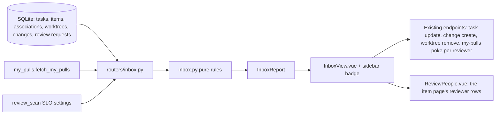
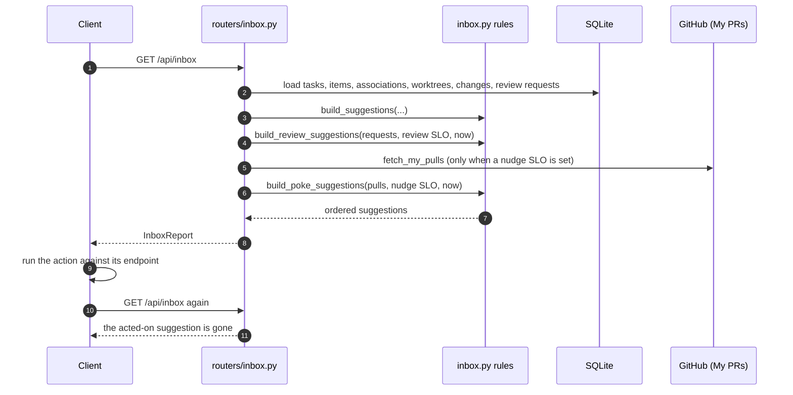

# Specification: Inbox: derived suggestions

## Overview

`inbox.py` holds the suggestion rules as pure, database-free functions in the style of `metrics.py`: each takes already-loaded rows and returns suggestion dicts, and nothing is written anywhere.
`routers/inbox.py` loads the tasks, items, associations, worktrees, and changes in one pass each, hands them to the rules together with the stored review requests, the configured SLOs, and the viewer's GitHub login, and wraps the result in an `InboxReport`.
`InboxView.vue` renders the report in six sections, with a header tab per kind present (plus `All`) that narrows the list to one section and remembers the choice per device in localStorage, and executes each action through the endpoint the action names, then reloads the inbox; an unreviewed pull request's requested reviewers are listed with the same `ReviewPeople.vue` rows the item page shows, each with its own poke.
Because nothing is stored, acting on a suggestion changes the state the suggestion was derived from and it disappears on the next read.

## Architecture

## Suggestion Rules

Each suggestion carries `id`, `kind`, `reason`, the task context it belongs to (or pull request fields when it has no task), and a list of actions the client can execute.

| Kind | Trigger | Actions |
|---|---|---|
| `review_pr_past_slo` | A scan-found request (source `requested`), not a draft, state open or unknown, waited past the review SLO from `first_seen_at` | `open_url` (Review PR) |
| `poke_pr_no_reviews` | One of the user's own open pull requests, not a draft, nobody but the author reviewed it, opened past the nudge SLO, with at least one requested reviewer GitHub still reports; the suggestion carries `reviewers` | `open_pr`, plus a per-reviewer poke the row performs through `POST /api/my-pulls/poke` |
| `find_pr_reviewer` | The same unreviewed pull request with no requested reviewer, so there is nobody to poke | `open_pr` |
| `close_task_finished_items` | An open task with at least one linked GitHub item, all closed or merged (a PR closed without merging counts) | `set_task_status` to done |
| `record_change_merged_pr` | A merged PR linked to a task with no change whose external ref matches the item's url or external id; archived tasks and other authors' PRs (when the viewer login is known) are skipped | `create_change` |
| `remove_worktree_done_task` | A done or archived task with an active worktree | `remove_worktree` |

The kind rank fixes the display order; within a kind the newest task leads, because the router loads tasks newest-first and the sort is stable.
Action kinds name the endpoint: `set_task_status` patches the task, `create_change` posts a change, `remove_worktree` deletes the worktree, `open_pr` navigates to the app's PR page, and `open_url` is an external link.
A `poke_pr_no_reviews` row also pokes each listed reviewer on its own through `POST /api/my-pulls/poke`, the same message the item page's poke sends.

## API Contracts

| Method | Path | Purpose |
|---|---|---|
| GET | /api/inbox | The current suggestions, ordered by kind, in an `InboxReport` |

`GET /api/inbox` takes no parameters and always returns 200.
The response carries `generated_at`, `count`, and `suggestions`; each suggestion has `id`, `kind`, `reason`, `task_id`, `task_title`, `task_status`, and for pull-request suggestions `repository`, `number`, `title`, `url`, plus `reviewers` (the requested reviewers an unreviewed pull request lists) and `actions`.
Each action has `id`, `kind`, `label`, and the fields its endpoint needs (`task_id`, `status`, `item_id`, `worktree_id`, or the repository, number, and title an `open_pr` navigates with).

The inbox read is the only inbox endpoint.
The sidebar badge and the page share it, so the badge clears as soon as an action changes the state.

## Non-Functional Considerations

- NFR-1: the rules in `inbox.py` are pure functions over loaded rows, so they are tested without a database and the router stays a thin loader.
- NFR-2: the router executes one query per table and computes in process; the My PRs read behind the nudge suggestions is the same shared, briefly cached read the My PRs page uses.
- NFR-3: a failed My PRs read carries no pulls, so the inbox renders without poke suggestions instead of guessing; naive stored timestamps are treated as UTC because SQLite drops the zone.
- NFR-4: the page follows the responsive patterns (sections that stack, buttons that wrap at phone widths, a tab bar that scrolls sideways rather than wrapping) and disables the other actions while one is in flight.

## Sequences

### Read the inbox and act on a suggestion

## Technical Decisions

| Decision | Choice | Rationale |
|---|---|---|
| Storage | None; recompute on every read | A suggestion is only valid while its state holds, so a table would drift; recomputation makes dismissal automatic |
| Rules | Pure functions over loaded rows | Deterministic, directly unit-testable, and the router stays thin (NFR-1) |
| Ordering | Stable sort by a fixed kind rank | The most overdue review leads; a finished task is offered for closing before its bookkeeping and cleanup |
| Change recording | Offer only the viewer's own merged PRs | A PR someone else wrote is not the viewer's change to record; with no login configured the filter is dropped rather than guessing |
| Review waits | Anchored at `first_seen_at` and the PR's `created_at` | A pull request the app just found is not instantly overdue; the nudge wait is exact because an unreviewed PR has never had a review |
| Nudge split | `poke_pr_no_reviews` when a reviewer is requested, `find_pr_reviewer` otherwise | A pull request nobody was asked to review has no one to poke; a separate section says so instead of offering a poke that cannot go |
| Reviewer rows | The same `ReviewPeople.vue` component the item page uses | One poke per reviewer, with the same person link, state badge, and error toasts, so the two pages cannot drift |
| Actions | Reference existing endpoints by kind | The inbox adds no write surface of its own, so CLI and agents already have every capability it offers |

## Risks and Unknowns

1. With a cold cache, the first inbox read of the hour can wait on the GitHub My PRs fetch before the nudge section fills.
2. The heuristics trust the item metadata (state, author, merged_at) captured by the item refresh; stale metadata hides or invents suggestions until the next refresh.
3. A pull request closed without merging counts the task as finished, which the user may not agree with; the close action is a suggestion, not an automation.

## Out of Scope

- Dismissals, snoozes, bulk actions, and any persistence of suggestion state.
- Sources other than GitHub issues and pull requests, and tasks with no linked items.
- Auto-executing suggestions; every action waits for a click or an explicit API call.
