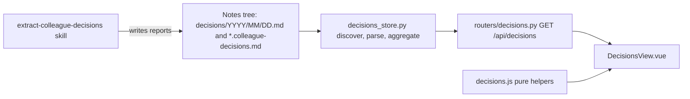
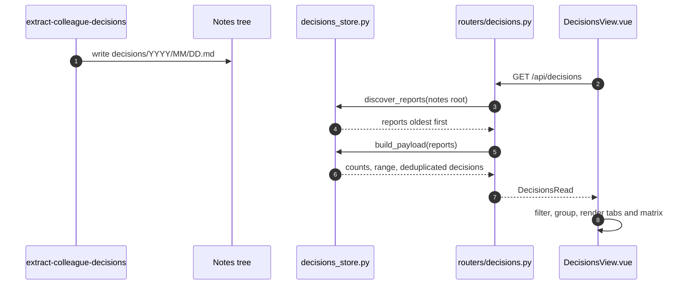

# Specification: Colleague decisions page

## Overview

`decisions_store.py` reads the Markdown reports the `extract-colleague-decisions` skill writes under the notes tree and turns them into plain dataclasses: one `Report` per file holding its `Decision` rows, headlines, not-heard names, and cross-cutting note.
It imports no FastAPI and never writes; a router maps its result onto the `DecisionsRead` response.
`DecisionsView.vue` renders the payload with grouping tabs, filters, and the matrix, backed by pure helpers in `frontend/src/decisions.js`.
The parsing rules deliberately mirror `scripts/colleague_decisions_page.py` in the agents repository, so the page and that script never disagree about what a report says.

## Architecture

## Data Models

### Decision (dataclass)

| Field | Type | Description |
|---|---|---|
| date | str | The report's day, `YYYY-MM-DD` |
| author | str | The person section the decision sits under |
| bucket | str | Decided, Deferred, Open, or Committed |
| text | str | The decision text with the permalink removed |
| permalink | str | The Slack thread link, empty when none |
| supported_by | list[str] | Names on the Supported by line, author excluded |
| opposed_by | list[str] | Names on the Opposed by line, author excluded |
| source | str | The report's path |

### Report (dataclass)

| Field | Type | Description |
|---|---|---|
| day | str | From the file path's date, else the file stem |
| path | str | The file's path |
| decisions | list[Decision] | The decisions in the file |
| headline | dict[str, str] | One optional headline line per person |
| not_heard | list[str] | Names under a "Not heard from" heading |
| cross_cutting | str | The lines under a "Cross-cutting" heading |

### GET /api/decisions payload (DecisionsRead)

| Field | Type | Description |
|---|---|---|
| root | str or null | The notes root, null when it does not exist |
| generated_at | datetime | When the aggregation ran |
| reports | int | How many files were read, ignoring the filters |
| counts | object | decisions, people, supporters, opponents |
| range | object or null | start and end day of the decisions |
| decisions | list[DecisionRead] | Deduplicated, newest first |
| headlines | dict[str, str] | Per-author headline lines |
| not_heard | list[str] | Expected people absent from the decisions |
| cross_cutting | list[str] | One entry per report that carries a note |

## Parsing Rules

- A person is a `## ` heading that is not "Not heard from ..." or "Cross-cutting"; names are cleaned of a leading `@`.
- A decision is a bullet like `- **Decided:** text`, with the bucket one of Decided, Deferred, Open, Committed.
- The permalink is the last Markdown link or bare URL in the decision line; an indented continuation line supplies it when the decision line has none.
- `**Supported by:**` and `**Opposed by:**` lines split into names on commas, semicolons, slashes, and the word "and", and the author's own name is dropped.
- A decision repeated across reports is deduplicated by date, author, bucket, text, and permalink.
- The aggregated list sorts by date, author, and bucket position, all reversed, so the newest day, then the bucket order backwards, leads.

## API Contracts

| Method | Path | Purpose |
|---|---|---|
| GET | /api/decisions | The aggregated reports under the configured notes root |

`GET /api/decisions` takes no parameters and always returns 200, including when the notes root is missing (an empty payload with `root` null, so the page can explain what to set).
There is no write path: creating or changing a report is the skill's job, done outside the API.

## Non-Functional Considerations

- NFR-1: the store is read-only; nothing under the notes tree is created, modified, or deleted.
- NFR-2: `parse_report`, `discover_reports`, and `build_payload` are pure functions over paths and text with no FastAPI import, so they are testable directly.
- NFR-3: dotfiles and unreadable files are skipped; a path without a parseable date falls back to the file stem.
- NFR-4: the page keeps per-device view preferences (the active tab) in localStorage and follows the responsive patterns at phone widths.

## Sequences

### From report to page

## Technical Decisions

| Decision | Choice | Rationale |
|---|---|---|
| Source of truth | The skill's Markdown reports | The skill already produces them from Slack; a second copy would drift |
| Parser fidelity | Mirror the agents repo script exactly | The same file layout, labels, and support rules, so the page and the script agree |
| Writes | None | The reports belong to the skill; the page explains how to produce more instead of offering edits |
| Deduplication | Identity key of date, author, bucket, text, permalink | Ad-hoc and dated reports for the same day repeat decisions; the page shows each once |
| People | Plain names, not People records | The reports carry free-text names; linking them to the directory would guess |
| Aggregation | Whole tree every request | The volume is a report per day of notes; parsing in process keeps the endpoint simple |

## Risks and Unknowns

1. The parser is coupled to the skill's Markdown shape; a report format change on the skill side breaks parsing here until both are updated.
2. The endpoint reads and parses every report on each request, so a very large notes tree makes the page slower over time.
3. Name matching is textual and case-insensitive; two spellings of one person count as two people, and the not-heard list depends on the skill naming people consistently.

## Out of Scope

- Writing, editing, or deleting reports; that is the `extract-colleague-decisions` skill's job.
- Linking report names to the People directory or resolving their Slack ids.
- A CLI command; the aggregation is reachable over HTTP or by reading the files.
