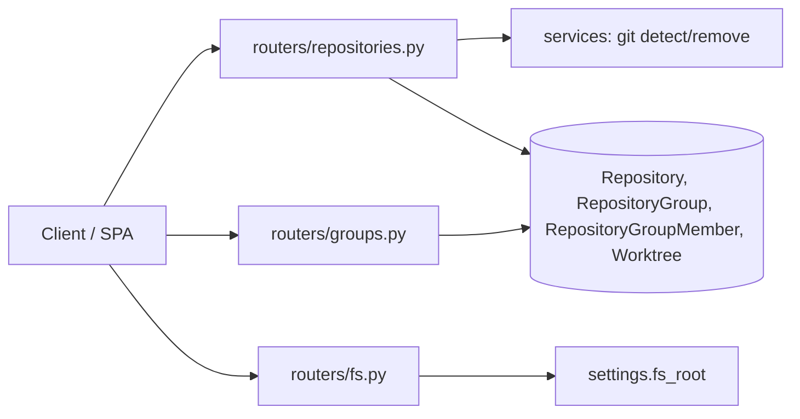
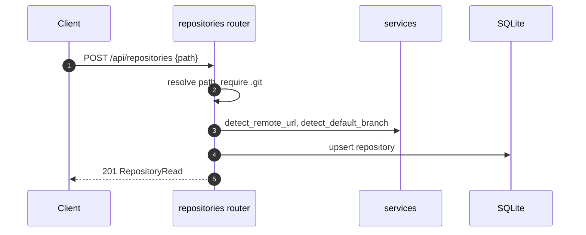

# Specification: Repositories, groups, and directory picker

## Overview

Repositories are served by `routers/repositories.py`, groups by `routers/groups.py`, and the picker by `routers/fs.py`.
`services.py` provides `detect_remote_url`, `detect_default_branch`, and the git helpers; worktree removal on repository delete reuses `remove_worktree`.
The group's paths are injected into the context prompt by `services.build_context_prompt`.

## Architecture

## Data Models

### Repository

| Field | Type | Constraints | Description |
|---|---|---|---|
| id | string | PK | Repository id |
| name | string | not null | Display name (defaults to folder name) |
| path | string | not null | Absolute path |
| remote_url | string | nullable | Detected origin |
| default_branch | string | nullable | Detected branch |

### RepositoryGroup / RepositoryGroupMember

| Field | Type | Constraints | Description |
|---|---|---|---|
| id | string | PK | Id |
| name / description | string | not null / default "" | Group fields |
| group_id | string | FK repositorygroup, index | Membership group |
| repository_id | string | FK repository, index | Member |

Unique constraint on `(group_id, repository_id)`.

## API Contracts

The normative contract is in [`api.yaml`](api.yaml) once written; the table below is the summary.

| Method | Path | Purpose |
|---|---|---|
| GET | /api/repositories | List repositories |
| POST | /api/repositories | Register one repository |
| POST | /api/repositories/bulk | Register several, with per-path errors |
| GET | /api/repositories/{id} | Read one |
| DELETE | /api/repositories/{id} | Remove one and its worktrees |
| GET | /api/groups | List groups |
| POST | /api/groups | Create a group |
| GET | /api/groups/{id} | Read a group |
| PATCH | /api/groups/{id} | Update a group and its members |
| DELETE | /api/groups/{id} | Delete a group, detaching tasks |
| GET | /api/fs/list | Browse the server filesystem |

## Sequences

### Register a repository by path

## Technical Decisions

| Decision | Choice | Rationale |
|---|---|---|
| Detection | `git remote get-url origin` and `origin/HEAD` | Avoids asking the user for metadata |
| Bulk add | Loop and collect errors | One bad path should not block the rest |
| Picker | Server-side `GET /api/fs/list` | A browser file input cannot reveal server paths |
| Repository delete | Remove worktrees, memberships, associations first | Foreign keys are enforced |

## Risks and Unknowns

1. Repository paths are machine-specific; the database is not portable across machines.
2. Browsing is confined to `AGENTIC_FS_ROOT`; setting it to `/` opens the whole filesystem.

## Out of Scope

- Cloning repositories; only existing local checkouts are registered.
- Per-repository credentials.
