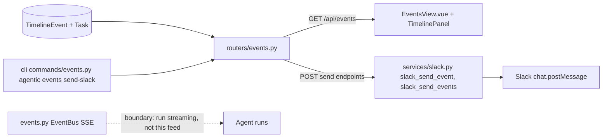
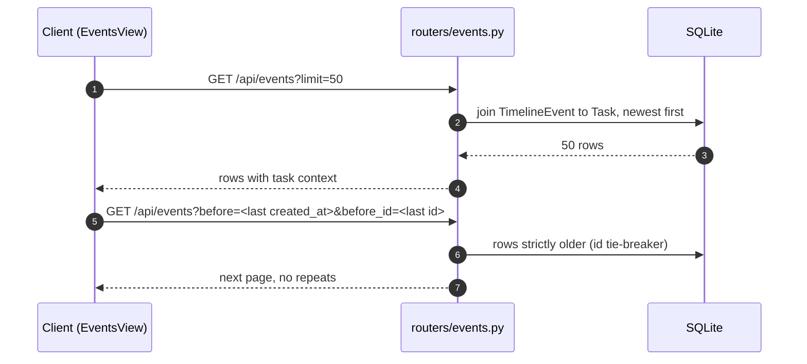
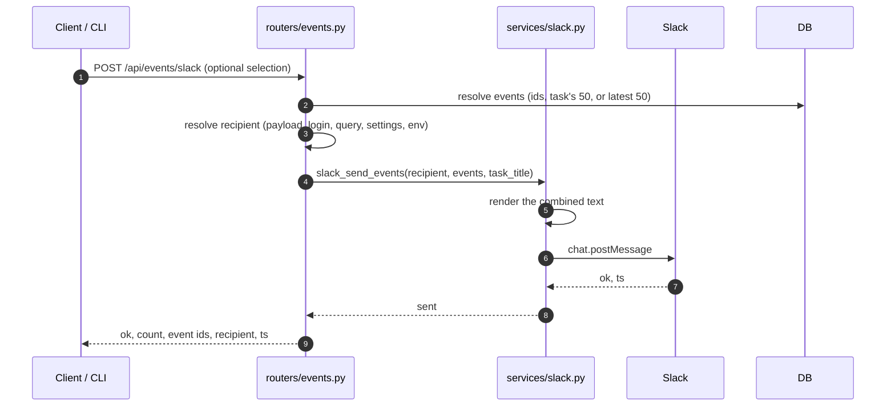

# Specification: Events feed

## Overview
`routers/events.py` serves the cross-task feed as one query: a join of `TimelineEvent` to `Task`, newest first with the id as a tie-breaker, so each row carries the task's title and status and reads on its own.
The same router exposes the Slack delivery endpoints, which select events, resolve the recipient through payload, People aliases, query, database settings, and then environment settings, and render through the pure text functions in `services/slack.py` before the shared bot-DM sender delivers them.
`EventsView.vue` renders the feed grouped by local day, reusing `TimelinePanel` per day, and pages backwards with the cursor the last row provides.
The in-process pub/sub bus in `events.py` is a different mechanism: it streams agent events to the SPA over SSE and belongs to the run streaming story, so it is only a boundary here and plays no part in this feed.

## Architecture

## Data Models

### EventRead (response row)

| Field | Type | Description |
|---|---|---|
| id | string | Event id |
| task_id | string | Owning task |
| task_title / task_status | string | Task context, joined per row |
| type | string | Event type, for example created, updated, run_started |
| message | string | Human-readable event text |
| data_json | object | Structured event data |
| client / actor | string | Provenance (web, cli, api and human, agent) |
| created_at | datetime | When it happened |

### SlackEventSend (request body, all fields optional)

| Field | Purpose |
|---|---|
| user_id, slack_user_id, channel, recipient, to | Recipient, first non-empty wins |
| login | Resolved through People aliases to a Slack user id |
| event_id, event_ids | One event, or an explicit selection |
| task_id | Send that task's latest 50 events |
| task_title | Override the task title in the rendered message |
| text | Override the rendered message entirely |

The feed stores nothing of its own; it reads the timeline tables the task feature writes.

## API Contracts

| Method | Path | Purpose |
|---|---|---|
| GET | /api/events | The cross-task stream, filtered and paged |
| POST | /api/events/{id}/slack, /send, /send-to-slack | Send one event to Slack (three aliases of one handler) |
| POST | /api/events/slack, /send, /send-to-slack | Send recent events to Slack (three aliases of one handler) |

`GET /api/events` accepts `task_id`, `type`, `actor`, `client`, `q`, `before`, `before_id`, and `limit` (1 to 500, default 50), and returns a list of `EventRead`.
The send endpoints return `ok`, the event count or event id, the event ids, the resolved `slack_user_id`, and the Slack message `ts`.
Status codes: 404 when the event id is unknown or the selection is empty ("Event not found", "No events to send"), 502 when Slack fails or refuses (a `SlackError` surfaces as a 502), and 200 otherwise.

Recipient resolution order: payload fields (`user_id`, `slack_user_id`, `channel`, `recipient`, `to`), then a `login` resolved through People aliases to a Slack user id, then the `user_id` and `channel` query parameters, then the database settings keys `slack_events_user_id`, `slack_event_user_id`, `slack_notify_user_id`, `slack_user_id`, `slack_events_channel`, then the same names as environment settings.
The rendered message lists `Task: title`, `[type] message`, `When: created_at`, and `Data: {...}` lines; `text` on the request replaces it.

## Non-Functional Considerations

- NFR-1: the feed joins the timeline tables only; the operations audit log is deliberately excluded so one action never appears twice.
- NFR-2: the cursor compares `created_at` and `id` together, so rows written in the same instant are neither skipped nor repeated across pages.
- NFR-3: `slack_event_text` and `slack_events_text` are pure renderers, and delivery reuses the shared bot-DM sender, so no endpoint talks to Slack directly.
- NFR-4: the page never polls; it loads on mount and on filter change, and keeps already-loaded rows when a later page fails.

## Sequences

### Page the feed

### Send recent events to Slack

## Technical Decisions

| Decision | Choice | Rationale |
|---|---|---|
| Source | Every task's timeline read in one join | The timeline is already the activity record; a second store would drift |
| Row shape | Denormalized task title and status per row | A feed row must read on its own without a second request |
| Ordering | created_at desc with an id tie-breaker | Same-instant rows keep a stable order, which the cursor depends on (NFR-2) |
| Audit log | Not merged | It records raw mutating requests, so the same action would appear twice (NFR-1) |
| Slack delivery | Reuse the shared renderer and bot-DM sender | One rendering and one sending path for the app and the CLI (NFR-3) |
| Endpoint aliases | `/slack`, `/send`, `/send-to-slack` kept side by side | Callers and earlier clients keep working; each maps to the same handler |
| SSE bus | Kept out of this feature | `events.py` streams agent runs to the SPA; the feed is a stored-data read |

## Risks and Unknowns

1. The page shows a load-older button whenever the last page came back full, so a feed sized at an exact multiple of 50 offers a click that can return nothing.
2. There is no forward paging: going back toward the present means reloading the first page.
3. Slack delivery is synchronous; a slow Slack API holds the request, and there is no retry after a 502.

## Out of Scope

- The in-process SSE bus (`events.py`), which belongs to the run streaming story.
- Merging the operations audit log into the feed.
- Slack delivery of item pokes and test notifications, which live with their own features.
- A CLI `events list`; agents read the stream over HTTP.
