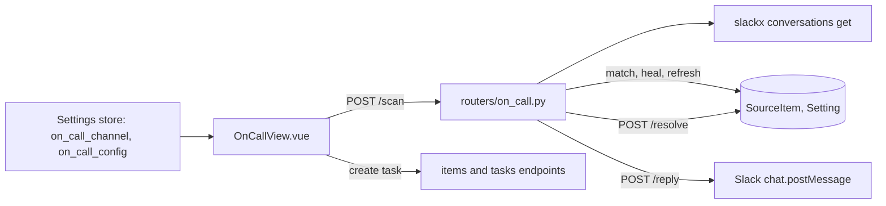
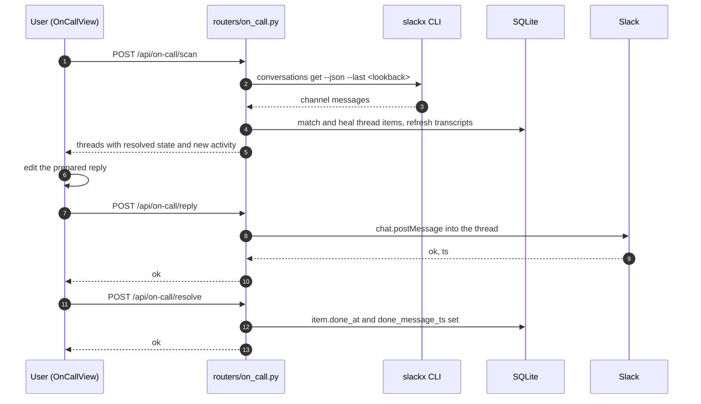

# Specification: On-call view

## Overview
`routers/on_call.py` is the whole backend surface: a scan that shells out to `slackx` for a channel window and groups the messages into threads, a reply that posts to Slack's `chat.postMessage`, and a resolve that creates or updates the thread's Slack item.
The scan is also where state heals and refreshes: each thread is matched to a stored `SourceItem` by a canonical external id, older id and URL forms are rewritten, the stored transcript and title are refreshed, and the resolved watermark is compared against the latest message to flag new activity.
`OnCallView.vue` owns the rotation: it restores the channel and rotation configuration from settings, scans on a timer while the rotation is active, prepares a draft reply per thread, and calls reply, resolve, and the item and task endpoints.
No docs page exists for this view yet.

## Architecture

## Data Models

The feature adds no tables; it uses existing rows.

### SourceItem (as used here)

| Field | Use |
|---|---|
| source / kind | `slack` / `thread` |
| external_id | Canonical `<channel id>:<dotless ts>`; older forms (bare ts, configured `#name`) are healed |
| url | Canonical `https://workspace.slack.com/archives/<channel id>/p<dotless ts>` permalink |
| title | The thread's first 80 characters, unless the user set a custom title |
| content | The refreshed transcript (root and replies, `user: text` lines) |
| done_at / done_message_ts | The resolved watermark: resolution time and the message ts it covers |
| fetched_at / updated_at | Refreshed on each scan that finds the item |

### Settings rows

| Key | Content |
|---|---|
| `on_call_channel` | The channel to scan, a `#name` or a channel id |
| `on_call_config` | JSON with `frequency_minutes`, `rotation_starts_at`, `rotation_ends_at` |

## API Contracts

| Method | Path | Purpose |
|---|---|---|
| GET | /api/on-call | Placeholder returning `{"threads": []}`; nothing calls it |
| POST | /api/on-call/scan | Fetch the channel window through slackx and return threads with their state |
| POST | /api/on-call/reply | Post a reply to the channel or thread through Slack |
| POST | /api/on-call/resolve | Create or update the thread's item and set or clear the resolved watermark |

`POST /scan` takes `channel` (required) plus optional `frequency_minutes`, `rotation_starts_at`, and `rotation_ends_at`, and returns `threads` (each with ts, title, text, user, replies, context, reply_count, slack_url, optional slackx_url, task_id, resolved, resolved_through_ts, has_new_activity), channel and channel_name as slackx reported them, `message_count`, and `lookback`.
A rotation start in the future short-circuits to an empty inactive payload.
Status codes: 400 when the channel is missing, 502 when slackx is unavailable, fails, or returns invalid JSON.

`POST /reply` takes `channel`, `text` (both required), and optional `thread_ts`, and returns `ok`, `ts`, and `channel`.
Status codes: 400 when channel or text is missing or no token is configured, 502 when the HTTP call fails or Slack refuses the message.

`POST /resolve` takes `channel`, `thread_ts` (both required), `resolved` (default true), and optional `resolved_through_ts`, and returns `ok` and `resolved`.

## Key Flows

### Rotation window and lookback

Without `rotation_starts_at` the lookback is `1d`.
With a start, the lookback is the elapsed time from start to now, formatted as days, hours, and minutes (at least one minute); a start in the future returns the inactive payload, and the page keeps its timer alive so scanning begins at the start time.

### Scan, heal, and flag new activity

For each thread the scan builds the canonical Slack permalink from the channel id slackx reports (resolving a configured `#name` when needed), finds the stored item by URL first, then by canonical external id, then by the legacy ids, heals the id and URL when an older form is found and nothing else holds the canonical one, refreshes the transcript, title, and fetch timestamps, reads the linked task from the item's association, and compares the latest message ts against `done_message_ts` to set `has_new_activity`.
A per-thread failure in this bookkeeping is swallowed so the scan still returns.

### Resolution watermark

`resolve` marks the item done at now, through the given ts, else the stored watermark, else the thread ts; `resolved: false` clears both fields.
Re-resolving finds the same item, so resolution is idempotent.

## Non-Functional Considerations

- NFR-1: one item per thread; scans and resolves heal legacy external ids and non-permalink URLs instead of creating duplicates.
- NFR-2: the slackx subprocess (60 second timeout) and the Slack HTTP call run inside sync route handlers, so the event loop is not blocked.
- NFR-3: per-thread item bookkeeping failures never fail the scan.
- NFR-4: the page stores its configuration in the settings store, not per device, so it follows the user across browsers.

## Sequences

### Scan and act on a thread

## Technical Decisions

| Decision | Choice | Rationale |
|---|---|---|
| Channel access | The `slackx` CLI with a windowed fetch | The same tool the rest of the workspace tooling uses; it caches and fetches threads with their replies |
| Thread identity | Canonical `<channel id>:<dotless ts>` external id | Permalinks and dedup need the id, not the configured `#name`; legacy forms are healed so existing data keeps working |
| Resolution state | `done_at` plus a `done_message_ts` watermark on the item | The item is already the thread's record, so the resolved state rides on it and survives scans |
| Rotation | Page-side timer plus server-side lookback | The server computes a window that stays fresh no matter when a scan actually runs |
| Reply tokens | Database `slack_bot_token`, else `SLACK_TOKEN`, optional `SLACK_COOKIE` | One precedence for bot and user tokens, matching the app's other Slack senders |
| Draft replies | Client-side default text per thread | Replies are personal and edited before sending, so the server stores nothing |

## Risks and Unknowns

1. The view probes several plausible API namespaces and method names before each call; it works, but it hides the real contract and should be tightened to the actual `api.js` methods.
2. `GET /api/on-call` returns an empty list and has no caller; it is kept as a placeholder and may be dead.
3. The scan shells out to `slackx`, so a missing or misconfigured CLI degrades the whole page to 502s, and message counts depend on slackx's fetch behavior.
4. Replying authenticates with a raw token and optional cookie; a leaked token has full posting rights, so the configuration should stay local.

## Out of Scope

- Automatic or agent-drafted replies beyond the static default draft.
- Rotation scheduling that runs without the page open; scanning only happens on the page's timer or an explicit API call.
- On-call handoff reports or shift calendars.
- Documentation: no page exists under `docs/` yet.
