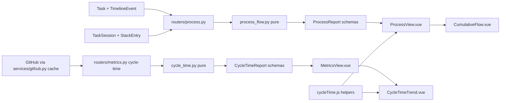

# Specification: Process view: flow and cycle time

## Overview

The feature reads the SDLC process as a production line and reports how work moves through it.
`process_flow.py` is a pure module: it takes task records, status transitions already mapped onto stations, focus-stack sessions, and the reporting window, and returns a `ProcessReport` with fourteen sections (inventory, flows, cycle time, histogram, dwell, weekly, Little's law, wait shares, queue pressure, flow samples, WIP items, touch, forecast, outcomes).
`routers/process.py` loads the tasks, reconstructs the transitions from the timeline, and wraps the report in response schemas for `GET /api/process`.
`cycle_time.py` is the second pure module: it takes GitHub issue and pull request records normalized by `services/github.py` and returns median-based series for issue close, review wait, and review to merge, which `routers/metrics.py` exposes per repository.
The SPA adds the Process page (`ProcessView.vue` with `CumulativeFlow.vue`) and the Metrics page's cycle-time panel (`CycleTimeTrend.vue`), both formatted through the shared `cycleTime.js` helpers.
The boundary with p11-metrics holds: p11 computes autonomy rate and yield from `change` rows, and this feature computes nothing from changes.

## Architecture

## Data Models

No new tables. The feature reads existing rows and reduces them to frozen dataclasses in the pure modules.

### Inputs (reduced from tables)

| Record | Fields kept | Source |
|---|---|---|
| TaskRecord | id, created_at, status, title | `Task` |
| Transition | task_id, at, from_stage, to_stage | `TimelineEvent` rows of type `updated` with `changes.status` |
| TouchRecord | task_id, started_at, ended_at | `TaskSession` resolved to a task through `StackEntry` |
| IssueRecord | number, created_at, closed_at | GitHub issues fetch |
| PullRecord | number, created_at, merged_at, reviews, review_requests | GitHub pulls fetch |

### Statuses to stations

| Task status | Station | Station label |
|---|---|---|
| open | backlog | Backlog |
| in_progress | in_progress | In progress |
| blocked | blocked | Blocked |
| done | done | Done |
| archived | archived | Archived |

Unknown statuses fall back to the backlog. The active stations (the queues Little's law is about) are backlog, in_progress, and blocked.

### Key computed shapes

- `StageStat`: per station count, oldest/median/newest age in hours.
- `StageFlow`: one from/to station pair with a move count.
- `Distribution`: count, mean, median, p10, p90, fastest, slowest, all hours.
- `HistogramBucket`: the fixed buckets `<1d`, `1-2d`, `2-4d`, `4-7d`, `1-2w`, `2-4w`, `1-2mo`, `>2mo`, half-open except the last.
- `QueuePressure`: stage, count, arrived, departed, net, trend (`filling`/`draining`/`steady`), weekly WIP samples.
- `FlowSample`: one day's backlog, in_progress, blocked inventory plus monotonically growing completions.
- `WipItem`: id, title, stage, entered_at, age_hours.
- `TouchStats`: completions, covered, touch_hours, cycle_hours, efficiency, mean_touch_hours.
- `Forecast`: items, sims, weeks_observed, p50/p85 weeks and dates.
- `Outcomes`: created, done, archived, active.
- `MetricSeries` (cycle time): metric id, label, median_hours, count, and `Bucket` tuple (start, end, median_hours, count).

## API Contracts

| Method | Path | Purpose |
|---|---|---|
| GET | /api/process | The production-line report for the window |
| GET | /api/metrics/cycle-time | Issue-close and review cycle-time series, per repository |

`GET /api/process` accepts `days` (default 90, bounded 1 to 730) and returns the `ProcessReport` schema: `generated_at`, `window_days`, `stages`, `flows`, `arrivals`, `completions`, `cycle_time`, `histogram`, `dwell`, `weekly`, `littles`, `wait_shares`, `queue_pressure`, `flow_samples`, `wip_items`, `touch`, `forecast`, and `outcomes`.

`GET /api/metrics/cycle-time` accepts `days` (default 90, bounded 1 to 730), `bucket_days` (default 7, bounded 1 to 90), `repository_id` (optional; without it every repository with a GitHub remote is included), and `refresh` (bypass the ten-minute cache). It returns `window_days` and one entry per repository with `repository_id`, `name`, `full_name`, and either `series` (three `MetricSeries`) or an `error` string. Status codes: 404 for an unknown repository id, 400 for a repository without a GitHub remote.

## Key Flows

### Transition reconstruction

Each `TimelineEvent` of type `updated` may carry `data_json.changes.status` as `{"from": ..., "to": ...}`.
The router maps both ends through `STATUS_TO_STAGE` and drops the event when either end is unknown or when the move is not a real station change.
The task walk (`stage_timeline`) starts every task in the backlog at creation, applies a transition only when the task currently sits in the transition's from-station, and corrects the final entry to the task's current station when the recorded history ends elsewhere, so missing or gappy history degrades to "has been here since its last known move".

### Report build

`build_report` slices the window (`now - days` to `now`), collects the completions (transitions into done inside the window), and fills every section from them:
dwell and wait shares split each completed trip's time per station, Little's law integrates active-station hours over the window and divides by throughput, queue pressure counts arrivals and departures (creations count as backlog arrivals) and samples inventory at each week end, flow samples snapshot once a day, the forecast resamples the weekly completion counts 500 times with a fixed seed, and touch stats clip focus-stack sessions to each trip.

### Cycle-time reads

The metrics router resolves the target repositories, fetches each one's issue and pull event data through the cached `fetch_github_cycle_time` (a few at a time), normalizes timestamps defensively, and hands the records to `build_series_for`.
Review wait runs from the earliest review request to the first review submitted at or after it, so a review that predates the request or belongs to an earlier round does not answer it; review to merge counts only merged pulls whose first review precedes the merge.
Trend buckets are anchored at the window start and keep empty periods as no-value entries.

## Technical Decisions

| Decision | Choice | Rationale |
|---|---|---|
| Purity | All arithmetic in `process_flow.py` and `cycle_time.py`, database access in routers | Matches the `metrics.py` convention; deterministic and testable without a database, network, or clock (NFR-1) |
| Transition source | Timeline `updated` events, validated against the current station | The timeline is the recorded history; rejecting guessed moves keeps dwell and shares honest |
| Missing history | Correct the timeline's last entry to the current station | A task with no events must still age in the station it is in |
| Cycle-time basis | Creation to done for items completed in the window | The completion moment is the only reliably recorded trip end |
| Bottleneck metric | Share of total cycle time per station | Sums to one and answers "where does an average trip lose its time" directly |
| Forecast | Monte Carlo resampling of weekly completions, seeded | Works with the small weekly history a solo line produces and stays reproducible (NFR-3) |
| Touch time | Focus-stack sessions clipped to the trip | An item nobody focused reads as zero touched, not as missing data |
| Cycle-time fetch | Cached per repository, parallel across repositories | The GitHub read costs several API round trips; the cache keeps repeat views cheap (NFR-4) |
| Trend buckets | Fixed width, empty periods kept | Dropping empty weeks would make the trend look denser than the data is (NFR-2) |

## Risks and Unknowns

1. The report is only as good as the timeline: status changes made before the timeline recorded diffs, or through paths that skip it, leave no transition and shorten the walks.
2. The forecast resamples weekly completions, so a single lucky week dominates the projection when history is short; the report carries `weeks_observed` so the reader can judge it.
3. Review wait measures only explicit review requests; a pull request reviewed without a request contributes nothing.
4. The daily flow-sampling loop is O(days x tasks); at the 730-day bound with a large task store the report read grows linearly.

## Out of Scope

- Autonomy rate and yield from change records (p11-metrics).
- Writing transitions from anywhere other than the task timeline.
- Per-person or per-agent measurements.
- Storing any computed metric; every read recomputes from the current data.
