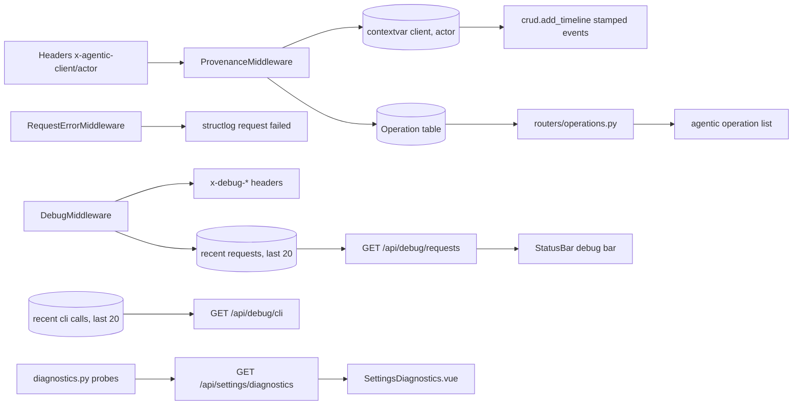

# Specification: Operations audit log and request provenance

## Overview

The feature answers "how did this work enter the system" and "why did that request fail".
`provenance.py` is ASGI middleware: it reads the two declaring headers, sets a contextvar pair (`OperationClient`, `OperationActor`) for the request, and after the response writes one `Operation` row for every mutating `/api` request.
`crud.add_timeline` stamps the same pair onto task timeline events, and the harness environment sets `AGENTIC_ACTOR=agent` so agent-driven CLI calls declare themselves end to end.
`request_logging.py` funnels Uvicorn access lines into structlog and adds the failure reason to the log through `RequestErrorMiddleware`.
`debug.py` adds per-request timing, database query counting (SQLAlchemy engine events), and helper-CLI call tracking, exposed as response headers and two read-only debug endpoints.
`routers/operations.py` is the read-only audit log API, mirrored in the CLI's `operation list` command, and `diagnostics.py` probes the external commands and caches the Settings page shows.

## Architecture

## Data Models

### Operation

| Field | Type | Constraints | Description |
|---|---|---|---|
| id | string | PK | Row id |
| method | string | default "" | HTTP method of the mutating request |
| path | string | default "" | Request path |
| status_code | int | default 0 | Response status |
| client | string/enum | default api, indexed | web, cli, or api |
| actor | string/enum | default human, indexed | human or agent |
| created_at | datetime | not null | When the request completed |

Enums live in `models/base.py` (`OperationClient`: web, cli, api; `OperationActor`: human, agent) and are shared by the `TimelineEvent` client/actor columns that `add_timeline` stamps.

### OperationRead (response)

id, method, path, status_code, client, actor, created_at.

## API Endpoint Summary

| Method | Path | Purpose |
|---|---|---|
| GET | /api/operations | List the audit log (filters: client, actor; limit clamped 1 to 500, default 100) |
| GET | /api/debug/requests | Recent request snapshots with timing, query counts, SQL snippets, and CLI calls |
| GET | /api/debug/cli | Recent helper-CLI calls (aliases: `/api/debug/cli-calls`, `/api/debug/cli_calls`, `/api/debug/rpc`, `/api/debug/rpc-calls`, `/api/debug/rpc_calls`) |
| GET | /api/settings/diagnostics | Runtime, tool, and harness probes plus ghx and slackx cache listings |
| CLI | agentic operation list | The audit log with --client/--actor/--limit |

## Key Flows

### Declared provenance to stamped records

The web UI sends `X-Agentic-Client: web` and `X-Agentic-Actor: human` on every request; the CLI's HTTP client sends `cli` plus the actor from `AGENTIC_ACTOR` (the ACP harness sets `agent` when it spawns the CLI).
`ProvenanceMiddleware` resolves both headers with tolerant coercion and sets the contextvar; handlers read it through `provenance.current_client()` and `provenance.current_actor()`, or override it with the `using()` context manager for system-initiated writes.
After the response completes, the middleware records the operation for POST, PUT, PATCH, and DELETE on `/api/` paths, opening its own short database session so the write is independent of the handler's.

### Failure logging

`RequestErrorMiddleware` wraps the response: for status 400 and above it buffers up to 8 KB of the body, extracts the `detail` (a string, or FastAPI's validation list joined into `loc: msg` pairs), collapses whitespace, truncates at 500 characters, and logs one structlog line with method, path, status, and duration in milliseconds, error level for 5xx and warning otherwise.
The body is passed through to the client untouched.

### Debug bar data

`DebugMiddleware` starts a per-request state (contextvar), and engine events (`before_cursor_execute`/`after_cursor_execute`) accumulate query counts, total time, and per-query SQL snippets capped at 300 characters.
The response gains the three `x-debug-*` headers; afterwards the snapshot joins the last-20 requests list (unless the path starts with `/api/debug`), and helper-CLI invocations recorded through `record_cli_call` join both the request state and their own last-20 list.
The status bar derives per-call stats from the response headers, polls `GET /api/debug/requests` (deduplicating on stable request ids), and offers tabs, a filter, and clear actions, with its layout preferences in localStorage.

### Diagnostics probes

`collect_diagnostics` reads the harness list from the database, then runs one pool of parallel probes: the Python runtime (the interpreter itself), git, ghx, gh, slackx (version probes with a 5-second timeout and closed stdin so a server-style harness cannot hang), each configured harness command, the ghx cache (`ghx repo list`, parsed from table rows including the trailing hit-rate columns), and the slackx cache (`slackx cache status --json`) with a 30-second timeout.
A command that is absent reports `present: false`; a command served by a configured RPC server counts as present without a local path or version.

## Technical Decisions

| Decision | Choice | Rationale |
|---|---|---|
| Provenance source | Caller-declared headers, not inference | The web UI always knows it is the web UI; the harness knows it spawned an agent; guessing would mislabel both |
| Context storage | ContextVar pair set and reset around the request | Handlers and stores read it without threading a parameter through every signature |
| Audit scope | Mutating `/api` requests only | Reads carry no provenance-worthy intent and would dominate the log (NFR-2) |
| Audit row shape | Method, path, status, client, actor only | The log answers "who did what", not "what payload"; bodies would bloat the table and leak content |
| Independent write session | The middleware opens its own session per row | Provenance must never fail a request and must not entangle with handler transactions (NFR-1) |
| Failure logging | Middleware reading the JSON detail | Every handler already puts its human reason in `detail`; one middleware covers them all |
| Debug state | Ring buffers in process memory, cap 20 | Local, single-user app; snapshots are diagnostics, not records, and must not grow unbounded (NFR-3) |
| Probes | Parallel with hard timeouts and closed stdin | The Settings page must never wait on a wedged helper or a harness that treats `--version` as a server start (NFR-4) |
| ghx cache listing | Parse the human table, not the typed RPC | Only the table carries the per-retrieval hit rates, and one spawn buys the full picture |

## Risks and Unknowns

1. `Operation` rows accumulate without a retention policy; on a long-lived store the table grows forever.
2. Provenance is declaration-based, so a curl request without headers reads as `api`/`human` even when a person made it; the timeline and audit log reflect the declaration, not the truth.
3. The debug ring buffers live per process; with multiple workers each worker keeps and serves its own last 20.
4. `RequestErrorMiddleware` buffers only the first 8 KB of an error body, so a detail arriving after that cap is not logged.

## Out of Scope

- Authentication or authorization; the headers declare, they do not authenticate.
- A web UI page for the operations log (the SPA defines the API client but no view).
- Structured request tracing across processes, sampling, or metric export.
- Modifying or deleting audit rows from any surface; the router is read-only.
