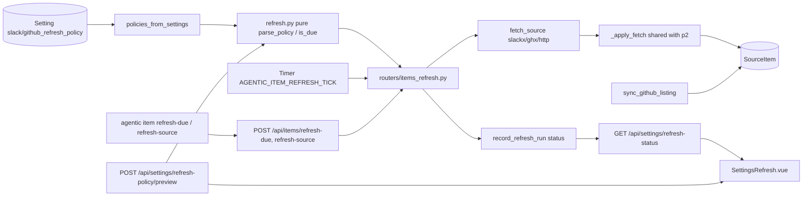

# Specification: Tiered item refresh

## Overview

The feature keeps source items current at a rate that matches how fast each item actually changes.
`refresh.py` is the pure policy language: `parse_duration` reads `30m`/`1h`/`1d`/`2w` and combinations like `1h30m`, `parse_policy` turns `1d=1h,7d=6h,30d=1d,*=7d` into ordered `RefreshTier` bands plus an optional fallback, `interval_for_age` picks the band, `is_due` compares the interval with the item's last fetch, and `item_start`/`item_age` derive the item's true age from its upstream creation rather than its import date.
`routers/items_refresh.py` is the database-side runner: it selects the due items, fetches them together on a pool thread, applies each result through the shared `_apply_fetch`, records per-item outcomes and per-source runs, and also merges repository listing state onto stored items.
`main.py` ticks the pass on a timer in a worker thread, `routers/items.py` exposes the manual endpoints, `routers/settings.py` validates and previews policies, and the Settings page's Refresh section edits everything.
The boundary with p2-source-items holds: the single on-demand `POST /api/items/{id}/refresh` and the item model belong to p2; this feature covers the tiered pass, the policy settings, and the status surfaces.

## Architecture

## Data Models

No new tables. The feature reads and writes existing state.

| Store | Fields used | Role |
|---|---|---|
| `SourceItem` | source, url, external_id, title, title_custom, content, metadata_json, fetched_at, updated_at, created_at, done_at, done_message_ts | The refreshed row |
| `Setting` | `slack_refresh_policy`, `github_refresh_policy`, `slack_refresh_status`, `github_refresh_status` | The policy texts and the JSON run statuses |
| `RefreshPolicy` (pure) | tiers of (max_age, interval), fallback, enabled | The parsed policy |
| Refresh status JSON | last_run_at, refreshed, failed, error, origin, runs history for the 24h sum | What the Settings page shows |

## API Endpoint Summary

| Method | Path | Purpose |
|---|---|---|
| POST | /api/items/refresh-due | Run one policy-driven pass now (origin manual) |
| POST | /api/items/refresh-source/{source} | Re-fetch every item of one source, ignoring the policy (404 unknown source) |
| POST | /api/items/{id}/refresh | Single-item refresh sharing `_apply_fetch` (p2) |
| PATCH | /api/settings | Save settings; both policy keys are parsed first and a malformed policy is a 422 |
| POST | /api/settings/refresh-policy/preview | Parse a policy and report its bands (valid, error, enabled, tiers, fallback) |
| GET | /api/settings/refresh-status | Per-source last run, counts, error, origin, and 24h refreshed sum |
| CLI | agentic item refresh-due / refresh-source | The same passes from the terminal |

Reports from the pass endpoints share one shape: `checked` (items of the active sources), `due`, `refreshed`, `failed`, and `items` (per item: id, source, title, refreshed, error).

## Key Flows

### Policy to due items

Each tick (or manual pass) reads the effective settings, maps the two policy keys to their sources, and parses each text; a source with no policy or a `PolicyError` is skipped.
Every item of an active source is checked: its age comes from `item_start` (GitHub `created_at` metadata, else the Slack thread timestamp in the URL, else the recorded time), the band selects an interval, and the item is due when it was never fetched or its last fetch is at least one interval old.
A naive `fetched_at` read back from SQLite is treated as UTC.

### The fetch pass

Due items fetch together (`run_parallel` over `_safe_fetch`, which turns any exception into that item's error), then results apply one at a time on the caller's thread so the session and per-item commits stay ordered.
`_apply_fetch` merges the fetched title only when the item's title is not custom, merges content and metadata, strips stored content from file items (a path stays a reference), and baselines a thread marked done before its first fetch with the latest message timestamp so the first fetch does not flag everything as new.
A failed fetch still merges what it returned but leaves `fetched_at` alone, so the item stays due.
Afterwards people are linked per item and `record_refresh_run` stores each active source's outcome with its origin; `record_merged_pr_changes` covers items the pass may have merged.

### Force refresh and listing sync

`force_refresh_source` fetches every item of one source that has a URL, ignoring the policy, and records a manual run.
`sync_github_listing` merges a repository listing's state fields (`state`, `is_draft`, `merged_at`, `created_at`, `author`) and non-custom titles onto the matching stored items, so the repository view never shows an item staler than the listing it read; an identical listing writes nothing, and the merge also records merged-PR changes.

## Technical Decisions

| Decision | Choice | Rationale |
|---|---|---|
| Policy language | Age bands plus fallback in one string, stored per source in settings | One field carries the whole schedule; the Settings UI, the CLI, and the loop all read the same text |
| Purity | Parsing, band selection, and due math in `refresh.py` with no imports of db or clock | Deterministic rules, testable without a database or clock (NFR-1) |
| Item age basis | Upstream creation, not import time | A just-imported old issue must not refresh hourly like a brand-new one |
| Failed fetch | Leave `fetched_at` unchanged | A miss must not read as fresh or the item goes quiet for a whole interval (NFR-4) |
| Concurrency | Fetches on the pool, applies on the caller's thread | Blocking CLI/network waits stay off the event loop while session writes stay ordered (NFR-2) |
| Failure scope | Per item, recorded in the entry and the source status | One wedged helper CLI must not stop the other items or sources (NFR-3) |
| Preview | The server parses what the UI shows | The preview and the runner cannot disagree (NFR-5) |
| Listing sync | Merge display state on repository reads; full writes only from fetch passes | The view stays current without paying a full fetch per item, and bodies still come from real fetches |

## Risks and Unknowns

1. The tick reads settings at each pass, so a policy edit lands within one tick; but a very long tick delays both the edit's effect and the next due check by up to that tick.
2. `sync_github_listing` scans all GitHub items per listing; with a large item store the per-visit merge grows linearly.
3. The 24-hour refreshed sum is kept in the status JSON, so it resets if the status setting is deleted or rewritten by an older version.

## Out of Scope

- The item model, associations to tasks, and the single on-demand fetch endpoint (p2-source-items).
- Push-based updates from Slack or GitHub; refresh is always a pull.
- Per-item or per-repository policy overrides; one policy text per source.
- Refreshing sources without an upstream (notes, files on demand only).
