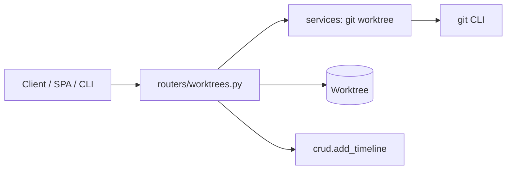
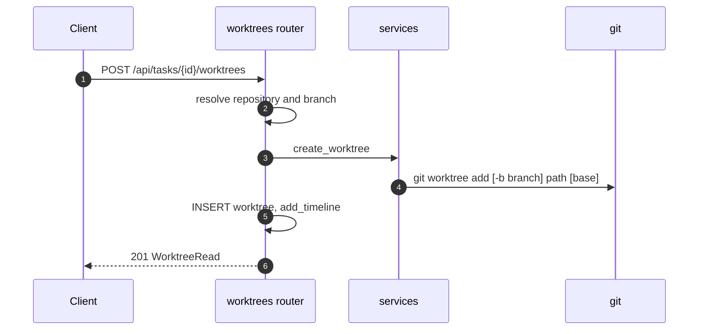

# Specification: Worktrees

## Overview

Worktrees are served by `routers/worktrees.py` (mounted under `/api/tasks`).
`services.py` provides `create_worktree`, `remove_worktree`, `worktree_path`, `slugify`, and `random_branch_name`, all wrapping the `git` binary through a small `_git` helper with timeouts.

## Architecture

## Data Models

### Worktree

| Field | Type | Constraints | Description |
|---|---|---|---|
| id | string | PK | Worktree id |
| task_id | string | FK task, index | Owning task |
| repository_id | string | FK repository | Source checkout |
| branch | string | not null | Branch name |
| path | string | not null | Absolute path |
| status | enum | active, removed | Lifecycle |
| created_at | datetime | not null | Created |
| removed_at | datetime | nullable | Removed |

## API Contracts

The normative contract is in [`api.yaml`](api.yaml) once written; the table below is the summary.

| Method | Path | Purpose |
|---|---|---|
| GET | /api/tasks/{task_id}/worktrees | List a task's worktrees |
| POST | /api/tasks/{task_id}/worktrees | Create a worktree |
| DELETE | /api/tasks/{task_id}/worktrees/{worktree_id} | Remove a worktree |

Error codes shared across endpoints:

| Status | Code | Description |
|---|---|---|
| 400 | NO_REPOSITORY | No repository set on the task and none passed |
| 400 | GIT_FAILED | `git worktree` failed |
| 404 | NOT_FOUND | Worktree or repository not found |

## Sequences

### Create a worktree

## Technical Decisions

| Decision | Choice | Rationale |
|---|---|---|
| Branch default | `agentic/<adjective>-<noun>` (random, retried until free) | Memorable and collision-free when a task has several worktrees |
| Path default | `AGENTIC_WORKTREE_ROOT/<task_id>/<slug>` | Keeps worktrees grouped and off the source checkout |
| Removal | Soft delete plus `git worktree remove --force` and `prune` | Preserves history while freeing disk |
| Git errors | Caught and re-raised as HTTP 400 | A git failure is a user/input problem |

## Risks and Unknowns

1. Removing a task removes its worktrees from disk on a best-effort basis; a locked worktree may remain.
2. Worktree paths embed the task id, so the worktree root is not relocatable without recreating them.

## Out of Scope

- Merging worktree branches.
- Git operations beyond worktree add and remove.
