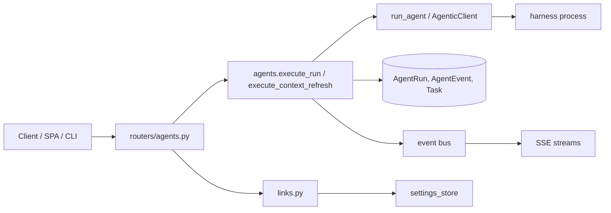
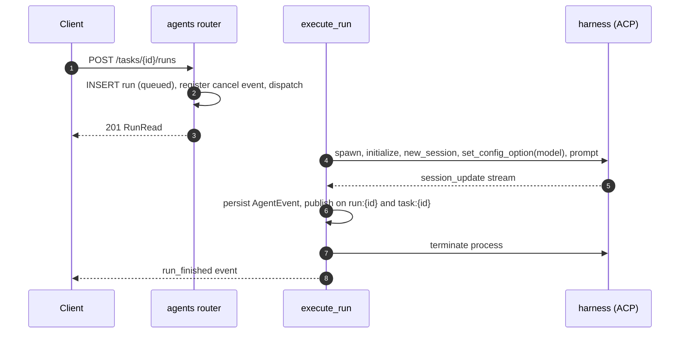

# Specification: Agent runs and context refresh

## Overview

`agents.py` holds the ACP client (`AgenticClient`), the harness presets and seeding, `run_agent`, and the background entrypoints `execute_run` and `execute_context_refresh`.
`routers/agents.py` exposes harnesses, runs, streams, and context endpoints.
`events.py` provides the in-process event bus and the run registry used for cancellation.
`links.py` builds session links, and `settings_store.py` resolves session-link settings from environment defaults and stored overrides.
`services.py` provides `build_context_prompt` and `extract_context_json`.

## Architecture

## Data Models

### Harness

| Field | Type | Constraints | Description |
|---|---|---|---|
| id | string | PK | Harness id |
| name | string | not null | Display name |
| command | string | not null | Executable |
| args | JSON | default [] | Arguments |
| env | JSON | default {} | Extra environment |
| model | string | nullable | Model selected per session over ACP; blank uses the harness default |
| resume_command | string | nullable | Resume template |
| is_default | bool | default false | The default harness (at most one); runs use it when a task picks none |

### AgentRun

| Field | Type | Constraints | Description |
|---|---|---|---|
| id | string | PK | Run id |
| task_id | string | FK task, index | Owning task |
| harness_id | string | FK harness, nullable | Harness used |
| worktree_id | string | FK worktree, nullable | Worktree used |
| cwd | string | nullable | Working directory |
| prompt | string | default "" | Prompt text |
| kind | string | default chat | chat or refresh_context |
| status | enum | queued, running, succeeded, failed, cancelled | Lifecycle |
| session_id | string | nullable | ACP session id |
| stop_reason / error | string | nullable | Outcome |

### AgentEvent

| Field | Type | Constraints | Description |
|---|---|---|---|
| id | integer | PK, autoincrement | Event id |
| run_id | string | FK agentrun, index | Owning run |
| seq | int | default 0 | Ordering |
| type | string | message, thought, tool_call, tool_update, plan, usage, status, error | Event kind |
| text | string | default "" | Text |
| data_json | JSON | default {} | Structured payload |

## API Contracts

The normative contract is in [`api.yaml`](api.yaml) once written; the table below is the summary.

| Method | Path | Purpose |
|---|---|---|
| GET | /api/harnesses | Harness availability and which one is the default |
| GET | /api/harnesses/full | Full harness rows |
| POST | /api/harnesses | Add a harness |
| PATCH | /api/harnesses/{harness_id} | Update a harness |
| DELETE | /api/harnesses/{harness_id} | Delete a harness |
| GET | /api/tasks/{task_id}/runs | List runs |
| POST | /api/tasks/{task_id}/runs | Start a run |
| POST | /api/tasks/{task_id}/context/refresh | Start a context refresh |
| GET | /api/tasks/{task_id}/context | Current summary and next steps |
| GET | /api/runs/{run_id} | Read a run with session links |
| GET | /api/runs/{run_id}/events | Persisted transcript |
| POST | /api/runs/{run_id}/cancel | Cancel a run |
| GET | /api/runs/{run_id}/stream | SSE transcript |
| GET | /api/settings | Effective settings and overrides |
| PATCH | /api/settings | Update session-link overrides |

## Sequences

### Run with live streaming

## Technical Decisions

| Decision | Choice | Rationale |
|---|---|---|
| Agent abstraction | ACP over stdio | A harness is a table row, never special-cased in code |
| Default harness | One `is_default` row, seeded once to installed `opencode2` else `opencode` | Runs resolve it when a task picks none; Settings can change it, and seeding never overrides that choice |
| Event normalization | One `session_update` branch per kind | A stable event vocabulary for UI and persistence |
| Cancellation | `asyncio.Event` per run, raced against the prompt task | Cancel without killing the process abruptly |
| Context parsing | Balanced-brace scan plus truncated-JSON repair | Models hit output limits and wrap JSON in prose |
| Model selection | ACP `session/set_config_option` (`model`), not a CLI flag | `opencode acp` rejects `--model` and would fail to start; the option is chosen per session after it is created |
| Message source | Prefer `message` events; fall back to `thought` only if empty | Thinking and message chunks interleave on one stream |
| Settings precedence | Stored override wins over environment default | Lets the UI change links without a restart |

## Risks and Unknowns

1. ACP turn latency is variable; a run that is still running after a minute is not necessarily hung.
2. Runs are lost on server restart (in-process).
3. Auto-approving all permission requests assumes a trusted environment.

## Out of Scope

- Interactive permission approval UI.
- Resuming an in-flight run after a server restart.
