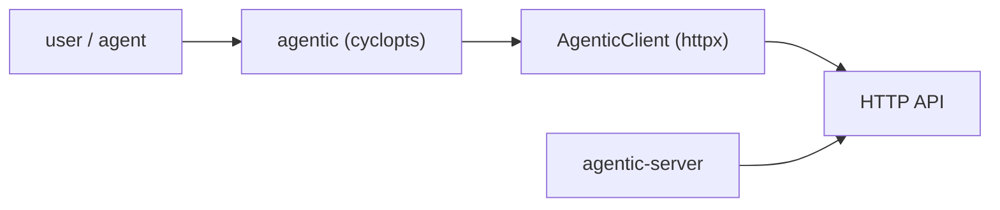
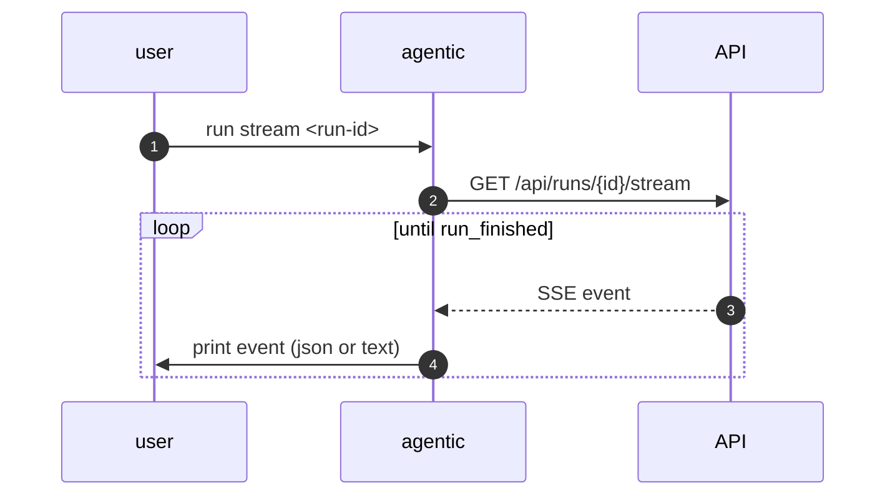

# Specification: Command-line interface

## Overview

`cli/src/agentic_cli/cli.py` is a cyclopts `App` whose global flags (`--api-url`, `--format`, `--timeout`) live on `app.meta.default`.
Inside the launcher, `app(tokens)` returns the command's value, so the launcher returns it for the console to print (and to turn integers into exit codes).
`cli/src/agentic_cli/client.py` is the `AgenticClient` (httpx) that the commands call.
`backend/src/agentic/server_cli.py` is the separate backend command that runs uvicorn or prints config.

## Architecture

## Data Models

The CLI holds no data models; it passes the API's JSON through and renders it.
`CONTEXT` carries the resolved `api_url`, `format`, and `timeout` per invocation.

## API Contracts

The CLI consumes the HTTP API; it exposes no API of its own.
Its command surface is:

| Command | Subcommands |
|---|---|
| `agentic health` | — |
| `agentic task` | list, get, create, update, delete, timeline |
| `agentic item` | list, get, create, refresh, delete |
| `agentic link` | add, remove |
| `agentic repository` | list, add, remove |
| `agentic worktree` | list, create, remove |
| `agentic run` | list, get, events, create, cancel, wait, stream |
| `agentic context` | get, refresh |
| `agentic harness` | list, create, update, delete |
| `agentic settings` | get, set |
| `agentic-server` | serve, info |

## Sequences

### Run stream

## Technical Decisions

| Decision | Choice | Rationale |
|---|---|---|
| Parser | cyclopts with a meta launcher | Global flags plus grouped subcommands, and value return for exit codes |
| Console | Plain Rich `Console(markup=False, soft_wrap=True)` | Keeps `[open]` literal and piped JSON unwrapped |
| Client/server split | Two packages | The user client should not import the backend |
| Format | `auto` by tty detection | Sane defaults for interactive and piped use |

## Risks and Unknowns

1. `run wait` polls rather than subscribing, so it can be slow to notice completion.
2. The CLI surface can drift from the API; there is no generated client.

## Out of Scope

- Shell completion.
- An interactive TUI.
