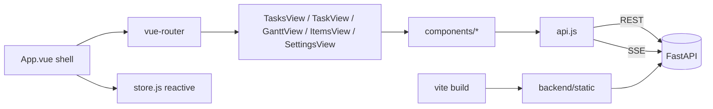
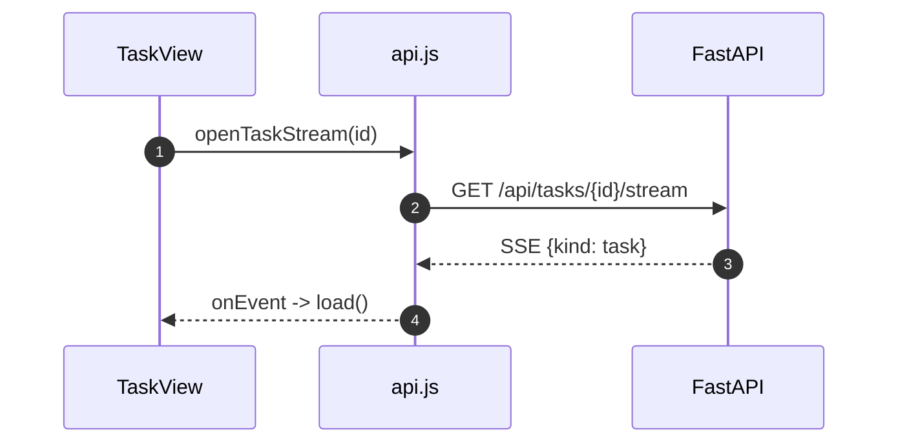

# Specification: Web single-page app

## Overview

The SPA lives in `frontend/`.
`main.js` creates the Vue app and router; `App.vue` is the shell (top bar, sidebar, new-task modal, toasts, command palette).
`store.js` is a small reactive store, and `api.js` wraps `fetch` and the two `EventSource` stream helpers.
`views/` holds TasksView, TaskView, GanttView, ItemsView, and SettingsView; `components/` holds the panels (Context, Agent, Items, Worktrees, Timeline), SessionLinks, SearchSelect, EditableText, DirectoryPicker, RepositoryGroupsPanel, and CommandPalette.
Vite builds into `backend/static`, which FastAPI serves.

## Architecture

## Data Models

The SPA holds no persistent models; it mirrors API responses in a reactive `store` (`tasks`, `harnesses`, `repositories`, `groups`, `loading`, `toast`).

## API Contracts

The SPA consumes the HTTP API through `api.js`, including the SSE endpoints `GET /api/runs/{id}/stream` and `GET /api/tasks/{id}/stream`.

## Sequences

### Live task update

## Technical Decisions

| Decision | Choice | Rationale |
|---|---|---|
| Serving | Build into `backend/static`, serve from the API | One process for API and UI |
| Caching | Workbox network-only for `/api`, deny-list the SPA fallback for `/api` | API responses must never be served stale |
| State | A single reactive store, no Pinia/Vuex | The app is small enough |
| Streams | One `EventSource` per open view, closed on unmount | Avoids leaks and duplicate updates |
| Styling | Hand-written CSS with a max-width breakpoint at 760px | No CSS framework dependency |

## Risks and Unknowns

1. No frontend tests, so UI regressions are caught only manually.
2. Host header validation in the dev server (`allowedHosts`) is machine-specific.

## Out of Scope

- Server-side rendering.
- Internationalization.
