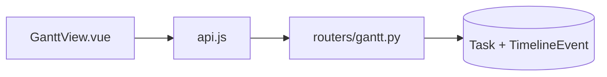
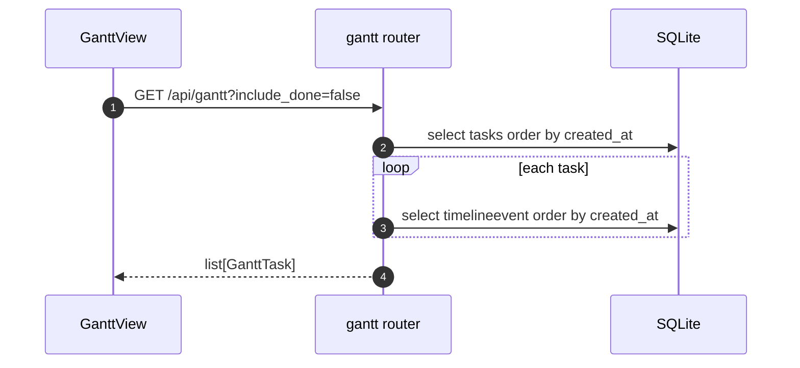

# Specification: Gantt timeline view

## Overview

The Gantt view is served by `routers/gantt.py` as `GET /api/gantt`, returning `GanttTask` rows built from `Task` plus its `TimelineEvent` markers.
`frontend/src/views/GanttView.vue` renders the rows as a hand-rolled CSS chart: a shared time domain, tick gridlines, a bar per task, a marker per event, and a legend.
The time domain comes from two date-time fields in the page header: a fitted window by default, or a start and end the user sets, with clipping of anything outside it.

## Architecture

## Data Models

### GanttTask (response-only)

| Field | Type | Constraints | Description |
|---|---|---|---|
| id | string | PK | Task id |
| title | string | not null | Task title |
| status | TaskStatus | not null | Lifecycle status |
| priority | int | not null | 0 to 3 |
| created_at | datetime | not null | Span start |
| updated_at | datetime | not null | Span end |
| markers | list[TimelineRead] | default [] | One per timeline event, oldest first |

No table is added; the view is derived from `task` and `timelineevent`.

## API Contracts

The normative contract is in [`api.yaml`](api.yaml) once written; the table below is the summary.

| Method | Path | Purpose |
|---|---|---|
| GET | /api/gantt | Tasks with spans and timeline markers (query: include_done) |

## Sequences

### Load the gantt

## Technical Decisions

| Decision | Choice | Rationale |
|---|---|---|
| Data source | Existing `Task` and `TimelineEvent` rows | No new persistence; markers are already recorded |
| Closed filter | `done` and `archived` hidden unless asked | Keeps the default view on work in flight |
| Rendering | Plain CSS positioning over a fixed data domain | No charting library; the shape is simple |
| Time window | Two date-time fields override a fitted window | Direct control over the viewed range without server state |
| Window state | Component-local, not persisted | The range is a view preference, cheap to reset with fit |

## Time window

The component keeps `rangeStart` and `rangeEnd` as date-time field values (local time, no timezone, second precision).
Until the user edits a field it refits the window on every load, filling both fields with the fitted start and end.
The fitted window spans every task (`created_at`, `updated_at`), every marker, and the current time, with a 2% pad.
An unset bound defaults to the fitted bound, so editing one end keeps the other fitted.
When the resolved start and end are ordered, they define the domain; otherwise the fitted window is used and the range is reported as invalid.
The track clips with `overflow: hidden`, so bars and markers outside the window are cut at the edges.
The "now" line and its legend entry render only when the current time falls inside the window.
Ticks use three across a window shorter than three days (time-of-day labels are long) and five otherwise.

## Risks and Unknowns

1. One timeline query runs per task (N+1); acceptable for the local dataset, but it would need batching on a large task count.
2. The fitted window always includes now, so far-future events would compress the visible range; the window fields let the user narrow past them.

## Out of Scope

- Editing a task from the chart.
- Live (SSE) updates of the chart.
