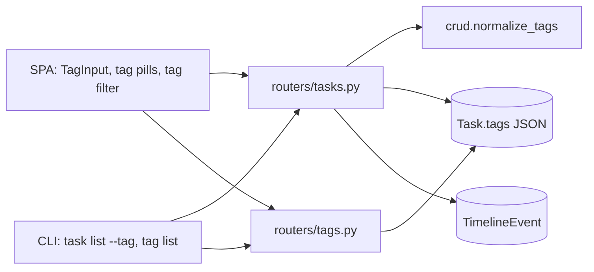
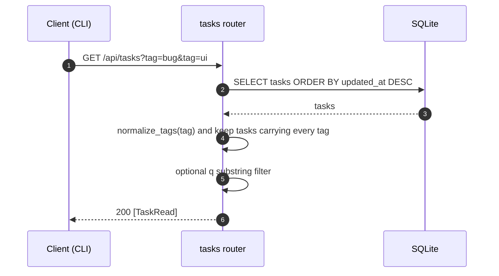
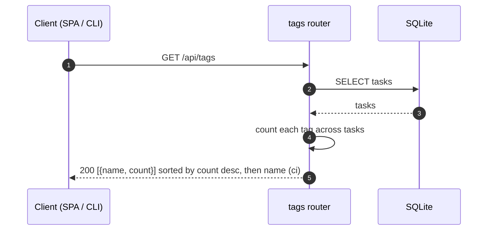
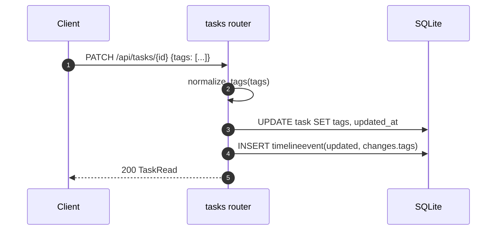

# Specification: Task tags

## Overview

Tags stay a JSON list on the `Task` row (`task.tags`), so no table or migration is introduced.
The tasks router normalizes the list on create and update, records a tag change on the timeline when a task is updated (the timeline is only written on update; create records a single "created" event), and filters the list in process when a `tag` query parameter is present.
A small `tags` router derives the set of tags in use and their counts from the tasks themselves.
The SPA adds a `TagInput` component (chips plus an inline entry field), tag pills on task rows, a tag filter that narrows the already-loaded list in the browser, and a tag field on the new-task form.
The CLI adds `task list --tag` (which sends the `tag` query parameter) and `tag list`.

## Architecture

## Data Models

### Task.tags (existing column)

| Field | Type | Constraints | Description |
|---|---|---|---|
| tags | JSON array of string | default `[]` | The task's labels, normalized on write (trimmed, no empties, no duplicates, order preserved) |

No new persisted table or column is added; the `tags` column already exists on the `task` table.

### Tag (derived, not persisted)

| Field | Type | Description |
|---|---|---|
| name | string | A tag that at least one task carries |
| count | int | How many tasks carry it |

`Tag` is computed on read by `routers/tags.py`; it is never stored.

## API Contracts

The normative contract is in [`api.yaml`](api.yaml) (OpenAPI 3), scoped to the tag surface this feature adds or changes.
The table below is a summary.
The rest of the tasks API is unchanged and documented in [`p1-tasks/specification.md`](../p1-tasks/specification.md).

| Method | Path | Purpose |
|---|---|---|
| GET | `/api/tasks` | List tasks; adds a repeatable `tag` query parameter (all must match) |
| POST | `/api/tasks` | Create a task; `tags` is normalized before storing |
| PATCH | `/api/tasks/{task_id}` | Update a task; `tags` replaces the list and is normalized |
| GET | `/api/tags` | List the tags in use with their task counts |

Error codes shared with the rest of the API:

| Status | Code | Description |
|---|---|---|
| 400 | INVALID_INPUT | Missing title and no GitHub URL on create |
| 404 | NOT_FOUND | Task not found |

## Web UI

| Component | Change | Requirements |
|---|---|---|
| `TagInput.vue` | Removable tag chips plus an inline entry field; Enter or comma adds, Backspace removes the last, existing tags offered as quick picks | FR-4, FR-6 |
| `TaskView.vue` | Renders `TagInput` in the task header; saving calls `PATCH /api/tasks/{id}` with the new list | FR-4 |
| `App.vue` (sidebar) | Tag pills under each task and a tag filter row that narrows the in-flight list; the new-task modal includes `TagInput` | FR-5, FR-6 |
| `CommandPalette.vue` / `App.vue` | A **Tags** group with one entry per tag (picks that tag's filter) and a "Clear tag filter" action while one is active; task entries are searchable by their tags | FR-5 |
| `TasksView.vue` | Tag pills on each focus row (clicking one filters) and a tag filter row; the status counts reflect the active filter while the per-tag counts stay global | FR-5 |
| `store.js` | Holds `tags` and `tagFilter`; `loadTags` and `toggleTagFilter` | FR-3, FR-5 |
| `api.js` | `api.tags.list()` calls `GET /api/tags` | FR-3 |

The SPA filters the loaded task list in the browser (FR-5); it does not send the `tag` query parameter.

## Sequences

### Filter the task list by tag

The SPA filters the list it has already loaded in the browser; the CLI sends the `tag` query parameter so the filter runs on the server.

### List the tags in use

### Change a task's tags

## Non-Functional Considerations

- **Data integrity (NFR-1):** tags reuse the existing `task.tags` JSON column; there is no new table, column, or migration, and existing databases keep working.
- **Consistency (NFR-2):** `crud.normalize_tags` is the single normalizer, and the filter predicate (every requested tag present, exact trimmed match) is shared by the API and CLI; the SPA uses the same predicate client-side.
- **Usability (NFR-3):** tag chips, the entry field, and the filter row wrap and stay reachable at phone widths.
- **Performance (NFR-4):** filtering and counting run in process over the task list, which is fast at the few-hundred-task scale this single-user app targets.
- **Security:** there is no authentication; the app assumes a trusted, single-user environment, so tags need no access control.

## Technical Decisions

| Decision | Choice | Rationale |
|---|---|---|
| Storage | Keep `tags` as a JSON list on `Task` | A single-user app with no need to query tags in SQL; avoids a table, join, and migration (NFR-1) |
| Normalization | `crud.normalize_tags` at the router boundary | One place trims, drops empties, and de-duplicates, so API, CLI, and UI agree (NFR-2) |
| Filtering | In-process over the fetched task list | Matches the existing search filter; a few hundred tasks fit comfortably (NFR-4) |
| Tag enumeration | Derived on read in `routers/tags.py` | No tag table to keep in sync; the list always matches the tasks |
| Multi-tag semantics | AND (a task must carry every requested tag) | The narrowest, most predictable filter; an "any" mode can be added later |
| Ordering | Count descending, then case-insensitive name | Most useful tags surface first; ties are stable and readable |

## Risks and Unknowns

1. In-process filtering and counting scan every task, so they will not scale to very large task counts; a `tag` table with an index would be the next step.
2. Tags are case-sensitive, so "Bug" and "bug" are distinct; changing this later affects normalization, filtering, and counting together.
3. There is no cross-task tag rename or delete; editing tags task by task can leave near-duplicates.

## Out of Scope

- Tag-driven views (a board or a lane per tag); this feature is the foundation for them.
- Renaming or deleting a tag across every task at once.
- Tag colors, hierarchies, or ordering controls.
- A full OpenAPI contract for the whole tasks API (only the tag surface is specified here).
