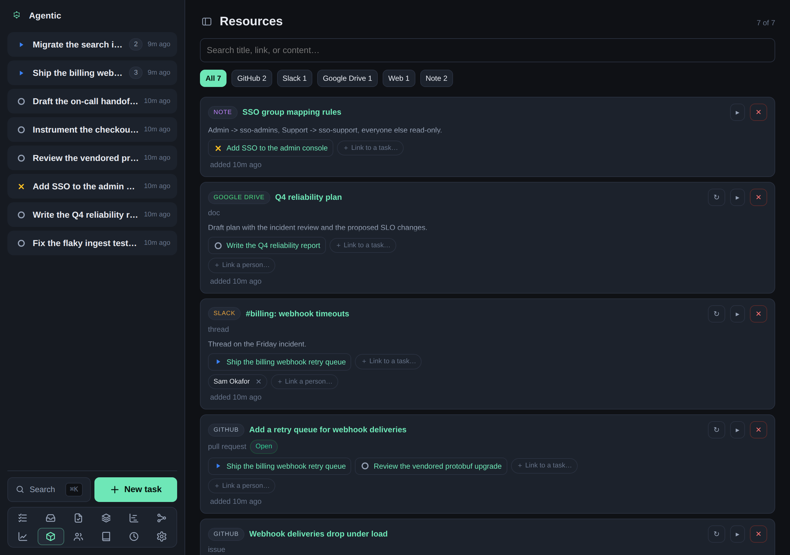

# Concepts

Agentic models a piece of work as a task, then attaches everything else to it.
This page explains the parts and how they relate.

## The nouns

| Concept | What it is |
| --- | --- |
| **Task** | The unit of work. Everything hangs off it. Carries an agent-maintained `summary` and `next_steps`. |
| **Item** | Something external: a Slack thread, GitHub issue or pull request, Drive doc, URL, note, or commit. Items are deduplicated by URL or external id. |
| **Association** | A link between an item and a task (many-to-many), with a note. |
| **Person** | An individual a task or an item involves: a name plus optional email, handle, and notes. Linked to tasks and items many-to-many. |
| **Worktree** | An isolated `git worktree` created for a task from a registered repository. |
| **Repository group** | A named set of repositories. Picking one on a task tells the agent those checkouts may hold information relevant to it. |
| **Agent run** | One prompt sent to a harness in a working directory, delivered to the worker through the run queue. Events stream live to the UI. |
| **Agent session** | An agent session recorded against a task: its session id, harness, working directory, and a label. A run records the session it produced; this records one you attach by hand, for example one you opened in OpenChamber. Both build the links that reopen it. |
| **Context refresh** | A special agent run that reads the task and its items and writes the `summary` and `next_steps`. |
| **Scheduled task** | A user-defined shell script the API runs on a cron schedule, with a recorded history of runs. |
| **Change** | A unit of factory output recorded against a task: a class, a lifecycle, a start and end time, and a human-intervened flag. Autonomy rate and yield are computed from changes. |
| **Stack entry** | A task's place on the focus stack: its position (0 is current), whether it is current, and a soft-delete timestamp. |
| **Task session** | A stretch of time a stack entry spent as the current task. Execution count and duration are derived from these. |
| **Operation** | An audit record of a mutating request: its method, path, and status, plus which client sent it (web UI, CLI, or raw API) and whether a human or a coding agent was behind it. |

## How the parts relate

- A task has zero or more items, people, repositories, worktrees, runs, sessions, changes, and dependency links.
- The task to repository relation is many-to-many, so a task can span several repositories.
- Dependencies form a directed acyclic graph: the API refuses a link that would close a cycle.
- Every open, in-progress, or blocked task is on the focus stack automatically.

## Timeline and provenance

Every meaningful change writes a timeline event, so a task's evolution is visible at a glance.

Each timeline event also carries its provenance: the client it came from and whether a person or an agent performed it.
The web UI sends `web` and `human`.
The CLI sends `cli` plus whatever actor its environment declares.
The ACP runner sets `AGENTIC_ACTOR=agent` for a harness, so agent work is told apart from human work.

Every mutating request is also recorded in the operations log (`GET /api/operations`).

## Related

- [How agents are wired](../explanation/how-agents-are-wired.md) explains the run pipeline.
- [Why Agentic is local-first](../explanation/local-first.md) explains the constraints these choices impose.
