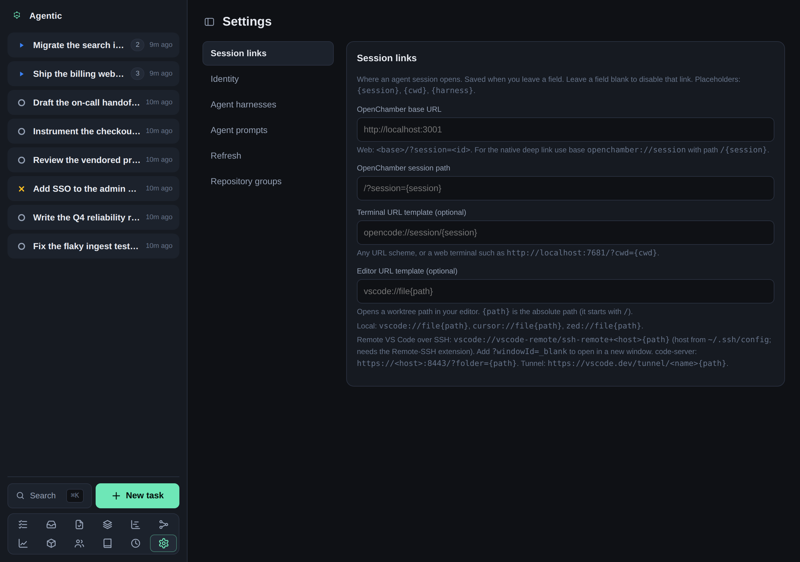

# How to configure session links

## Problem

When you come back to a run, you want one click to reopen the session in your editor, terminal, or OpenChamber, instead of digging through a transcript.

## Prerequisites

- A running API and the web app open (see the [tutorial](../tutorials/getting-started.md)).

## Steps

1. Open **Settings**.

   

2. Set the **OpenChamber URL** base and the session path.
   The default path is `/?session={session}`, so with base `http://your-host:3001` a run opens `http://your-host:3001/?session=<id>`.
   For the native OpenChamber app, use base `openchamber://session` and path `/{session}`.
3. Set the **Terminal URL template** to any URL scheme, or a web terminal.
   Placeholders are `{session}`, `{cwd}`, and `{harness}`.
4. Set the **Editor URL template** for the worktree **Open in editor** button.
   The placeholder is `{path}`.
   Examples:
   - Local VS Code: `vscode://file{path}`
   - Remote VS Code over SSH: `vscode://vscode-remote/ssh-remote+<host>{path}` (needs Remote-SSH; add `?windowId=_blank` to open a new window)
   - code-server: `https://<host>:8443/?folder={path}`
   - Tunnel: `https://vscode.dev/tunnel/<name>{path}`
5. Set each harness's **Resume command** template, which the **Copy resume command** button renders.
   Placeholders are `{session}`, `{cwd}`, and `{harness}`.

A stored override on the Settings page wins over the matching environment variable.

## Verification

Open a task that has a recorded session and confirm the Open in OpenChamber, Open in terminal, and Copy resume command controls produce a working link or command.

## Related

- [Run an agent against a task](../how-to/run-an-agent.md) describes when the links appear and how to attach a session by hand.
- [Configuration reference](../reference/configuration.md) lists the matching `AGENTIC_` variables.
