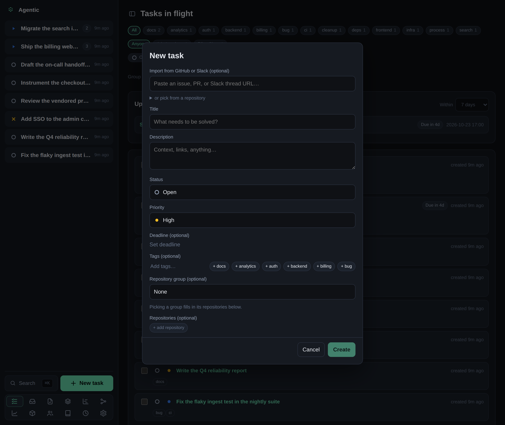

# How to import a GitHub issue or Slack thread

## Problem

You want a task that already carries its upstream context, instead of retyping a title, a description, and links by hand.

## Prerequisites

- A running API (see the [tutorial](../tutorials/getting-started.md)).
- `ghx` on your `PATH` to fetch GitHub issues and pull requests.
- `slackx` on your `PATH` to fetch Slack threads.

## Steps

1. Click the `+` at the top of the sidebar to open the new-task form.

   

2. Paste a GitHub issue or pull request URL into the import field.
   Agentic detects the GitHub source, prefills the title and description, and links the issue to the task as an item.
3. To import a Slack thread instead, paste its permalink.
   Agentic gathers the thread with `slackx` and runs an agent to name the task and summarize the discussion.
4. To browse GitHub instead of pasting, expand **or pick from a repository**, choose a registered repository, and pick an issue from the filterable, newest-first list.
5. Optionally pick a repository group, add tags, and set a deadline.
6. Save the task.
7. Add more context later from the task's **Items** panel: paste a GitHub or Slack permalink, a Google Drive doc, a URL, or a note.
   Agentic infers the source from what you paste.

If the Slack naming run fails, open the task and click **Name & summarize** in the **Context** panel to retry it.

## Verification

The task header shows the linked item, and the **Items** page lists the item with a link back to the task.

## Related

- [Run an agent against a task](../how-to/run-an-agent.md) to summarize the imported context.
- [CLI reference](../reference/cli.md) for `agentic link add` and `agentic task create --slack-url`.
