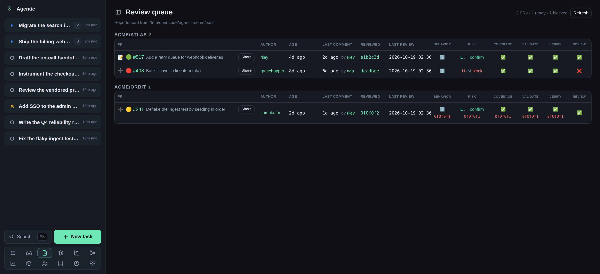

# How to read the review queue

## Problem

You want one place that shows which pull requests still need your review and what each review step concluded, whether or not a review has run against a pull request yet.

## Prerequisites

- A running API and the web app open (see the [tutorial](../tutorials/getting-started.md)).
- `ghx` on your `PATH`: the queue reads each pull request's own fields (title, state, author, age) from it.
- `gh` on your `PATH` and authenticated, for the review scan that asks GitHub which pull requests await your review.
- Review reports in the store for the pull requests you have already reviewed.
  Run `/review-pr-full` (or the individual review skills) on a PR to write them.

The reports live under `AGENTIC_SDLC_DIR` (`~/.sdlc` by default), at `{owner}/{repository}/pull-requests/`.

## Steps

1. Open the **Review queue** page (the `/reviews` route).
   Each row is one pull request: those with review reports in the store, plus the ones the review scan found awaiting your review. Grouped by repository, newest first.

   

2. Read the row's own columns: the pull request number and title, its author, its age, the last comment and who made it, the commit last reviewed, and when the last review ran.
   Click the number to open the pull request on GitHub.
3. Read the merge-readiness light beside the number:
   - 🟢 green: the collected signals could be approved automatically.
   - 🟡 yellow: something still needs attention.
   - 🔴 red: a signal blocks approval.
4. Read the per-step columns, one per review skill: **Behavior**, **Risk**, **Coverage**, **Validate**, **Verify**, and **Review**.
   A cell shows the step's verdict (a mark when it has one, otherwise the verdict word), and a report that does not cover the newest reviewed commit shows the commit it covers in red underneath.
   A step with no report shows a dash.
5. Click a cell to open that step's report.
6. Use the row's **📝** to open the linked task in its PR view, or **➕** to import the pull request into a new task, the same as the repository view's **New task**.
7. Use **Share** to pick the must/should/may findings the skills recorded and hand the selection to an agent run on the task, whose skills post them to the pull request.
   The app itself posts nothing to GitHub.
8. Click **Refresh** to re-read the store and bypass the short cache of the pull request field lookups.

## Where the pull requests come from

The review scan asks GitHub which pull requests await your review: the ones with a review requested from you (`review-requested:@me`), and the open ones you have already reviewed (`reviewed-by:@me`).
Discovery runs through `gh`, and a pull request the scan finds joins the queue even before any review report exists for it.

Configure the scan under **Settings → Review requests**:

- **How often to scan** is a duration such as `30m`, `1h`, or `1d`; leave it blank to stop scanning.
- **Repositories with no policy of their own** is what a repository that has no policy of its own does: **Include** (scan every repository except the excluded ones) or **Exclude** (scan only the repositories marked include).
- Each repository can be left on **Default** to follow that choice, or set to **Include** or **Exclude** on its own.
- **Scan now** runs one pass immediately.

The section shows when the scan last ran, how many it found and kept, and any error.

## Where the data comes from

The review-step state comes from the reports the review skills write under the store, and each pull request's own fields come from `ghx`.
Fields that would need a read the queue does not make (the diff size, the approvers, the pull requests an open PR blocks) are left out.

## Verification

Every PR with a report in the store appears, plus the ones the scan found awaiting your review, its readiness light reflects its step verdicts, and clicking a step cell opens that report.

## Related

- [Triage reviewer feedback](../how-to/triage-pr-feedback.md) to decide on the comments reviewers left.
- [Run an agent against a task](../how-to/run-an-agent.md) to act on a pull request through its task's PR view.
- [HTTP API reference](../reference/http-api.md) covers the `/api/reviews` endpoints.
- [Configuration reference](../reference/configuration.md) lists `AGENTIC_SDLC_DIR` and the `AGENTIC_REVIEW_SCAN_*` keys.
