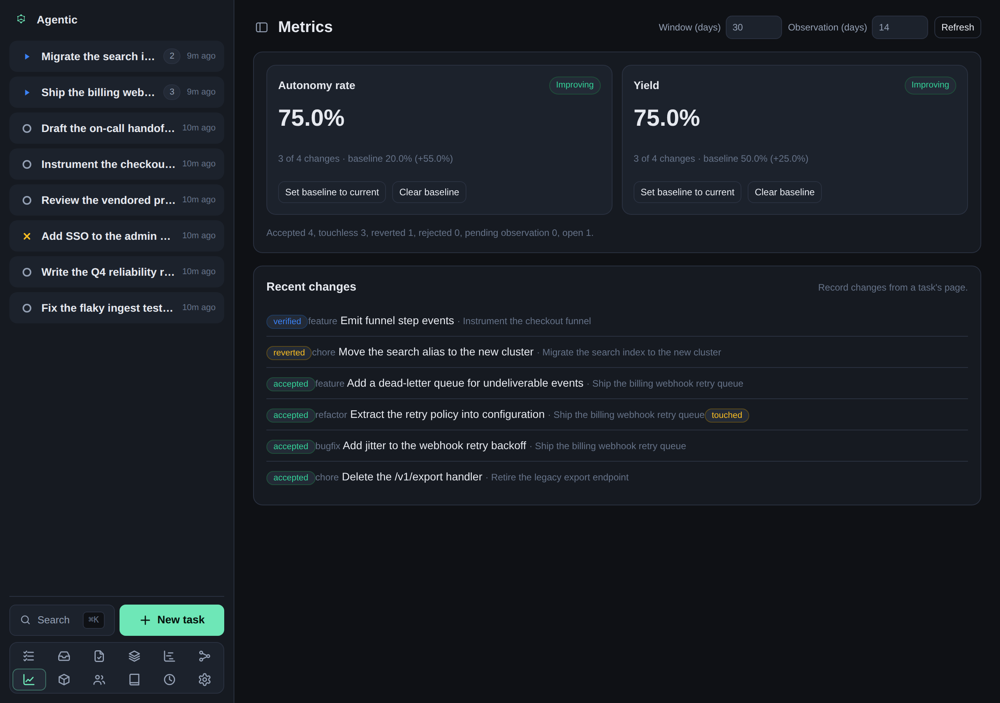

# How to track changes and read the metrics

## Problem

You want to know how much work the agent lands without your help, and whether that is getting better or worse.

## Prerequisites

- A running API and the web app open (see the [tutorial](../tutorials/getting-started.md)).
- At least one task.

## Steps

1. Open a task and find the **Changes** panel.
2. Record a change against the task with a title and a change class.
3. Move the change through its lifecycle: **verify**, **accept**, **reject**, or **revert**.
4. Record an intervention whenever you touch the work, so the metrics know the change was not touchless.
5. Open the **Metrics** page to read the two primary factory metrics:
   - **Autonomy rate** is the share of accepted changes that had no human intervention.
   - **Yield** is the share of accepted changes that survived the observation window without a revert.

   

   At the bottom the page lists every task that has a linked pull request with no change record yet, so you can see what still needs recording. Each row has a **Record accepted** button that creates the change already accepted (dated to the PR's merge when GitHub reports one) without going through the proposed step.

6. Set a baseline so each metric is shown with a direction (improving, worsening, or flat):

   ```bash
   agentic metrics baseline set autonomy_rate 0.2
   ```

## How the numbers are computed

- Autonomy rate = touchless accepted changes / accepted changes in the window.
- Yield = accepted changes not reverted / accepted changes whose observation window has elapsed.

A change still inside its observation window is pending and is excluded from yield, so a recent change never counts as a survivor by default.

Changes are recorded explicitly.
Nothing auto-creates a change from a run, a git commit, or a GitHub pull request yet, so the metrics are only as complete as what gets recorded.

## Verification

The Metrics page shows autonomy rate and yield, and each has a direction once a baseline is stored.

## Related

- [CLI reference](../reference/cli.md) for `agentic change` and `agentic metrics`.
- [Concepts](../explanation/concepts.md) explains what a change record holds.
