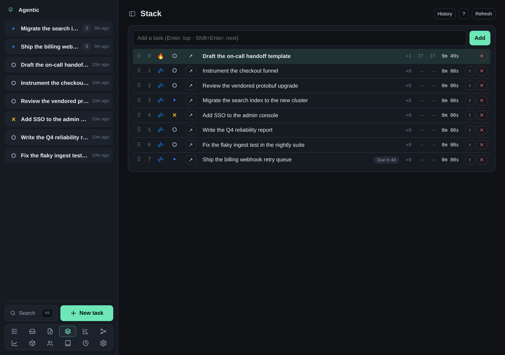

# How to use the focus stack

## Problem

You want one ordered queue of the work in flight, with the task you are on right now at the top, so you always know what comes next.

## Prerequisites

- A running API and the web app open (see the [tutorial](../tutorials/getting-started.md)).

## Steps

1. Open the **Stack** page (the `/stack` route).
   Every task that is open, in progress, or blocked is on the stack automatically.
   You never add work by hand.

   

2. Use the keyboard to drive the queue:

   | Key | Action |
   | --- | --- |
   | **Enter** | Add a new task to the top, making it current. |
   | **Shift+Enter** | Insert a new task right after the current one. |
   | **Up** / **Down** | Move the selection. |
   | **Left** / **Right** | Move the selected task up or down one position. |
   | **Home** (or `/`) | Promote the selected task to current. |
   | **Delete** | Remove the selected task from the stack (the task is kept). |
   | **0-9** | Select a task by position. |
   | **Esc** | Clear the selection and the filter. |

3. Drag a row, or its handle, to reorder the list.
   The list reorders live and the move saves when you release.
4. Click a row to select it.
   The status icon opens a picker, so you can set a task to **Done** to complete it; it then leaves the stack.
5. Open **History** to see removed and completed entries.

Each row shows its status, how many times it has become current, when it started, when it was last current, and the total time it has been current.

## Optional: the tray companion

The `agentic-stack` launcher adds a tray icon showing the current task and a global hotkey (default `Ctrl+Shift+T`) that opens the stack page from anywhere.

```bash
uv run agentic-stack
```

On macOS the first run asks for Accessibility and Input Monitoring.

## Verification

The task you promote is at position 0 and is marked current, and **History** lists the entries you removed.

## Related

- [CLI reference](../reference/cli.md) for `agentic stack push`, `pop`, `promote`, `reorder`, and `history`.
