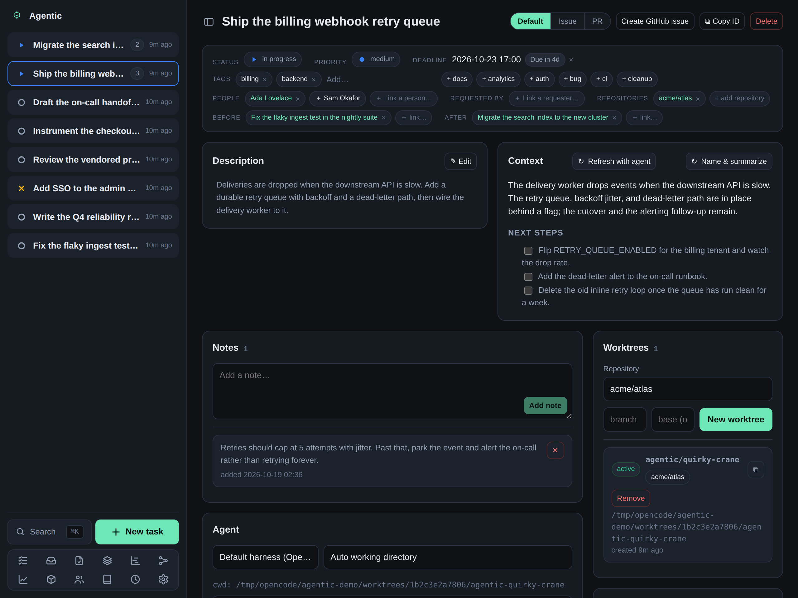

# How to create and remove worktrees

## Problem

You want an agent to work in an isolated checkout of a repository, without touching your main working copy.

## Prerequisites

- A running API (see the [tutorial](../tutorials/getting-started.md)).
- At least one repository registered in Agentic.

## Steps

1. Open **Repositories** in the sidebar.
   Use **Browse** to pick folders on the machine; select several at once if you want.
   Git repositories are marked in the picker.
2. Optionally create a **Repository group** under **Settings → Repository groups** to name a set of related repositories.
   Pointing a task at a group tells the agent which checkouts may hold information relevant to the task.
3. Associate the task with one or more repositories using the `repositories:` chips on its header, or with a repository group.
4. Open the task's **Worktrees** panel and create a worktree.
   Agentic runs `git worktree add` and creates the checkout under `AGENTIC_WORKTREE_ROOT` (`~/.agentic/worktrees` by default).

   

5. To open the checkout in your editor, set an **Editor URL template** in Settings, then use the **Open in editor** button on the worktree.
   A local VS Code template is `vscode://file{path}`.

## Remove a worktree

Remove the worktree from the task's **Worktrees** panel when the work is done.
The **Inbox** also suggests removing a worktree left behind by a closed task, so leftovers surface without a manual sweep.

## Verification

The task's **Worktrees** panel lists the checkout, and the path exists on disk until you remove it.

## Related

- [Run an agent against a task](../how-to/run-an-agent.md) uses the worktree as the working directory.
- [CLI reference](../reference/cli.md) for `agentic worktree create` and `agentic repository`.
