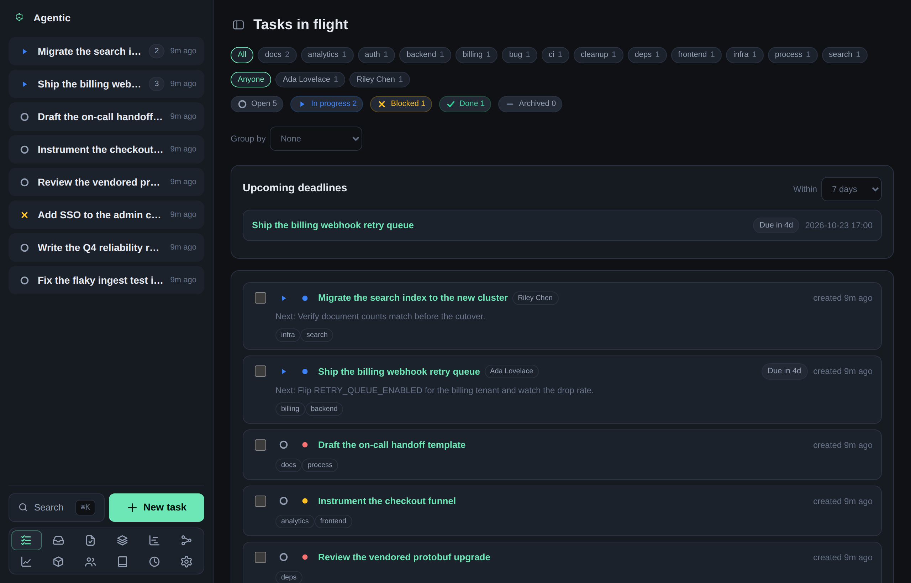
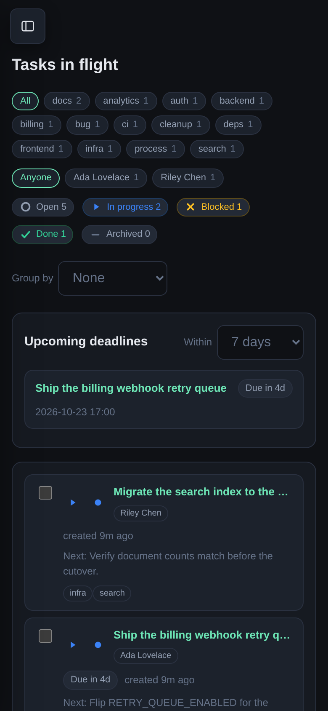

# Agentic

Agentic is a local-first work tracker for a single developer who works alongside coding agents.

You track work as **tasks**, attach the Slack threads, GitHub issues and pull requests, Google Drive docs, URLs, and notes that feed each task, create isolated git worktrees to work in, and let a coding agent keep a current summary and next-steps list.

The goal is that resuming a task takes under a minute: the context you need sits with the task instead of scattered across systems.

## What it does

- Tracks tasks with a status, priority, tags, a deadline, and a timeline of every change.
- Attaches external items (Slack, GitHub, Drive, URLs, notes) to tasks, and links the people involved.
- Keeps a focus stack: an ordered queue of in-flight tasks with the current one on top.
- Creates git worktrees per task and runs any ACP harness against them.
- Streams the agent transcript, then stores a summary and next steps on the task.
- Runs user-defined shell scripts on a cron schedule, with a run history.
- Reads the review reports your review skills write, scans GitHub for the pull requests awaiting your review, and shows each open pull request's merge readiness.
- Collects the reviewer comments your PR-feedback skill analyzed, so you can decide what to implement, decline, or defer.
- Records changes, so it can report autonomy rate and yield.

## The app

The web app is organized into these pages:

| Page | What it shows |
| --- | --- |
| Tasks (`/`) | The task list, with status filters, grouping, upcoming deadlines, and the people in flight. |
| Inbox (`/inbox`) | Suggested next actions, recomputed on every read. |
| Review queue (`/reviews`) | Pull requests awaiting your review and those with review reports, one row per PR with a column per review step and a merge-readiness light. |
| PR feedback (`/feedback`) | Reviewer comments awaiting a decision, one card per comment, with Implement / Decline / Defer. |
| Stack (`/stack`) | The focus queue, with the current task on top. |
| Task (`/task/:id`) | One task: context, items, people, dependencies, worktrees, runs, and changes. |
| Gantt (`/gantt`) | Tasks in flight as a timeline, one marker per event. |
| Graph (`/graph`) | The before/after dependency DAG. |
| Events (`/events`) | Every task's activity as one stream, newest first, filtered by search, actor, or client. |
| Metrics (`/metrics`) | Autonomy rate and yield, each against a stored baseline. |
| Items (`/items`) | Every tracked resource, with per-source filters. |
| Item (`/items/:id`) | One resource, laid out for its type, with its linked tasks and people. |
| People (`/people`) | The people directory and what each is attached to. |
| Person (`/person/:id`) | One person and the tasks and items they are attached to. |
| New person (`/person/new`) | Create a person from an unresolved handle; a handle no person carries links here, kept grey. |
| Repositories (`/repositories`) | Registered checkouts and their issues and pull requests. |
| Repository (`/repositories/:id`) | One repository's issues and pull requests, read fresh from GitHub. |
| Scheduled tasks (`/schedules`) | Cron-scheduled shell tasks, with run history and output. |
| Settings (`/settings`) | Harnesses, repository groups, refresh policies, link templates, the sidebar layout, and dependency and cache diagnostics. |

The app is built to work at phone widths: below 760px the sidebar becomes a drawer you open from the top bar.

## Documentation

The documentation follows the [Divio](https://docs.divio.com/documentation-system/) four-part structure, so each page serves one purpose.

| Section | Use it when you want to |
| --- | --- |
| [Tutorial](tutorials/getting-started.md) | Learn the app from scratch by completing a first task end to end. |
| [How-to guides](how-to/run-an-agent.md) | Accomplish a specific task you already know you want. |
| [Reference](reference/cli.md) | Look up a command, an environment variable, or an endpoint. |
| [Explanation](explanation/concepts.md) | Understand how a part of the system works and why. |

## Status

Agentic is a single-user, local-first tool under active development.
It has no authentication and no multi-tenant isolation, so run it on a trusted network only.
See [Why Agentic is local-first](explanation/local-first.md) for the constraints this implies.

Source code lives at [TomzxCode/agentic](https://github.com/TomzxCode/agentic).
