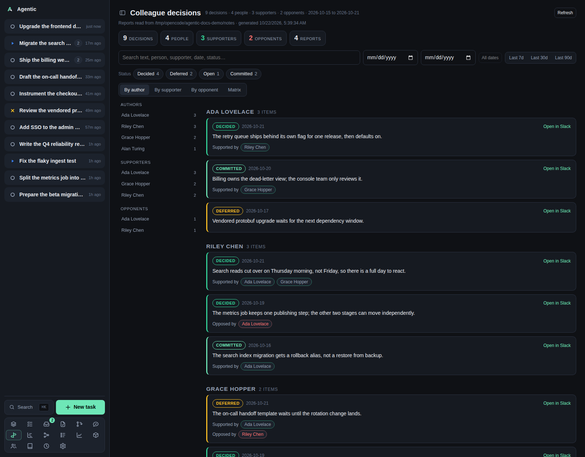

# Decisions

`/decisions` reads the colleague-decisions reports in your notes tree and shows what your colleagues decided, and who backed or opposed it.

## Problem

Keeping up with a team means knowing what was decided, not reading every thread.
The `extract-colleague-decisions` skill already turns a day of Slack into one report per day.
This page aggregates those reports by person and by decision, so you can answer "what did Ana decide last week", "what did we defer", and "who opposed that" without reading the reports one by one.

The page is read-only.
It never writes to the notes tree.

## How to use it

### The page

The header reads `Colleague decisions` with counts of decisions, people, supporters, and opponents, plus the date range when the reports carry one.
The root line names the notes directory and when the aggregation was generated.
Five tiles count `decisions`, `people`, `supporters`, `opponents`, and `reports`.

The body has four tabs:

| Tab | What it shows |
| --- | --- |
| `By author` | One group per person, with their decisions as cards. |
| `By supporter` | The same decisions grouped by who supported them. |
| `By opponent` | The same decisions grouped by who opposed them. |
| `Matrix` | A grid of authors against the people related to their decisions, coloured by how often they agree or disagree. |

The tab choice is remembered on this device under `agentic.decisionsView`.
The matrix's own `Support` and `Oppose` sub-tabs are not.

### Filtering

| Control | Behaviour |
| --- | --- |
| Search | Matches the decision text, author, bucket, date, supporter, and opponent. |
| `From date` / `To date` | Clamped to the range the reports cover, which is not today. A backwards range is silently swapped. |
| `All dates` | Clears both dates. |
| `Last 7d`, `Last 30d`, `Last 90d` | Sets a window ending at the latest report day, not at today. |
| Status chips | `Decided`, `Deferred`, `Open`, `Committed`, plus any other bucket the reports use. Multi-select. |

Chip counts are computed before the status filter but after the search and the dates, so a count tells you what is there.

The sidebar always lists all three person lists.
Clicking a name switches to that tab and scrolls to the person's group.

### The matrix

Rows are authors and columns are the union of authors and the people related to their decisions.
The diagonal is a person's own decisions.
An off-diagonal cell shows how many of that author's decisions the other person supported or opposed, and what share that is.
The `Received` column totals the off-diagonal cells.
Cells are focusable and respond to `Enter` and `Space`, and clicking one opens a detail panel with `Clear`.

In the matrix, the support and opposition percentages are coloured from red to green, so the pattern of agreement is visible before you read any number.

### Decision cards

Each card shows the bucket, the author, the date, `Open in Slack` when the report carries a permalink, the decision text, and `Supported by` and `Opposed by` person chips.
The same decision appearing in several reports is deduplicated by date, author, bucket, text, and permalink.

Below the list, `Not heard from` names the people the reports expected but did not hear from, and `Cross-cutting` lists the notes that span several decisions.

### Good to know

- The notes root is `AGENTIC_NOTES_DIR`, or `NOTES_DIR`, and defaults to `~/notes`. It is read-only.
- Reports are found at `decisions/YYYY/MM/DD.md` and as `*.colleague-decisions.md`.
- A missing root yields the message `No notes directory found. Set AGENTIC_NOTES_DIR (or NOTES_DIR) …` rather than an error.
- The `reports` tile ignores the filters while the other counts follow them.
- People on this page are plain names; they are not linked to the People directory.

## CLI and agent interface

This page has no CLI and no write path.

| Operation | CLI | HTTP |
| --- | --- | --- |
| Read the aggregated decisions | none | `GET /api/decisions` |
| Write a report | `/extract-colleague-decisions` | none |
| Read one report | open the file under the notes root | none |

An agent reads `GET /api/decisions` for the same aggregation, or reads the markdown files directly.
Nothing on this page can be changed from the CLI or the API.

## Related

- [Concepts](../explanation/concepts.md) for the nouns the app stores. The decisions here are not app records.
- [Configuration](../reference/configuration.md) for `AGENTIC_NOTES_DIR`.
- [HTTP API](../reference/http-api.md) for the `/api/decisions` endpoint.
