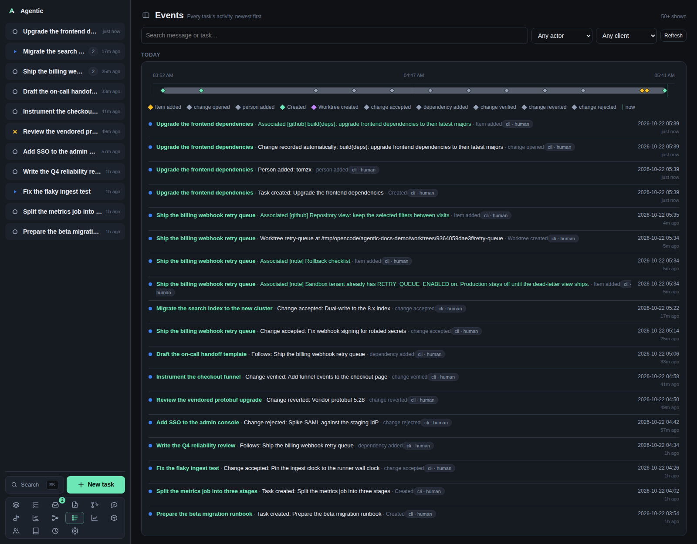

# Events

`/events` is every task's activity as one stream, newest first.

## Problem

A task's timeline is useful when you are on that task, and useless when you are trying to remember what happened across everything.
This page merges every task's timeline into one feed, grouped by day, so you can see what you and your agents did recently without opening each task.
Each row keeps enough task context (title and status) to read on its own.

## How to use it

### The page

The header reads `Events` with `Every task's activity, newest first` and a count of how many events are shown.
Below the filters, each day is a group with a heading (`Today`, `Yesterday`, or a full date) and one timeline panel: a single-row chart of that day's events above the event list.

Each event shows its time, its message, the task it belongs to, and its provenance (`client · actor`).
The task title opens the task page, and an item event whose item still exists opens the item page.

### Filters

| Control | Options |
| --- | --- |
| Search | `Search message or task…`, sent to the server and debounced by 250 ms. |
| Actor | `Any actor`, `Human`, `Agent`. |
| Client | `Any client`, `Web`, `CLI`, `API`. |
| `Refresh` | Reloads the first page. |
| `Load older events` | Fetches the next page with a cursor. |

Filters are not remembered; reloading the page resets them.

### Paging

A page holds 50 events.
`Load older events` asks for everything older than the last row, using the row's time and id as the cursor, so events written in the same instant are not skipped.
The button shows whenever the last page came back full, which means a page that ends exactly on a multiple of 50 offers a click that can return nothing.

There is no reverse paging: going forward again means reloading the page.

### Good to know

- The page loads on mount and on any filter change, and never polls.
- A load that fails with rows already on screen raises a toast and keeps the rows; a first load that fails shows `Could not load events.`
- `No activity yet.` means the filters matched nothing or nothing has happened.
- The view does not send events to Slack. The API has endpoints for that and the CLI has `agentic events send-slack`, but no control on this page calls them.

## CLI and agent interface

| Operation | CLI | HTTP |
| --- | --- | --- |
| Read the stream | none | `GET /api/events?task_id=&type=&actor=&client=&q=&before=&before_id=&limit=` |
| Read one task's timeline | `agentic task timeline <task>` | `GET /api/tasks/{id}/timeline` |
| Send an event to Slack | `agentic events send-slack <event-id> --user-id U0123` | `POST /api/events/{id}/slack`, `/send`, `/send-to-slack` |
| Send recent events to Slack | `agentic events send-slack --user-id U0123` | `POST /api/events/slack`, `/send`, `/send-to-slack` |

The CLI has no `events list`, so an agent reads the stream over HTTP.
`limit` is 1 to 500 and defaults to 50.
The per-event column set is the one the page renders: id, task id and title, task status, type, message, data, client, actor, and time.

## Related

- [How to send events to Slack](../how-to/send-events-to-slack.md).
- [Task](task.md) for one task's timeline, which can mark events on its chart.
- [Gantt](gantt.md) for the same activity on a per-task time axis.
- [Concepts](../explanation/concepts.md) for timeline events and provenance.
