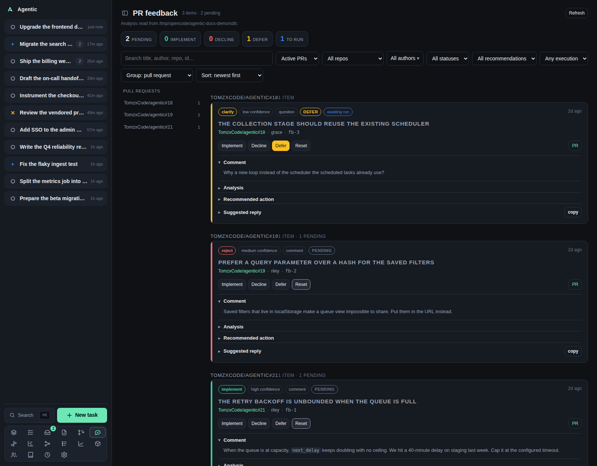

# PR feedback

`/feedback` collects the reviewer comments your PR-feedback skill analyzed and lets you decide what to do with each one.

## Problem

Reviewers leave a dozen comments and each one is a small decision: implement it, decline it, or defer it.
Reading them inside GitHub means losing the analysis the skill already wrote for each comment.
This page shows one card per analyzed comment, with the recommendation, the suggested reply, and the decision, all in one place.

The app records decisions.
It changes nothing on GitHub: the skill carries the decision out.

## How to use it

### The page

The header reads `PR feedback` with the item and pending counts, and `Refresh`.
The root line names the directory the analysis was read from.
Five tiles count `pending`, `implement`, `decline`, `defer`, and `to run`.

The layout is a sidebar of groups and a list of cards.
Picking a group in the sidebar narrows the list to that group's cards (a pull request under the default grouping).
Picking the same group again, or `All items`, shows the whole queue.
The picked group also appears as a `Show all` button in the toolbar, so it can be cleared when the sidebar is hidden on a phone.
Changing the grouping clears the pick.
The toolbar sits above both:

| Control | Options |
| --- | --- |
| Search | Matches title, repo, PR number, author, kind, recommendation, state, and run state. |
| State | `Active PRs` (default), `All PRs`, `Closed PRs`. |
| Repository | `All repos` plus each repository present. |
| Authors | A menu with `Select all`, `Clear`, and a checkbox per author with a count. |
| Status | `All statuses`, `Pending`, `Implement`, `Decline`, `Defer`. |
| Recommendation | `All recommendations`, `implement`, `reject`, `clarify`, `no-action`. The skill's vocabulary, separate from your decision. |
| Execution | `Any execution`, `Awaiting run`, `Executed`. |
| `Group` | `pull request` (default), `repository`, `author`, `recommendation`, `status`, `type`. |
| `Sort` | `newest first` (default), `oldest first`, `title`, `confidence`, `recommendation`, `author`. |

Grouping and sorting are remembered on this device, under `agentic.feedbackGroup` and `agentic.feedbackSort`.
The search and the selects reset on navigation.

### Reading a card

The pills show the recommendation, its confidence, the comment kind, whether the pull request is closed, the decision status, and the run state (`awaiting run` or `executed`).

The sections, with the first one open, are `Comment` (with a `Thread` link), `Analysis`, `Recommended action`, `Suggested reply` (with `copy`), and `Suggested change` when the comment asks for code.

### Deciding

| Button | Decision written |
| --- | --- |
| `Implement` | Accept the comment and do the work. |
| `Decline` | Reject it and reply saying so. |
| `Defer` | Accept it, but not now. |
| `Reset` | Clear the decision and return the card to pending. |

A click writes `decision` and `decided_at` into the analysis file's frontmatter and drops any earlier `executed_at`.
The card then shows `awaiting run` until `/handle-pr-reviewer-feedback` runs and stamps `executed_at`.
A deferral is carried out as a no-op that just marks it done.

There is no confirmation step and no undo other than `Reset`.

### Good to know

- The tiles and the header count only the items the filters show.
- The sidebar keeps every group under the current filters, so you can switch without clearing the pick first.
- Cards come from `~/.sdlc/{owner}/{repository}/pull-requests/{number}/feedback/`, one file per analyzed comment.
- Group headings link to GitHub, not to an app page.
- A pull request whose state cannot be read stays under `Active PRs`.
- `Refresh` re-reads the store and each pull request's state.

## CLI and agent interface

The data is a set of files a skill writes, and the only writable surface is the decision endpoint.

| Operation | CLI | HTTP |
| --- | --- | --- |
| Read the analyzed comments | none | `GET /api/feedback?refresh=true` |
| Record a decision | none | `POST /api/feedback/{feedback_id}/decision` with `implement`, `decline`, `defer`, or `null` |
| Write the analysis | `/handle-pr-reviewer-feedback` | none |
| Carry the decisions out | `/handle-pr-reviewer-feedback` again | none |

An agent reads the same files directly, or posts to the decision endpoint to record what you decided.
There is no `agentic` command for either, so an automated loop has to speak HTTP.

## Related

- [How to triage reviewer feedback](../how-to/triage-pr-feedback.md) for the walkthrough.
- [My PRs](my-pulls.md) for where the comments came from.
- [Task](task.md) for acting on a pull request through its task.
- [Configuration](../reference/configuration.md) for `AGENTIC_SDLC_DIR`.
