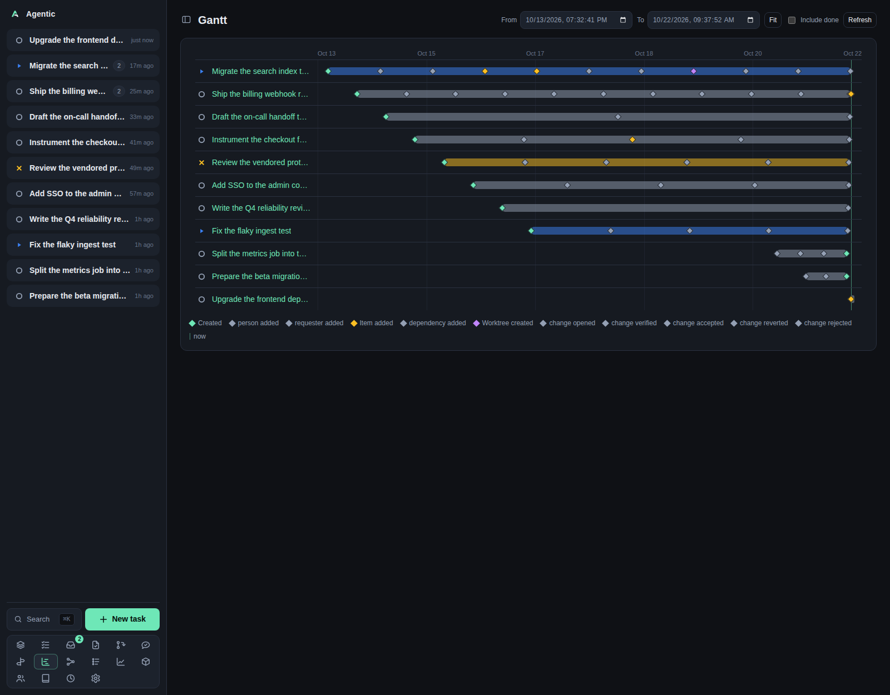

# Gantt

`/gantt` shows every task in flight as a bar on a time axis, with one marker per timeline event.

## Problem

A list of tasks hides how long they have been open and when things actually happened.
The Gantt puts every in-flight task on one axis, so you can see what started when, what is still moving, and where activity clustered.
Markers are the task's timeline events, so the chart is a history as well as a schedule.

## How to use it

### The page

The header has `From` and `To` datetime fields, `Fit`, an `Include done` checkbox, and `Refresh`.
Below it, one panel holds the chart.

Each row shows the task's status picker and its title on the left, and on the right a track with tick gridlines, an optional `now` line, a bar from when the task was created to when it was last updated, and markers.

Hovering a marker shows its label, its timestamp, and its message.
The legend below the chart lists the marker kinds present, plus `now` when the current time is in view.

### The time window

`From` and `To` start fitted to the data and stay fitted until you edit either one.
Editing a field pins the window, and refreshes stop refitting until you press `Fit`.

`Fit` recomputes the window from the data: every task's created and updated times, every marker, and the current time, with a small padding and a minimum span of one minute.
The pinned window is lost when you leave the page.

Ticks adapt to the span: six labels normally, four with times of day when the span is under three days, and three in a compact chart.

### Controls

| Control | What it does |
| --- | --- |
| `Include done` | Adds `done` and `archived` tasks. Off by default. |
| `Refresh` | Reloads the chart. |
| Row status picker | Changes the task's status. Saves immediately and rolls back on failure. |
| Row title | Opens the task page. A click on the status picker does not follow the link. |

An end date before the start date shows `End must be after start. Showing the fitted range.` and falls back to the fitted window.

### Good to know

- Nothing polls; the chart loads on mount and when you change the window, `Include done`, or `Refresh`.
- `No tasks in flight. Create one to see it here.` is the empty state, so a filtered window with nothing in it looks the same as an empty database.
- The task page's own timeline panel shares the chart code, so a marker looks the same in both places.

## CLI and agent interface

There is no Gantt command; the data is one read.

| Operation | CLI | HTTP |
| --- | --- | --- |
| Read the chart data | none | `GET /api/gantt?include_done=true` |
| Change a task's status | `agentic task update <task> --status in_progress` | `PATCH /api/tasks/{id}` |
| Read one task's events | `agentic task timeline <task>` | `GET /api/tasks/{id}/timeline` |

The endpoint returns tasks oldest first, each with all of its timeline events and its created and updated times.
The window, `Fit`, and the legend are computed in the browser, so an agent has to do its own filtering.

## Related

- [Events](events.md) for the same activity as a list.
- [Graph](graph.md) for the dependency view of the same tasks.
- [Task](task.md) for one task's timeline.
